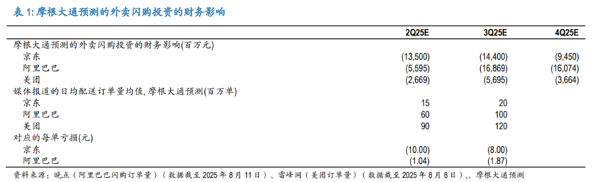

# 财报“敲响警钟”！摩根大通：京东三季度或退出价格战，阿里或继续，美团挑战严峻

- 页面显示时间：2025-08-18T09:07:04+08:00
- 页面署名：董静
- 标注来源：未单列，见正文
- 原文：[华尔街见闻](https://wallstreetcn.com/articles/3753509)
- 取得时间：2026-11-04T16:04:05+08:00
- [HTML阅读版](article.html) · [来源记录](metadata.json)

## 导语

摩根大通称，京东二季度外卖投资损失130亿元，超出预期30%。基于此，摩根大通上调阿里三季度外卖损失预期至300亿元以上。三大巨头面临分化命运：京东因财务压力或率先在三季度退出价格战；阿里准备打持久战，将继续投资外卖业务；美团作为传统霸主面临最严峻挑战，市场份额和利润双重下滑风险突出。

---

摩根大通最新警告：中国外卖市场竞争激烈程度超预期，三大巨头面临分化命运！

8月18日，据追风交易台消息，摩根大通在最新研报中称，京东二季度外卖投资损失达130亿元，超出摩根大通预期的100亿元。基于此数据，摩根大通 **大幅上调阿里巴巴三季度外卖损失预期至300亿元以上** ，远超此前预测的170亿元。

摩根大通在研报中提醒道，市场应密切关注即将公布的阿里巴巴和美团2025年二三季度财报，特别留意其盈利能力的下行风险。

研报指出， **京东因财务压力或率先在三季度退出价格战，阿里巴巴基于战略考量可能继续投资外卖业务，而美团作为行业龙头将面临最严峻的长期挑战** 。

## 京东财报揭示行业竞争超预期

据[见闻此前文章](https://wallstreetcn.com/articles/3753330)，京东二季度新业务板块收入同比飙升198.8%，主要由京东外卖驱动。然而，该板块的运营亏损从去年同期的7亿元急剧扩大至148亿元。

摩根大通称，从京东2025年二季报可以清晰看出，中国外卖市场的竞争和投资强度远超摩根大通最初预计。

数据显示，摩根大通此前预测京东2025年二季度外卖投资损失为100亿元，但实际财报显示当季损失高达130亿元，超出预期30%。

摩根大通分析师认为，京东的二季报表现可作为阿里巴巴和美团的重要参考指标。根据摩根大通测算：

京东2025年二季度每单损失约为10元。即使阿里巴巴的每单损失仅为京东的一半，假设日均订单量为7000万单（周末订单量峰值的70%），2025年三季度阿里巴巴源于外卖的损失也可能超过300亿元，远高于摩根大通此前预测的170亿元。

根据摩根大通预测，2025年二季度至四季度外卖闪购投资的财务影响为：

> - **京东** ：135亿元、 **144亿元** 、94.5亿元
> - **阿里巴巴** ：56亿元、 **169亿元** 、161亿元
> - **美团** ：27亿元、 **57亿元** 、37亿元
>
> 

摩根大通称，对应的每单亏损方面， **京东预计为8元，阿里巴巴为1.87元** 。投资者应 **密切关注即将公布的阿里巴巴和美团2025年二三季度财报** ，特别留意其盈利能力的下行风险。

## 京东或率先"举白旗" 、阿里准备“持久战”、美团面临挑战

面对高强度竞争带来的巨额损失， **摩根大通认为京东可能率先回撤** 。渠道调研显示，最近宣布转向理性竞争后，阿里巴巴和美团的价格补贴仅略有下降，而非显著减少。

考虑到竞争对手更激进的价格补贴策略以及更大的财务灵活性，摩根大通预计京东可能率先在2025年三季度取消价格补贴。

目前摩根大通预测的京东2025年四季度调整后每股收益比市场一致预期高122%，且存在进一步上调的可能。

摩根大通称，与京东形成鲜明对比， **阿里巴巴显然准备打一场持久战** 。据媒体报道，外卖闪购投资加码以来，淘宝的日活跃用户、用户参与度及淘宝商家的线下成交额均出现增长或改善。

摩根大通认为， **未来几年阿里巴巴可能继续对外卖业务投资并探索闪购方面的机会** 。这意味着外卖市场份额结构不太可能回到2024年的状况，行业竞争格局将发生根本性改变。

作为外卖市场的传统霸主， **美团面临的挑战最为严峻** 。摩根大通指出，市场份额结构的变化对美团构成重大挑战，原因是过去美团获得了绝大多数乃至100%的行业利润。

更令人担忧的是，对该行业的长期投资可能改变消费者行为并降低行业平均订单价值和GMV，这将不利于整个行业的利润池。摩根大通警告，如果行业利润池和美团的市场份额双双下降，美团的股价将面临持续压力。

 

\~\~\~\~\~\~\~\~\~\~\~\~\~\~\~\~\~\~\~\~\~\~\~~

以上精彩内容来自[追风交易台](https://mp.weixin.qq.com/s/uua05g5qk-N2J7h91pyqxQ)。

更详细的解读，包括实时解读、一线研究等内容，请加入【 [**追风交易台▪年度会员**](https://wallstreetcn.com/shop/item/1000309) 】

风险提示及免责条款

市场有风险，投资需谨慎。本文不构成个人投资建议，也未考虑到个别用户特殊的投资目标、财务状况或需要。用户应考虑本文中的任何意见、观点或结论是否符合其特定状况。据此投资，责任自负。
