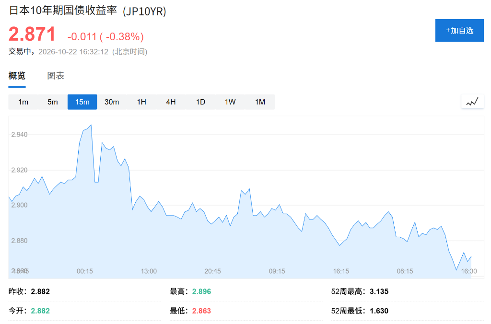

# 资金加速回流日债！日本投资者连续第五周抛售外债，创四年最长纪录

- 页面显示时间：2026-10-22T16:34:28+08:00
- 页面署名：张雅琦
- 标注来源：未单列，见正文
- 原文：[华尔街见闻](https://wallstreetcn.com/articles/3784209)
- 取得时间：2026-11-04T16:03:26+08:00
- [HTML阅读版](article.html) · [来源记录](metadata.json)

## 导语

截至10月17日当周，日本投资者净抛售外国长期债券1616亿日元，连续第五周录得净卖出，创下四年来最长连续抛售纪录。核心驱动是日本10年期国债收益率年内上行逾80个基点，吸引资本回流。国内银行主导抛售，寿险机构拟增配国内债券，其2.5万亿美元资产动向受关注。

---

日本投资者持续抛售海外债券的趋势正在强化，折射出日本国内债市吸引力上升背景下潜在的资产配置策略转变。

据路透报道， **截至10月17日当周，日本投资者净抛售外国长期债券1616亿日元（约合10.2亿美元），连续第五周录得净卖出，创下四年来最长连续抛售纪录。** 与此同时，五周累计净抛售外国长期债券规模已达约3.43万亿日元，年初至今净抛售总量升至5.18万亿日元，为2022年以来同期最高。

这一资金流向转变的核心驱动力，在于日本国内债券收益率的持续攀升。 **日本10年期基准国债收益率年内已累计上行逾80个基点，开始对滞留海外的日本资本形成引力。** 与此同时，国内银行和寿险机构的行为分化，正在成为市场密切关注的信号。

## 收益率走高，资金回流逻辑渐趋清晰

日本10年期国债收益率年内大幅攀升，累计涨幅超过80个基点，对长期将资产配置于海外的日本机构投资者构成明显吸引力。收益率此前曾触及三十年高位，尽管近期避险买盘有所推动，令其从高位小幅回落，但整体仍处历史性高位区间。

国内收益率环境的根本性改善，正推动日本投资者重新审视海外债券的持有价值。五周连续净抛售的纪录本身，即是这一再配置逻辑逐步落地的体现。

## 抛售节奏放缓，美债收益率回落提供缓冲

值得注意的是， **最新一周的抛售规模为五周中最小，约1616亿日元，较前几周明显收窄。** 路透指出，这一节奏放缓与美国国债收益率从高位回落密切相关——受市场对人工智能领域忧虑引发的股市震荡影响，避险资金涌入债券市场，推动美国10年期基准收益率从本月早些时候触及的24.5年高位5.3645%回落约27个基点。

外部收益率的相对变化，在一定程度上压缩了日本投资者抛售海外债券的套利空间，从而对当周的出售节奏形成制约。同期法国10年期国债收益率因国内大规模抗议引发的市场担忧，一度升至24年高位5.022%，但整体对日本资金流向的影响有限。

## 国内银行主导抛售，寿险动向成焦点

日本财务省数据显示，年内外国债券抛售的主要力量来自国内银行。与此同时，日本寿险公司已明确表态，计划在本财年下半年维持甚至增加国内债券的配置比重。

市场目前高度关注寿险公司的最新投资计划披露。据日本寿险协会数据，日本寿险业管理资产规模约为2.5万亿美元，其中约四分之一配置于海外。一旦寿险机构加速将海外资产回流至国内债市，相关资金流将对日本国债市场产生不可忽视的支撑效应，并对日元汇率走势产生潜在影响。

## 外资持续买入日本长债，短债则现分歧

资金流向呈现出明显的双向特征。在日本投资者持续抛售外债的同时，海外投资者连续第三周净买入日本长期国债，当周净购入规模达1.45万亿日元，显示外资对日本国债的兴趣仍在延续。

不过，外国投资者同期净卖出短期日本国库券2.24万亿日元，为三周内最大单周抛售规模，显示外资在日债市场的配置行为仍存在期限分化。

在股票市场，日本投资者在过去六周中有五周录得外国股票净买入，最新一周净购入外国股票1283亿日元，显示海外权益资产的配置需求并未因债券抛售而同步收缩。

风险提示及免责条款

市场有风险，投资需谨慎。本文不构成个人投资建议，也未考虑到个别用户特殊的投资目标、财务状况或需要。用户应考虑本文中的任何意见、观点或结论是否符合其特定状况。据此投资，责任自负。
