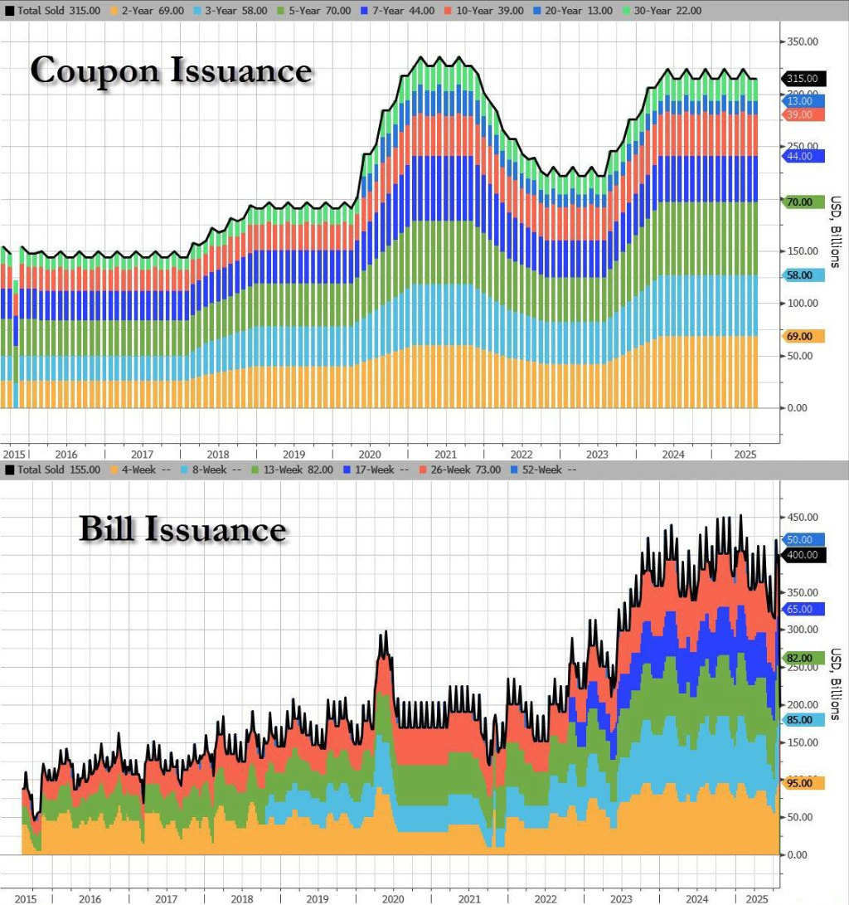
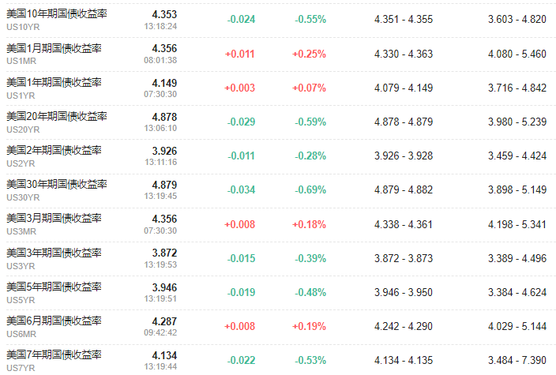
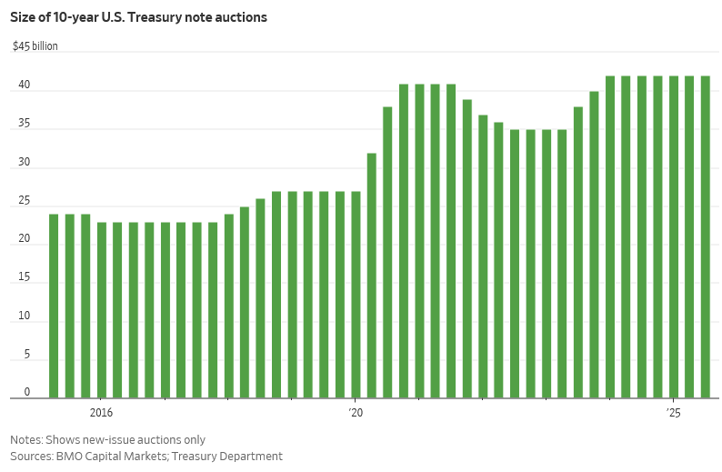

# 走向“影子QE”？贝森特要主导美债利率

- 页面显示时间：2025-07-31T15:08:46+08:00
- 页面署名：李笑寅
- 标注来源：未单列，见正文
- 原文：[华尔街见闻](https://wallstreetcn.com/articles/3752315)
- 取得时间：2026-11-04T16:03:18+08:00
- [HTML阅读版](article.html) · [来源记录](metadata.json)

## 导语

美国财政部宣布扩大长债回购规模，同时维持中长期债券发债规模不变，继续依赖短债弥补财政赤字。考虑到贝森特此前公开表达对长债收益率高企感到担忧，市场将财政部此举普遍解读为，在美联储不愿进一步降息的背景下、通过“影子QE”的手段压低长期收益率。

---

美国财政部大幅扩大债券回购计划，旨在压低长期收益率。

当地时间周三，[美国财政部宣布将大幅加强去年启动的债券回购计划，](https://wallstreetcn.com/articles/3752263)从8月13日起，长期美债（10年至30年期）回购操作频率翻倍，季度流动性支持上限从每季度300亿美元提高到380亿美元上限，年度回购目标超过3000亿美元。

同时，财政部还宣布将继续增发1年以内的短期美债，并小幅增加通胀保值国债(TIPS)的销售，9月10年期TIPS重新开放拍卖规模将增至190亿美元，10月5年期TIPS新发行拍卖规模将增至260亿美元。

这种用新增的短债发行为资金，去二级市场购买存量长债的操作，在功能上与美联储的量化宽松（QE）有相似之处。

**考虑到贝森特此前公开表达对长债收益率高企感到担忧，市场将财政部此举普遍解读为，在美联储不愿进一步降息的背景下、通过“影子QE”的手段压低长期收益率。**

长端利率不仅关系到美国政府的付息压力，更直接影响企业投资和消费者信贷成本。DWS美洲区固定收益主管George Catrambone在接受采访时表示，高企的长债券利率会增加货币政策的整体限制性，并使美债的偿付成本持续高企：

> “更高的长端利率是笼罩在经济上的一块湿毛毯。”

目前，10年期美债收益率徘徊在4.36%附近，30年期美债收益率接近5%的心理重要关口。

## 短债“挑大梁”，贝森特延续前任策略

声明显示，财政部维持了对中长期债券发行的保守态度。

财政部表示， **将在“至少未来几个季度”保持2年期至30年期债券拍卖规模不变** ，这与去年初以来的指导方针一致。

这意味着短期国债在未来几个月的占比预计将继续攀升， **不断增长的联邦赤字融资需求将继续依赖1年以内的短期美债。**

目前，短期美债在美债市场的占比约为20%，已达到财政部借款咨询委员会（TBAC）建议的水平。

分析师普遍认为，货币市场基金等领域对短期美债的需求依然充足，但过度依赖短债会使政府的融资成本变得极易波动，并可能迫使其维持更高的现金储备，以应对潜在的展期风险。

有观点指出，这一策略的延续颇具讽刺意味。

实际上， **贝森特此前曾批评前任财政部长耶伦的短债策略，称其是“人为控制长债发行以在选举前保持低借贷成本”。而如今，他延续了同样的策略。**

## 市场激辩“影子QE”实际效力

华尔街对此次财政部扩大回购规模的计划评价不一。

实际上，高盛在财政部此次发布声明前就曾预测， **财政部回购规模可能增加50%-100%，** 并评论称：

> “称之为‘影子QE’或许为时过早……但我们可能正走在通往那座桥的路上。”

美联储主席鲍威尔此前在接受彭博电视采访时也曾暗示，如果美联储不采取行动，财政部拥有一个“大工具箱”，可以“增加国债回购”。

这些信号叠加在一起， **让市场猜测美联储与财政部之间存在高度协调，甚至可能走向政策“合并”，以实现对收益率曲线的控制。** 贝森特本人也曾透露，他与鲍威尔每周共进早餐。

然而，贝森特主导的压低长端利率的努力，正面临其自身政府内部政策的挑战。

市场担心，特朗普政府推行的关税政策会引发通胀卷土重来，这对长期债券的腐蚀性尤为严重。此外，7月初通过的“大漂亮”巨额预算案也加剧了对美国财政赤字持续扩大的担忧。

还有投资组合经理指出， **即使财政部扩大了回购，但其规模在整个美债市场中仍是“杯水车薪”，** 可能难以凭一己之力扭转由通胀和赤字预期驱动的收益率上行趋势。

风险提示及免责条款

市场有风险，投资需谨慎。本文不构成个人投资建议，也未考虑到个别用户特殊的投资目标、财务状况或需要。用户应考虑本文中的任何意见、观点或结论是否符合其特定状况。据此投资，责任自负。
