# 趋势、抱团与疯狂——A股“抓主线”投资方法论

- 页面显示时间：2026-05-10T19:45:29+08:00
- 页面署名：鲍奕龙
- 标注来源：未单列，见正文
- 原文：[华尔街见闻](https://wallstreetcn.com/articles/3771926)
- 取得时间：2026-11-04T16:03:41+08:00
- [HTML阅读版](article.html) · [来源记录](metadata.json)

## 导语

国投证券策略研报系统阐述A股抓主线方法论，提出宏观叙事、产业趋势、增量资金、风格切换四大工具，强调专注一至两个、切忌杂糅。增量资金视角下"凡是趋势皆为抱团"，超额收益、估值分化、增量资金依次见顶是卖出信号。风格切换需交易信号与逻辑信号交叉验证。

---

在A股市场，"抓主线"是投资制胜的核心命题，但方法论的混乱与误用，往往令投资者在热闹的行情中颗粒无收。

5月7日，国投证券策略团队发布研报，围绕增量资金与风格切换两大工具，系统阐述如何识别、跟踪并把握A股阶段性主线。

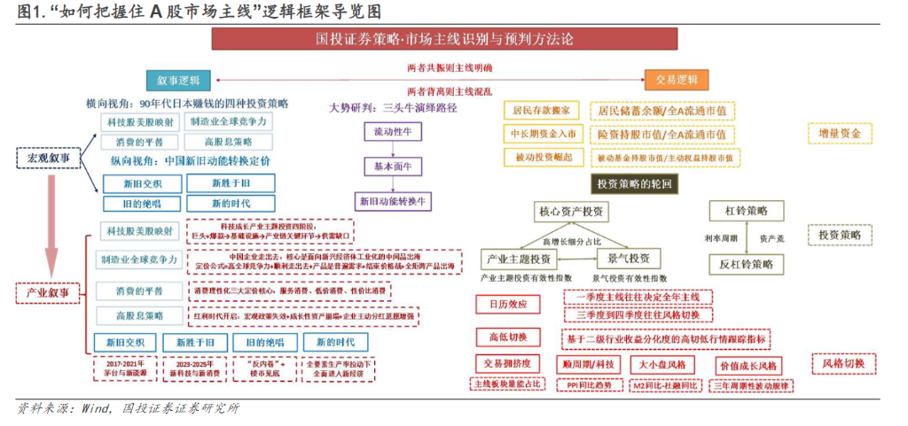

**研报指出，A股一年中约60%时间段主线清晰，40%处于无明确主线状态，投资者的目标不是"一网打尽"，而是"不缺席大盛宴，不随便赶潮流"。**

**此外，增量资金决定主线方向，风格切换需要交易信号与逻辑信号交叉验证，且任何抱团最终都会瓦解，而识别瓦解节奏，是实现超额收益的关键。**

## 方法论总纲：四大抓手，勿杂糅使用

在抓主线的实战层面，研究团队将工具浓缩为 **宏观叙事** 、 **产业趋势** 、 **增量资金** 、 **风格切换** 四个抓手。

投资者需根据市场所处阶段的主要矛盾、自身专长与投资偏好，选取其中一至两个工具使用，切忌四者杂糅，否则"乱交织，主线往往不清晰"。

研报从两个维度衡量这四个工具：

> - **定价持续有效性** ：宏观叙事 \> 产业趋势 \> 增量资金 \> 风格切换
> - **实操辨别难易度** ：增量资金难度最高 \> 宏观叙事 \> 风格切换 \> 产业趋势

报告特别指出，四大工具之间的相关关系与因果关系正在发生深刻变化。

随着AI崛起，宏观叙事与产业趋势开始形成共振，"看不透AI就很难讲好宏观叙事"。

与此同时，被动投资崛起、量化私募高速发展以及以保险为代表的长期资本持续涌入，三股力量正在深刻改变股市生态， **增量资金与风格切换之间也逐渐形成互为因果的关系。**

## 增量资金视角："凡是趋势，皆为抱团"

从增量资金视角抓主线，核心逻辑一句话概括："凡是趋势皆为抱团"。

市场定价由边际交易者决定，这是理解增量资金如何形成主线的逻辑起点。历史上每一轮大趋势，背后都对应着特定的增量资金群体：

> - 2017至2021年：外资持续涌入A股，带动市场形成高ROE、高自由现金流风格偏好，催生"茅指数"雏形；随后公募基金持续扩张并成为主导力量，定价迅速向宁德时代等标的迁移，形成"大盘成长"主线结构；
>
> 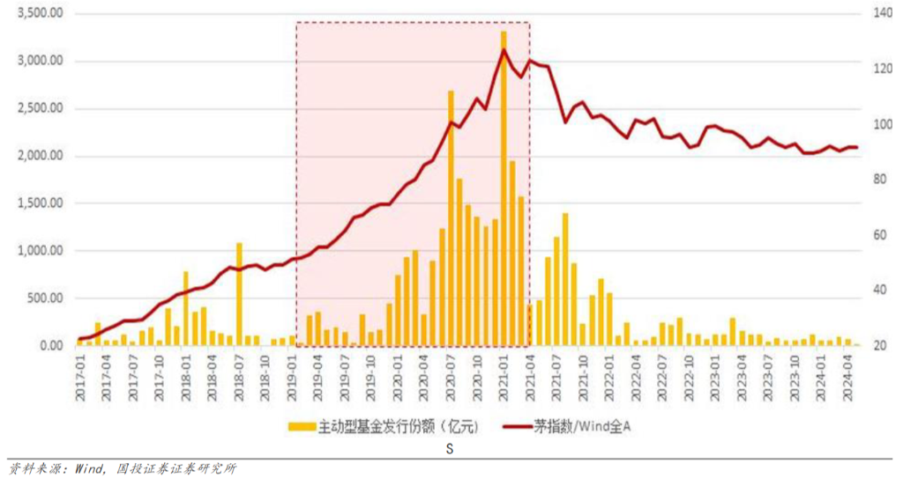
>
> - 2021至2023年：量化私募进入高速发展阶段，间接或直接推动万得微盘股指数长达两年半的上涨周期；
>
> 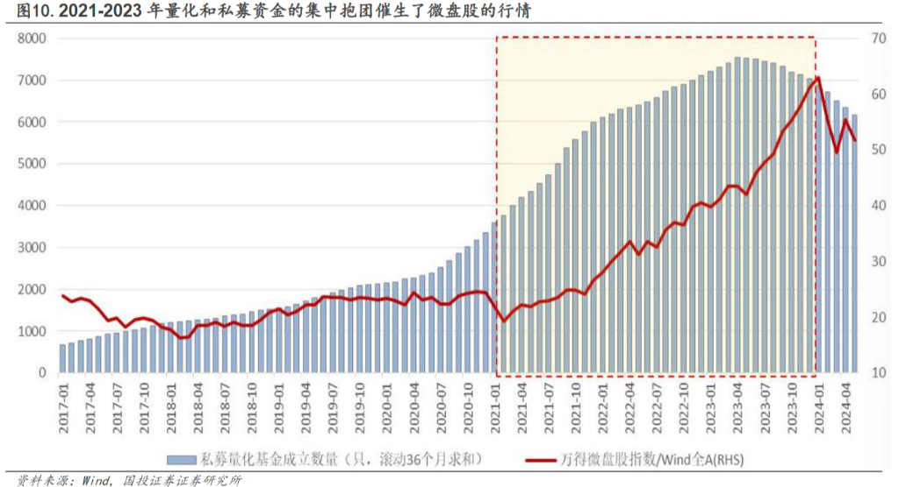
>
> - 2023至2025年：保险资金与ETF产品崛起成为主要变量。银行板块的走势与中证红利指数相关性并不高，反而与沪深300ETF的申购节奏高度吻合——这是"被动多头崛起"推动的主线，而非单纯的高股息逻辑；高股息风格，则更多是保险资金提升权益配置比例过程中自然形成的定价主线。
>
> 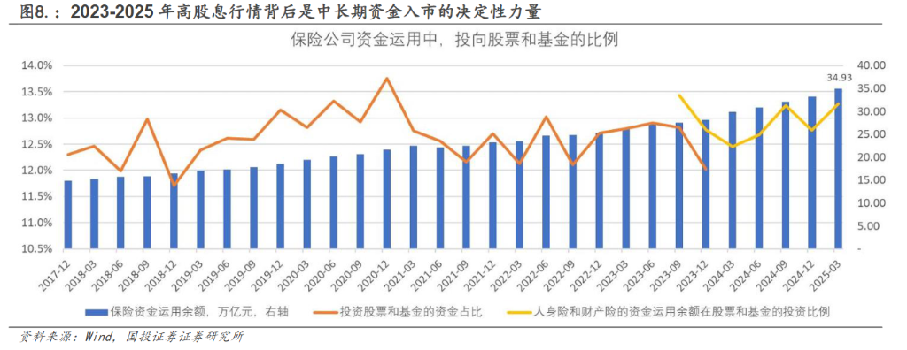

在抱团过程的量化刻画上，研报构建了超额收益、持股分化（估值分化指数）、增量资金三要素跟踪框架，并通过多个历史周期复盘归纳出一般性规律：

> **在每一轮资金抱团周期中，超额收益总是率先见顶回落，其次是估值分化指数见顶，最后才是增量资金见顶。**

**以最经典的"茅指数"行情为例** ：2020年第四季度，公募超额收益开始见顶回落；随后估值分化指数出现见顶；增量资金（公募发行量）最后才进入见顶回落过程。

这一序列在2005至2007年、2012至2014年、2016至2017年等多轮抱团周期中均得到验证。对于投资者而言，实战操作的卖点逻辑由此清晰：

> - **超额收益率先见顶回落（A卖）** ：可卖可不卖，个人投资者可考虑左侧减仓；
> - **估值分化见顶回落** ：板块间分化已达历史高位，"高切低"操作的必要性显著上升；
> - **三者均确认见顶回落（B卖）** ：主线结束概率极高，通常位于M顶第二个卖点附近，必须卖。

**值得注意的是，报告强调增量资金规律在多数情况下是后验的。**

纯市场化资金难以前瞻，但若增量资金来源于体制机制设计——如沪港通开通、保险资金权益投资比例提升、监管层有意引导ETF发展，则可以相对准确地进行前瞻布局。

以居民存款搬家为例，报告认为自2024年9月以来相关讨论持续升温，但实际进程并不顺利，核心原因正是"缺乏体制机制设计"，在没有类似OCI账户通道机制的情况下，这只能是后验信号。

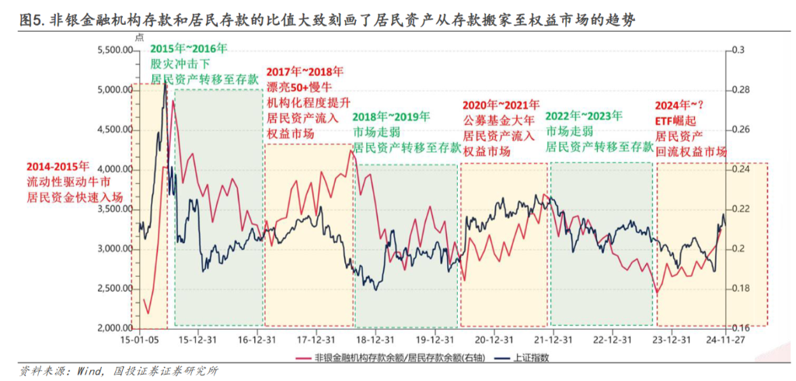

## 三因素框架识别主导资金偏好

在增量资金视角下，不同市场环境对应不同的主导资金，不同资金又有截然不同的审美与偏好。

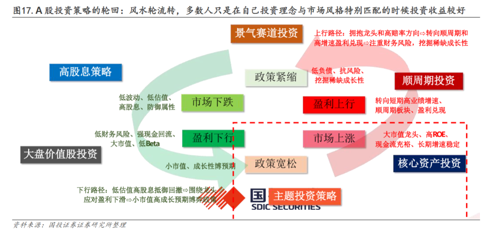

报告构建了"基于高增长细分—流动性—供给侧优化"的三因素A股投资策略轮回框架，将主观多头投资理念归纳为三种核心范式：

> **高增长细分占比超过50%** ：景气投资最有效（典型案例：2021年新能源行情）；
>
> **高增长细分占比在25%至50%之间** ：核心资产投资更有效，买入行业龙头（典型案例：2016至2017年消费升级）；
>
> **高增长细分占比低于25%** ：产业主题投资最有效，基本面分析失效（当前AI行情即为典型案例）。
>
> 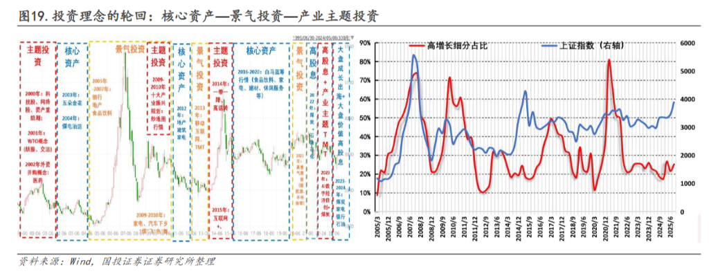

**其中，高增长细分行业定义为：中信三级行业中利润增速超过30%的行业占比。**

这一框架的核心启示在于：风水轮流转，多数投资者仅仅是在自己的投资理念与市场风格高度匹配的阶段，才能取得突出的超额收益，没有任何一种投资策略永远奏效。

## 风格切换抓主线：盯紧交易信号，交叉验证逻辑信号

在风格切换这一维度，报告首先强调"去伪存真是第一要务"。

市场上大量风格切换研究存在两类问题： **一是** 某些图表所呈现的相关性与因果性早已失效，但仍在持续更新； **二是** 若更换不同的指数编制方法，所得图形可能截然不同，存在"技巧性包装"。

**报告指出，此类研究应当越少越好，精选几组真正具备稳定相关性与因果解释力的核心关系，远比堆砌似是而非的图表更有实战价值。**

报告将风格切换抓主线归纳为三类方法。

**第一类：常态化跟踪。**  以PPI走势与科技/周期相对表现的关系为例，PPI在过去几年有效指引了科技板块与顺周期板块之间的轮动。

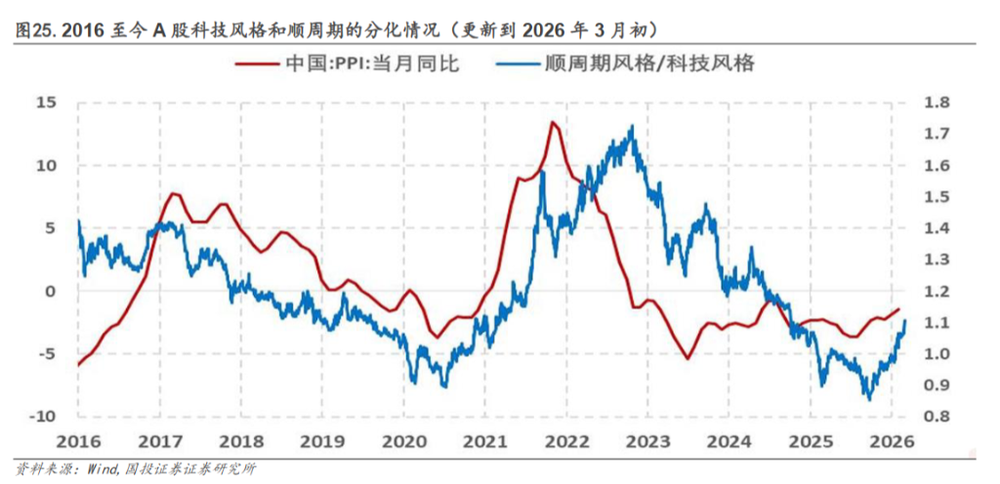

报告判断，在季度到半年的短期风格维度上，科技与周期之间的"新旧共舞"是明确的，根本指引仍来自PPI的回升方向。

**第二类：突发性条件反射。**  核心信号是"仓位失衡+宏观巨变"同时发生并形成共振。

2021年从"茅指数"向"宁组合"的切换，以及2022年从"宁组合"向煤炭高股息的切换，均是典型案例。报告特别指出，单独的仓位失衡不必然引发风格逆转——茅指数仓位完全可以在失衡状态下继续攀升。

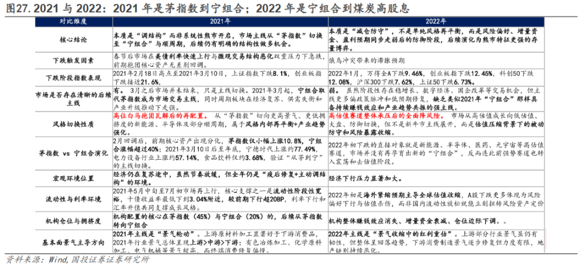

同样，单独的宏观巨变若缺乏仓位失衡配合，市场通常只出现阶段性"高切低"调整，原有主线大概率回归。以2025年对等关税落地为例，市场仅出现单日下跌后迅速V型反转，原因正是各板块仓位并未严重失衡。

**第三类：特定环境下的主线识别。**  报告以"反杠铃"策略为案例。团队于2025年最早提出，传统杠铃策略（高股息+小盘成长）有效性可能正在下降。

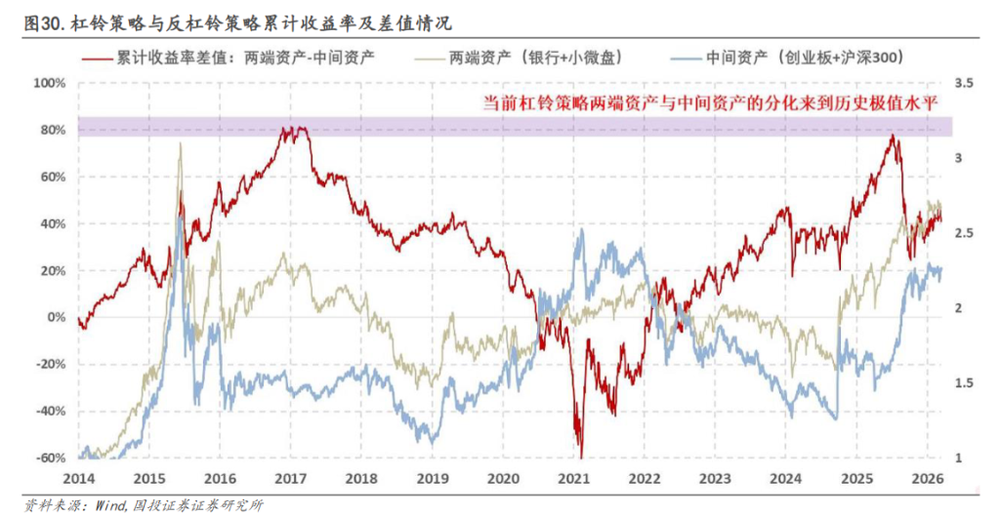

**当10年期国债收益率出现大幅下行时，悲观预期驱动资金向两端配置，形成典型杠铃结构；而当国债收益率进入震荡区间、不再持续下行时，对中期经济的悲观预期有所缓解，资金将逐步从两端向中间资产（创业板指、A500、中证500等大盘成长资产）回流，"反杠铃"逻辑随之成立。**

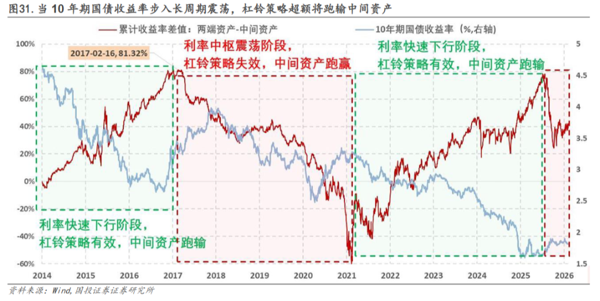

**对于更短期的行业轮动，团队构建了"A股高切低指数"，构建方法为计算各二级行业累计收益率的方差：**

- 指数处于高位（60附近）：从高位板块向低位板块切换，可获得超额回报；
- 指数处于低位（30附近）：各行业涨幅接近，为新一轮主线酝酿期，应积极寻找新方向。

**历史数据显示，A股每年出现约2至3次高切低规律，每次周期大致在2至3个月，"做好高位离场是行业轮动的核心"。**

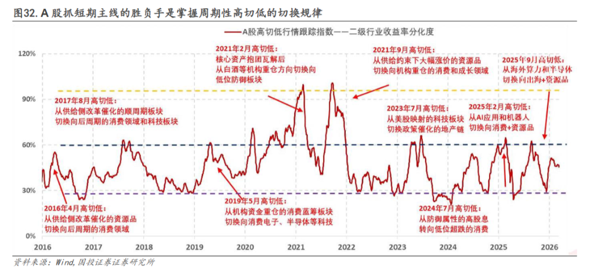

 

风险提示及免责条款

市场有风险，投资需谨慎。本文不构成个人投资建议，也未考虑到个别用户特殊的投资目标、财务状况或需要。用户应考虑本文中的任何意见、观点或结论是否符合其特定状况。据此投资，责任自负。
