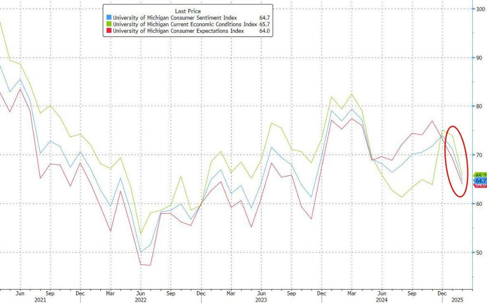

# 通胀预期升温或倒逼美联储加速紧缩？

- 页面显示时间：2025-02-26T19:48:30+08:00
- 页面署名：张雅琦
- 标注来源：未单列，见正文
- 原文：[华尔街见闻](https://wallstreetcn.com/articles/3741938)
- 取得时间：2026-11-04T16:03:15+08:00
- [HTML阅读版](article.html) · [来源记录](metadata.json)

## 导语

近期美国消费者对于未来12个月的通胀预期已上升至一年以来的最高水平。而如果通胀预期持续上升，美联储可能被迫采取更激进的紧缩政策，包括加快加息步伐或推迟降息。

---

在经历了数十年来最严重的通胀冲击后，美国民众再次为物价上涨做准备。

根据21日的[密歇根大学的消费者调查数据](https://wallstreetcn.com/articles/3741638?keyword=%E9%80%9A%E8%83%80)，近期美国消费者对于未来12个月的通胀预期已上升至一年以来的最高水平。消费者对更长期通胀的预期在2月份也出现了自2021年以来最大的单月涨幅。

特朗普政府在贸易、移民和税收等方面的政策，尤其是关税政策，加剧了民众对物价上涨的担忧。《纽约时报》25日援引经济学家的观点称， **特朗普的政策可能会推高物价。**

如果通胀预期持续上升，美联储可能被迫采取更激进的紧缩政策，包括加快加息步伐或推迟降息。Evercore ISI的John Roberts表示， **如果通胀预期没有改善，美联储今年可能完全放弃降息。**

## 通胀预期抬头：多项指标敲响警钟

25日，《纽约时报》报道显示，美国民众对未来12个月的通胀预期已升至一年多来的最高水平，部分原因是鸡蛋和能源相关支出价格持续上涨，以及对关税影响的担忧。

**更令经济学家担忧的是，消费者对更长期通胀的预期在2月份也出现了自2021年以来最大的单月涨幅，** 这种担忧普遍存在于各个年龄段和收入水平的人群中。此外，美国经济咨商会（Conference Board）2月份的调查也显示，消费者信心大幅下降，通胀预期上升。

特朗普政府在贸易、移民和税收等方面的政策，尤其是关税政策，加剧了民众对物价上涨的担忧。《纽约时报》援引经济学家的观点称，特朗普的政策可能会推高物价。

而经济学家最担心的是通胀预期“失锚”，即民众对通胀回归2%的目标失去信心。目前，这种风险似乎比几个月前更为突出。前美联储副主席Richard Clarida表示：

> “如果我在美联储工作，我不会想当然或掉以轻心。”

## 美联储的困境：加速紧缩？

通胀预期的上升给美联储带来了巨大的挑战。

到目前为止，美联储官员淡化了对通胀预期的担忧。芝加哥联储主席Austan Goolsbee表示，密歇根大学的最新调查“数据不太好”，但这仅反映了一个月的数据。他认为，至少需要两到三个月的数据才能算数。圣路易斯联储主席Alberto Musalem也强调，通胀预期处于控制之中。他将密歇根大学的数据描述为“各种指标中一个略有上升的指标”。

**尽管如此，美联储目前已暂停进一步降息。** 官员们不仅希望看到更多通胀正在回落的证据，并表示，稳健的经济让他们有时间观望特朗普的计划将如何影响消费者价格、劳动力市场和更广泛的经济增长轨迹。

一些人，如美联储理事Christopher J. Waller，认为央行可以“忽略”关税等政策的经济影响。但芝加哥联储前主席Charles Evans认为，这可能是一个冒险的策略，特别是考虑到2020年后经济冲击导致的通胀飙升。

Evans表示，看到通胀预期有所上升让他“有点紧张”，尤其是在他担心企业可能比过去更倾向于将更高的价格转嫁给消费者的情况下。 **由于这些原因，他预计美联储今年在进一步降息方面将保持“谨慎”。**

而如果通胀预期持续上升，美联储可能被迫采取更激进的紧缩政策，包括加快加息步伐或推迟降息。 **Evercore ISI的John Roberts表示，如果通胀预期没有改善，美联储今年可能完全放弃降息。**

风险提示及免责条款

市场有风险，投资需谨慎。本文不构成个人投资建议，也未考虑到个别用户特殊的投资目标、财务状况或需要。用户应考虑本文中的任何意见、观点或结论是否符合其特定状况。据此投资，责任自负。
