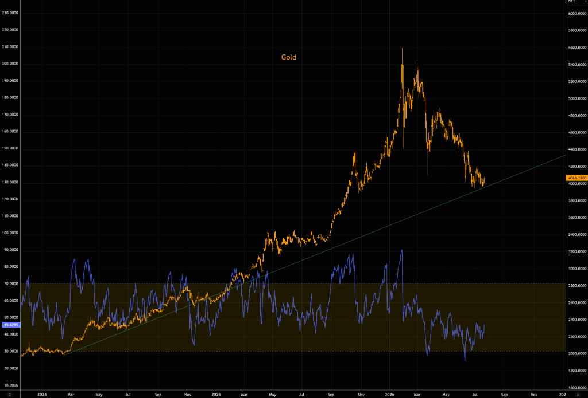
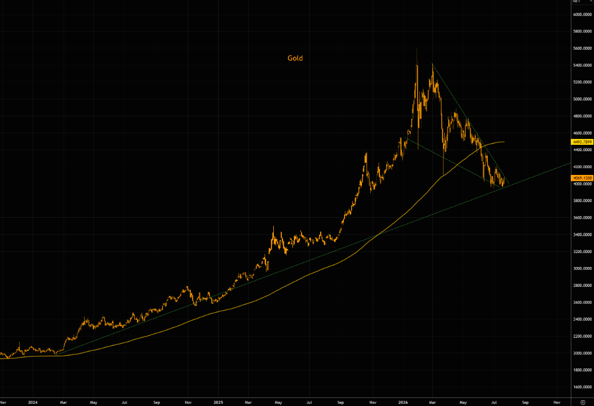
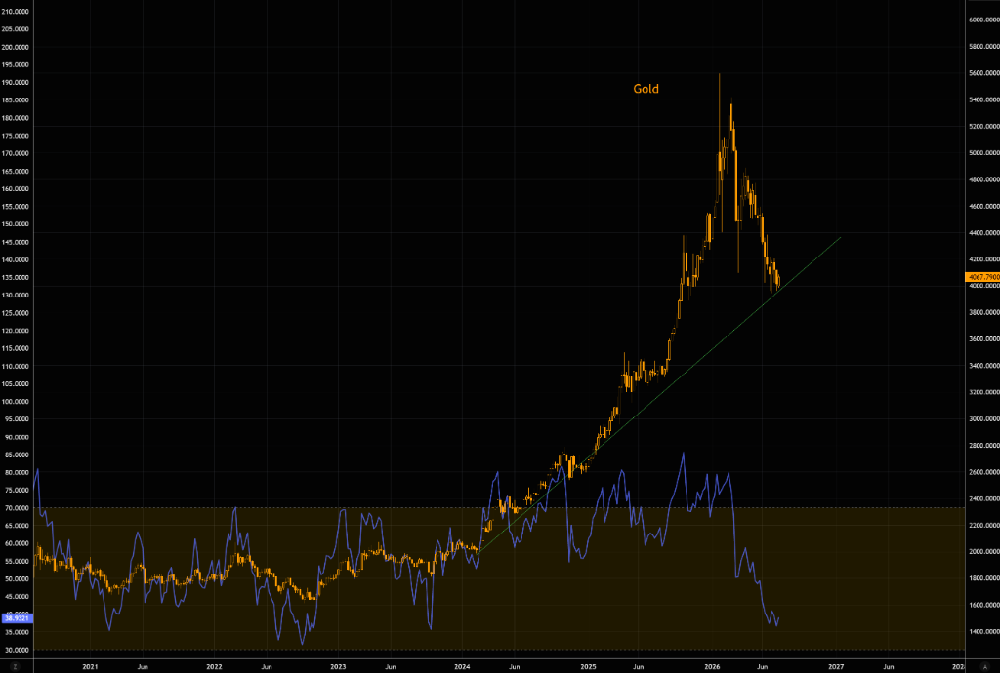
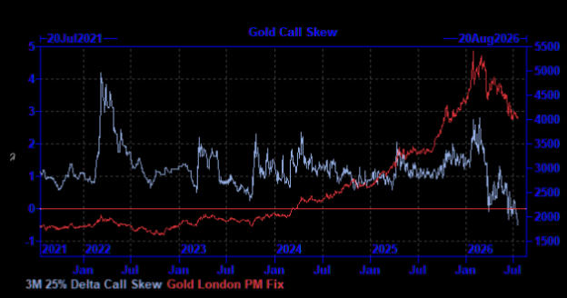

# 重挫之后逼近“超卖”，黄金见底了吗？

- 页面显示时间：2026-07-22T08:25:04+08:00
- 页面署名：鲍奕龙
- 标注来源：未单列，见正文
- 原文：[华尔街见闻](https://wallstreetcn.com/articles/3777611)
- 取得时间：2026-11-04T16:03:31+08:00
- [HTML阅读版](article.html) · [来源记录](metadata.json)

## 导语

黄金自2月底累跌约22%，但技术面周线RSI逼近超卖区域，日线出现底背离，楔形结构蓄势待发。宏观层面，美联储政策路径不明，实际利率存在下行可能，均对黄金构成潜在利好。股市风险溢价不足，进一步凸显黄金对冲价值。但逼空行情能否启动，仍待政策信号明朗。

---

经历数月深度调整，黄金正站在技术与基本面交汇的关键节点上。

今年2月底以来，金价累计下跌约22%，但多项技术指标显示卖压正在衰竭。周线RSI已逼近超卖区域，日线图则出现RSI底背离信号。

与此同时，实物需求保持韧性，投机性多头仓位处于历史低位，市场整体情绪趋于冷漠。这一组合正在积累一次潜在"逼空"行情所需的条件。

不过UBS首席投资办公室大宗商品策略师Giovanni Staunono指出， **历史上黄金表现最佳的时期往往对应实际利率下行阶段，而当前美联储政策路径仍存在相当不确定性。**

## 技术面：楔形收窄，方向蓄势待发

从图表结构看，黄金目前被夹在两条关键趋势线之间：一条是长期上升支撑线，另一条是自3月初以来持续压制价格的下降阻力线。

两线构成的楔形正日益收窄，突破方向将具有决定性意义。

若金价向上有效突破阻力，技术性逼空的力度可能相当剧烈。

值得注意的是，黄金周线RSI经过数月的持续走弱，目前已接近超卖区域，历史上这一水平往往对应阶段性低点。

此外，金价目前仍运行于200日均线下方，市场情绪趋于冷漠。分析认为前期不坚定的跟风盘和短线筹码已大部分出清，上方阻力一旦被有效突破，系统性买盘的涌入可能令反弹幅度超出预期。

## 期权信号：市场仍在对冲下行，偏斜暗示反转空间

期权市场的定价结构提供了另一个维度的观察。

当前黄金期权呈现负偏斜（negative skew），即市场参与者为下行保护支付的权利金溢价，远高于上行期权。

这与黄金通常的定价模式相悖。在常规环境下，黄金往往呈现上行偏斜，因其在危机时刻的避险属性，市场更倾向于为上涨情景付费。

当前负偏斜的出现，说明投资者的恐慌心理更多集中在继续下跌的风险上。

然而，正是这种普遍的"单边思维"，构成了逼空行情的心理基础。

分析人士指出，从期权策略角度看，通过看涨价差（call spread）来捕捉潜在逼空行情具有吸引力，以较低的成本敞口，博取金价向上突破时的非线性收益。

## 宏观背景：美联储路径不明，实际利率走势存变数

金价此轮下跌的宏观逻辑，部分源于市场对美联储加息应对通胀的预期。投资者担忧，利率上升将增强现金相对于无息资产黄金的吸引力。

然而，美联储的实际政策走向仍充满变数。根据芝商所数据，市场目前对9月前加息的隐含概率约为50%。

新任美联储主席沃什对前瞻指引持抵触态度，迄今仅就维护价格稳定发表原则性表态，实质性政策信号极为有限。

他还召集了多个工作组，就通胀驱动因素、人工智能对生产率的影响等议题展开研究，相关报告可能要到年底才会出炉。

这一不确定性催生出多种情景：

> - 若美联储在应对油价冲击时行动迟缓，更广泛的通胀压力可能积聚；
> - 若AI投资热潮降温迫使美联储放松货币政策，而地缘政治因素又使油价维持高位，实际利率亦可能下行。

以上两种情景均对黄金构成潜在利好。

## 配置逻辑：股市乐观情绪高涨，黄金对冲价值凸显

从资产配置的角度审视，黄金当前的配置逻辑并未被彻底打破。

**股市在此轮地缘冲突期间整体保持强势，权益投资者对AI前景维持高度乐观，对地缘政治及其他潜在风险的警惕程度则相对较低。**

这种"风险溢价不足"的市场状态，恰恰是保留黄金仓位作为尾部风险对冲的理由所在。

UBS首席投资办公室大宗商品策略师Giovanni Staunono指出，黄金的代价是不产生任何收益，但在不确定性集中的时期，维持一定的黄金配置以对冲不可预见风险，对投资者而言具有合理的组合意义。

目前来看，技术面信号、持仓结构与实物需求的共振，为黄金潜在的方向性突破提供了条件。但逼空能否真正启动，仍有待美联储政策信号、美元走势及地缘局势演变的进一步明朗。

风险提示及免责条款

市场有风险，投资需谨慎。本文不构成个人投资建议，也未考虑到个别用户特殊的投资目标、财务状况或需要。用户应考虑本文中的任何意见、观点或结论是否符合其特定状况。据此投资，责任自负。
