# 野村警告：美股指数“严重失真”，十只股票贡献标普七成涨幅，警惕柴油带来新冲击

- 页面显示时间：2026-10-10T18:23:15+08:00
- 页面署名：董静
- 标注来源：未单列，见正文
- 原文：[华尔街见闻](https://wallstreetcn.com/articles/3783332)
- 取得时间：2026-11-04T16:03:45+08:00
- [HTML阅读版](article.html) · [来源记录](metadata.json)

## 导语

McElligott认为，标普500陷入“幻觉式繁荣”：85%成分股已回调（1/6腰斩）。更危险的是，当前市场相关性之低，历史上仅在2007年金融危机前夕和2018年"波动率末日"出现过。市场正面临两大暗雷：一是OpenAI营收暴雷（仅预期三成）动摇AI叙事根基；二是结构性炼油短缺使“柴油价差=利率波动率”，成隐形炸弹。

---

美股表面平静之下，一场滚动式熊市正在悄然蔓延。

野村证券跨资产策略师Charlie McElligott在10月8日的报告中警告，标普500指数近两个月几乎原地踏步，但85%的成分股已陷入技术性调整，指数的"平静"不过是极度集中的市场结构所制造的幻觉。

**McElligott指出，仅十只股票就贡献了标普500自3月30日以来23%涨幅的70%，其中英伟达一家独占13%。** 与此同时，欧洲柴油短缺正通过利率波动率传导至整个市场， **构成随时可能引爆的“导火索”** 。

就在野村报告发布数小时内， **两大关键变量相继落地：** 特朗普宣布中期选举前不对伊朗动武，油价应声下跌；英国《金融时报》随即披露OpenAI年化营收远低于此前向投资者传递的预期，纳斯达克周四当日跌逾1%，AI板块遭到重创。

上述两则消息直接冲击了McElligott所描述的市场核心逻辑—— **一个由少数AI赢家撑起指数、其余成分股在水面之下大幅下跌的"严重失真"结构** 。野村的分析显示，当前市场相关性处于过去25年中仅有两次出现过的极低水平，而那两次的历史背景，分别是2007年全球金融危机前夕和2018年的"波动率末日"（Volmageddon）。

## 指数"原地踏步"，水面之下已是熊市

自7月"动量去杠杆/AI平仓"冲击以来，标普500指数整体涨跌幅不足1%，波动率指标全面压缩： **SPX 10日已实现波动率仅为7，3个月平值隐含波动率处于过去一年的第2百分位，25-delta认沽/认购偏斜更低至0.4百分位。**

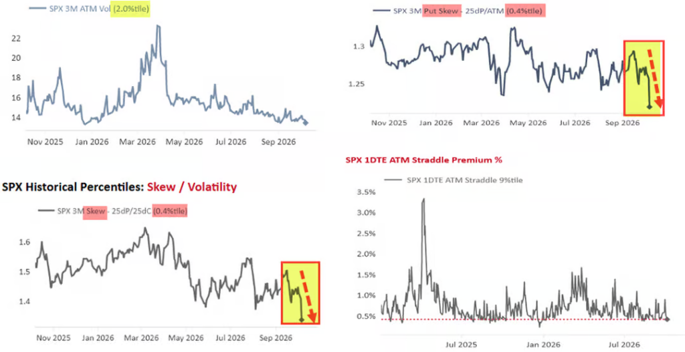

然而， **这种平静与个股层面的剧烈分化形成鲜明反差。** 过去一个月，标普500指数仅移动0.8%，而成分股平均波动幅度高达8.9%，两者之差达8.1个百分点，位于过去30年的第95百分位。AMD单月涨幅达39.5%，英特尔上涨27.6%；而奈飞下跌18.2%，银行股同样承压。

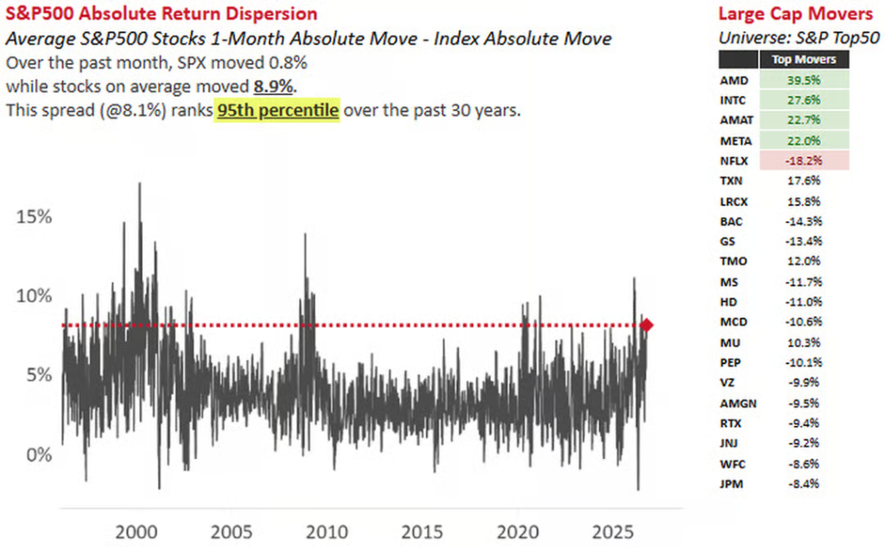

从更宏观的视角看，成分股的损伤触目惊心：

> - **85%的标普500成分股较历史高点回撤超过10%**
> - **59%回撤超过20%**
> - **41%回撤超过30%**
> - **26%回撤超过40%**
> - **17%回撤超过50%**
>
> 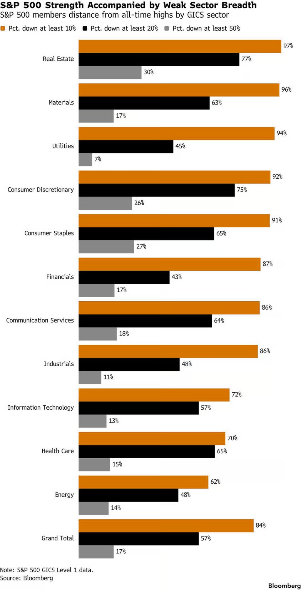

换言之， **指数距历史高点仅一步之遥，但六分之一的成分股已腰斩。** McElligott将此定性为"滚动式大幅修正"，并批评那些认为"股市没有反映利率风险"的观点—— **利率敏感型板块过去一个半月已遭到重创：** 医疗保健-3.5%，非必需消费品-3.6%，公用事业-4.6%，工业-5.8%，金融-7.7%，材料-7.9%，REITs -9.8%。过去30天内，标普500中仅有科技、媒体、电信（TMT）和能源两个板块录得正收益。

## 十只股票撑起七成涨幅，集中度风险极端

野村的数据揭示了这场"幻觉"的核心机制。 **自3月30日以来，标普500累计上涨23%，其中十只股票贡献了70%的涨幅：英伟达单独贡献13%，美光、苹果和微软各贡献约9%，其余490只股票合计仅贡献30%。**

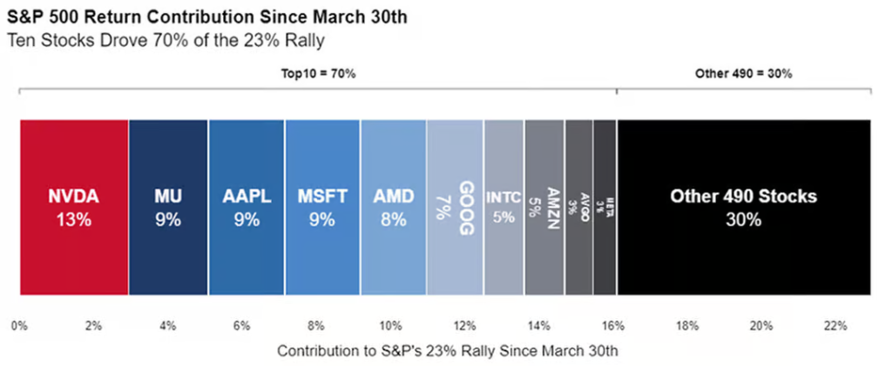

自8月3日以来，"Mag 7"（七大科技巨头）上涨7.7%，标普500上涨2.6%，而等权重标普500则下跌3%。

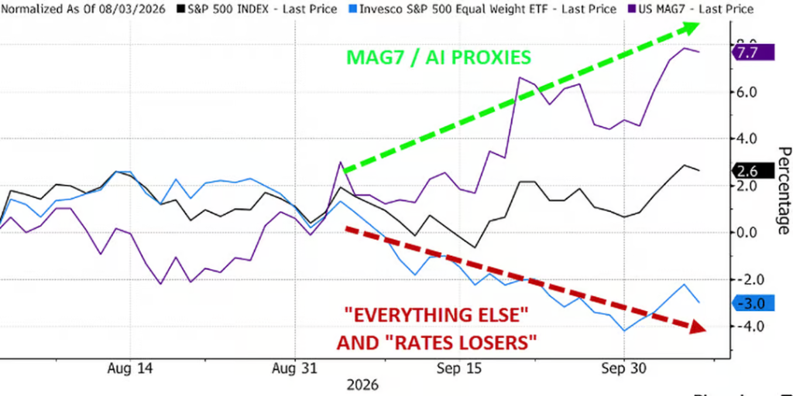

McElligott将这一现象定义为"主题性分化"（Thematic Bifurcation）：

> 少数AI赢家承担了全部指数上行动力，其余股票则因资本和情绪被"挤出"、AI颠覆风险的预期，以及利率上升的压制而持续落后。

当前市场相关性之低，历史上仅有两次可比先例。标普500一个月隐含相关性处于过去一年的第1.8百分位，一个月已实现相关性处于第0.7百分位。

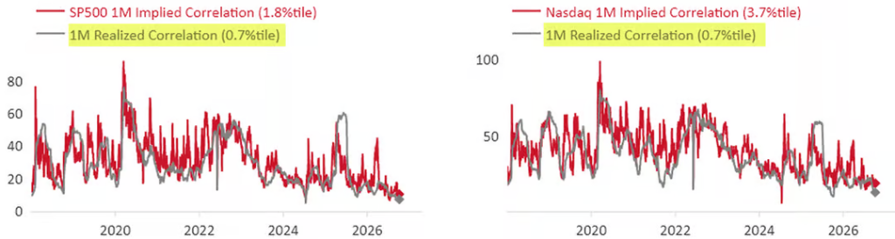

据彭博报道，高盛衍生品策略师Brian Garrett此前指出，过去25年中仅有两个时期出现过如此低的已实现相关性——分别是全球金融危机前夕和Volmageddon。

## 期权市场"只怕上涨"，Gamma压制波动

指数层面的平静并非偶然，而是有结构性力量在主动维持。

McElligott指出，指数"波动率供给"规模庞大，尤其是0DTE/1DTE日内期权的卖出行为，主要来自QIS波动率风险溢价（VRP）策略， **将做市商的Gamma头寸"塞满"，从而隔绝了大幅波动的可能。野村测算的0DTE客户Gamma区间达到+140亿美元，处于第100百分位。**

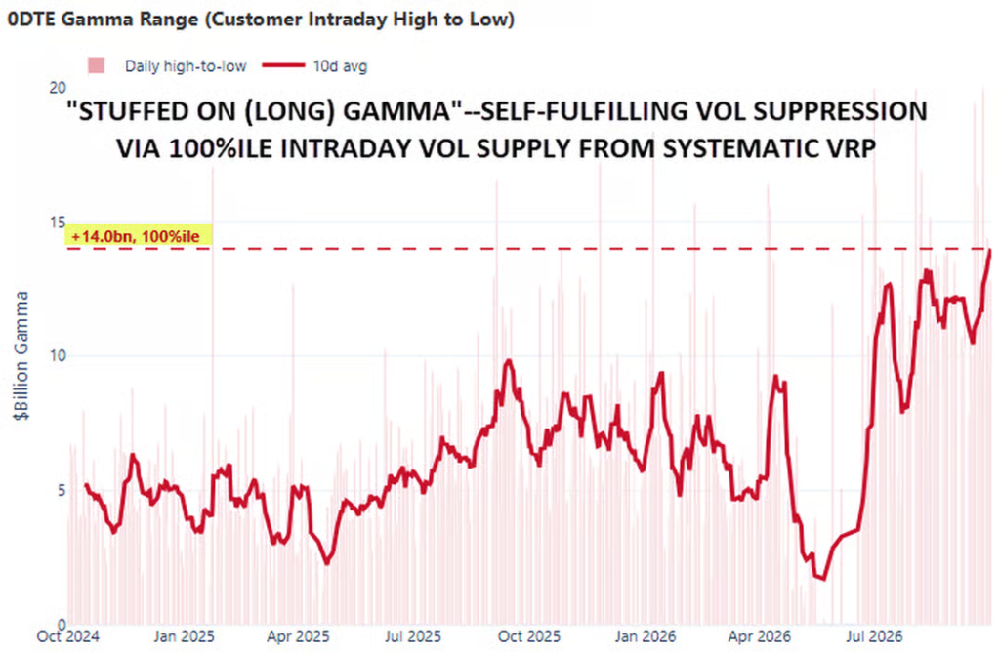

**卖出波动率的回报之丰厚令人咋舌：** 卖出日度25-delta标普认沽期权的10日夏普比率高达13.9，卖出日度宽跨式组合的夏普比率达14.2。

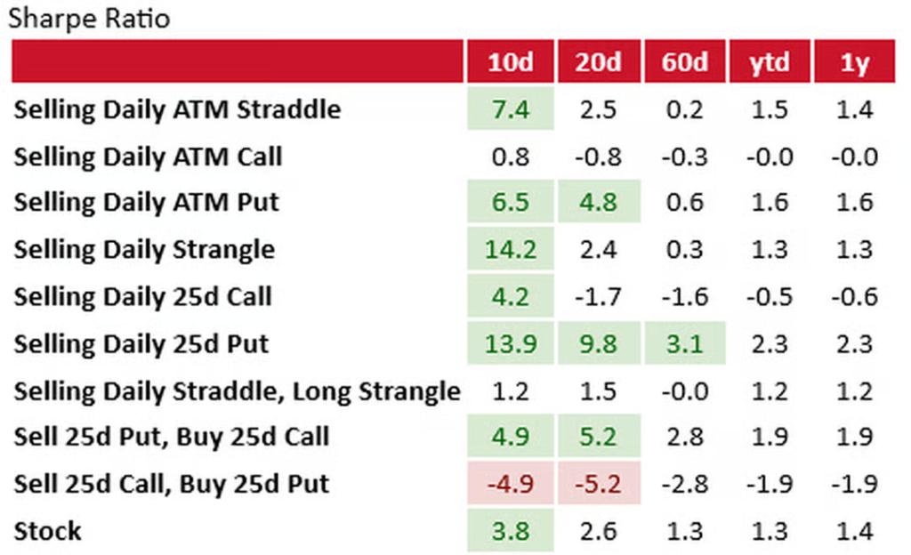

除QIS策略外，衍生品收益基金的规模同样不可忽视。 **衍生品/收益基金资产管理规模目前达3220亿美元，自2020年以来增加2220亿美元，基金与结构性产品合计每月提供的Vega供给达4.15亿Vega。**

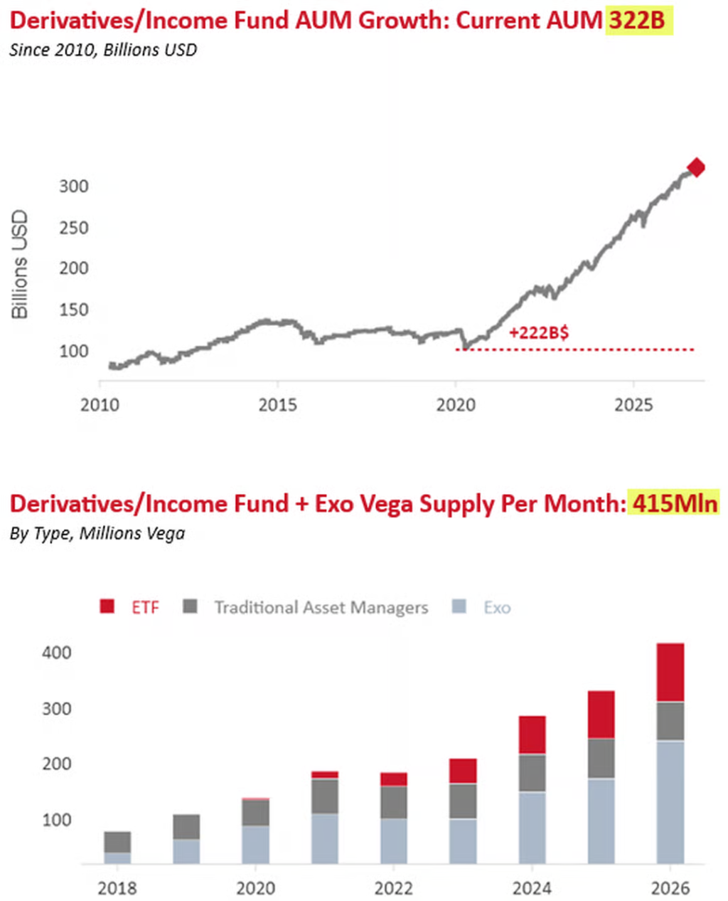

**低实现波动率形成自我强化循环：** 波动率控制策略、CTA和风险平价基金的美股敞口已回升至第86百分位，接近年内高点。

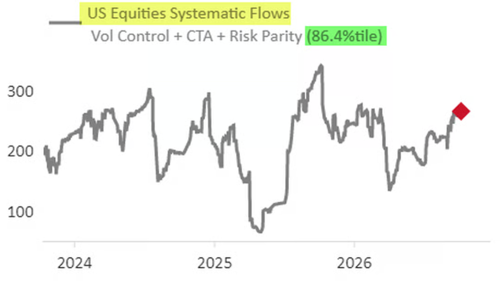

最为反常的是期权偏斜结构： **认沽偏斜处于过去一年的第0.4百分位，而认购偏斜则高达第99.6百分位（野村图表显示为第100百分位）。** 市场参与者几乎不购买下行保护，“唯一的恐惧是右尾上涨风险”—— **大量机构投资者因持仓不足AI核心股票而面临踏空压力，被迫追涨的潜在动能持续积聚。**

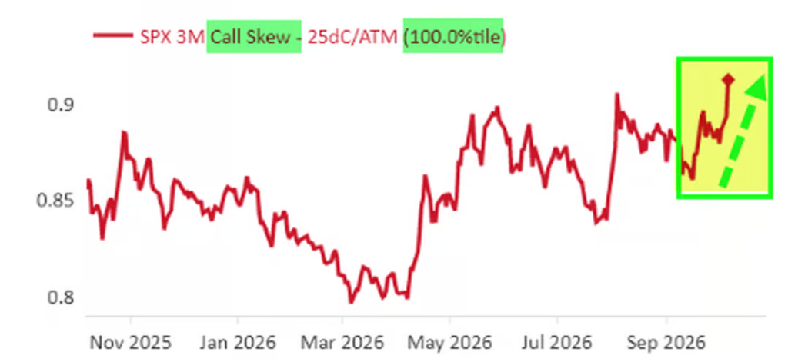

## 柴油短缺：利率波动的隐形导火索

McElligott将能源——尤其是欧洲柴油短缺——定性为整个市场结构中最脆弱的环节。 **他的核心判断是：柴油裂解价差（Cracks）= 利率波动率。**

其逻辑链条清晰：欧洲和亚洲面临能源短缺，全球（亚洲和印度除外）炼油产能严重不足。特朗普此前以"柴油禁令"相威胁，迫使欧洲释放了规模超出预期的紧急储备（仅法国一国就释放1000万桶柴油），但这仅能维持约一个月的供应，且无法解决根本性的炼油产能瓶颈。

**欧盟柴油裂解价差目前处于85，欧元区1年1年利率波动率为112.6，两者自2月以来几乎同步运动——利率交易员实际上已在交易柴油。**

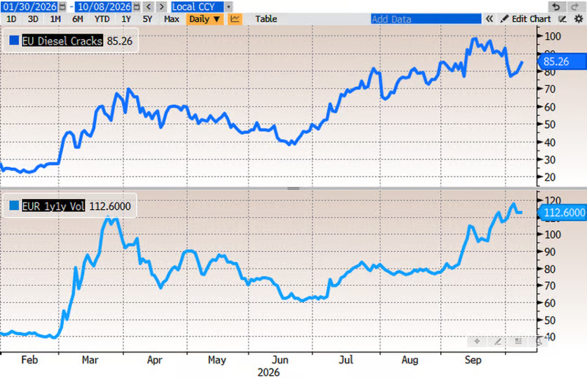

**欧洲能源市场同样处于年内高位：** 德国1年期远期基础电价138，荷兰天然气近79，英国天然气196，柴油价格1485美元。

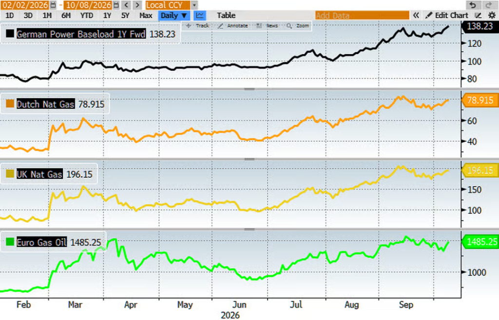

McElligott警告，即便伊朗局势暂时缓和，炼油产能的结构性短缺依然存在，"无论多少条Truth Social帖子，都无法炼出一桶柴油"。

## 三种交易路径与核心风险

面对上述复杂局面，McElligott提出三种交易策略：

**第一，追逐右尾上涨。** 在未来一个月的财报季中，买入大型科技股认购价差期权，押注AI财报再度提振市场，推动标普500向8000点冲击。当前认购偏斜处于第99百分位，对于仍处于低配状态的机构而言，这一策略具有不对称的赔率。

**第二，在和平预期中做空能源溢价。** 若特朗普在中期选举前释放伊朗谈判信号，能源和利率波动率将大幅回落，届时可转向黄金和罗素2000（IWM）上行期权等"超跌资产"。

**第三，无论如何持有利率波动率。** McElligott建议通过做多美元/欧元利率Vega、持有长期限Swaption宽跨式期权进行对冲，因为即便财报季表现亮眼，终端利率预期仍可能上行，美联储政策路径需要重新定价至"真正限制性"区间。

野村回测显示， **美元20年20年Swaption宽跨式期权在通胀最高五分位数环境下月均回报超过1%，几乎全部来自Vega收益。**

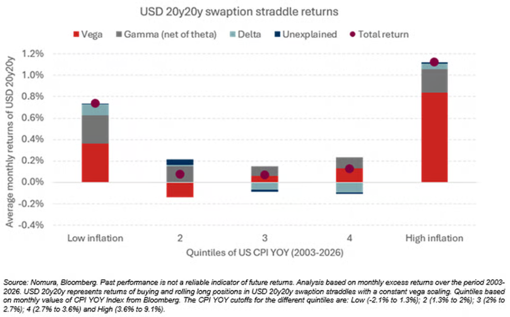

## OpenAI营收数据重击AI叙事

就在McElligott报告发布当日， **两大关键事件相继验证了其分析框架。** 特朗普在Truth Social宣布中期选举前不对伊朗动武，油价随即下跌，印证了McElligott所描述的"和解"情景。

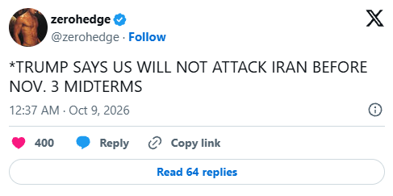

然而更具冲击力的是，据英国《金融时报》报道，OpenAI年化营收约为200亿美元，远低于此前向投资者传递的约700亿美元预期，差距高达约500亿美元。 **消息公布后，纳斯达克当日跌逾1%，AI板块遭到集中抛售。**

分析认为， **这一数据直接打击了支撑整个市场结构的核心前提** ——AI需求的真实性与增长可持续性，也对英伟达、博通（AVGO）等芯片融资交易的逻辑构成直接挑战。

McElligott的牛市情景建立在"AI资本支出涓滴效应"最终惠及其余493只股票的预期之上——Mag 7对标普500盈利增长的贡献已从15%降至7%，而其余493只股票的贡献则从7%加速至13%再至18%。

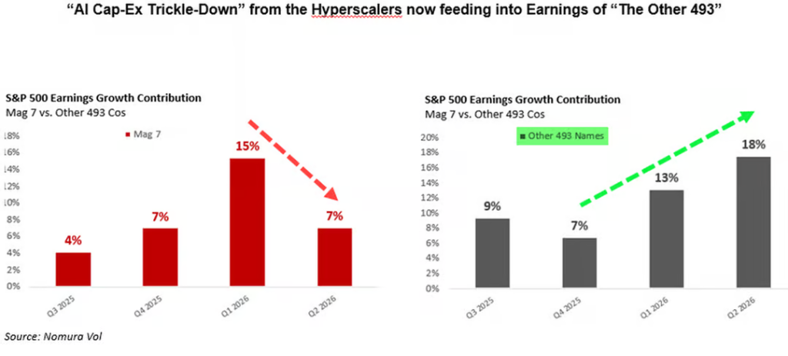

但这一逻辑链条的起点，正是AI需求的真实性，而这一前提刚刚遭遇了来自OpenAI自身投资者文件的首次重大冲击。

当前，市场相关性处于仅在全球金融危机前夕和Volmageddon出现过的极低水平，认沽偏斜处于第0.4百分位，几乎所有人都在以14倍夏普比率的代价做空左尾风险。McElligott的Swaption宽跨式期权，或许是当前市场上性价比最高的保险。

风险提示及免责条款

市场有风险，投资需谨慎。本文不构成个人投资建议，也未考虑到个别用户特殊的投资目标、财务状况或需要。用户应考虑本文中的任何意见、观点或结论是否符合其特定状况。据此投资，责任自负。
