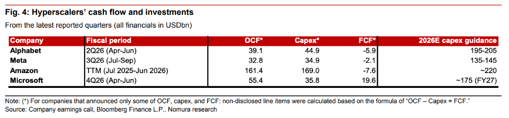
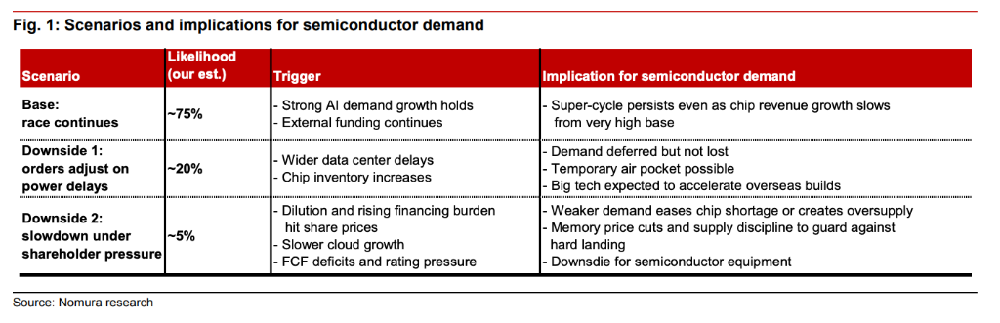

# 野村：AI军备竞赛有75%的概率继续，2027年存储芯片短缺已基本锁定

- 页面显示时间：2026-10-25T11:45:59+08:00
- 页面署名：李佳
- 标注来源：未单列，见正文
- 原文：[华尔街见闻](https://wallstreetcn.com/articles/3784406)
- 取得时间：2026-11-04T16:03:55+08:00
- [HTML阅读版](article.html) · [来源记录](metadata.json)

## 导语

野村认为，AI军备竞赛陷入难以退出的困局，科技巨头即使自由现金流承压，仍可能继续加码投资。报告预计，竞赛延续的概率约为75%，2027年存储器供应量和价格已通过长期协议基本锁定。融资市场关闭是打破竞赛的主要风险，电力短缺则可能推迟芯片部署，但未必改变长期需求。

---

AI军备竞赛难以刹车，2027年存储芯片供需紧张的格局也已基本锁定。 野村全球存储器研究团队在最新报告中指出，科技巨头持续加码AI投资，即使自由现金流承压，也不愿率先退出竞争；与此同时，存储器长期供应协议已提前锁定2027年的供应量与价格，为行业景气度提供支撑。

野村将这场竞争称为“懦夫游戏”（Game of Chicken）： **任何一家企业率先削减投资，都可能在下一轮AI竞争中落后。只要竞争对手仍在加码，维持投入就成为更现实的选择，即使代价是持续消耗现金流。**

这种竞争格局正在转化为半导体行业的机会。台积电及多家科技巨头均表示，AI需求仍超过现有供给能力；长期协议中的订单锁定与违约条款，也为存储器供应商提供了一定保障。

野村预计，AI投资竞赛持续、半导体超级周期延续的概率约为75%。 **真正可能打破这一格局的，是融资渠道关闭；电力短缺则可能推迟芯片部署，成为另一项关键风险。**

## AI军备竞赛难以刹车：没人愿意率先退出

即使AI投资能够带来可观的资本回报率（ROIC），只要投资增速持续超过回报兑现速度，企业就可能长期面临负自由现金流。

科技巨头的表态印证了这一取舍。谷歌CEO桑达尔·皮查伊表示，前沿模型训练的算力优先级高于云业务收入；微软CEO萨提亚·纳德拉称，若将所有新增GPU用于Azure，云业务增速将超过40%；Meta CEO马克·扎克伯格则表示，即使超级智能发展晚于预期，新增算力也可转用于广告和推荐系统。

企业投资的不只是当期收入，更是未来的竞争地位。广告、云服务等成熟业务仍能提供现金流，而竞争对手持续投入，也使任何一家企业都难以率先放缓。 **只要融资能力尚存，短期现金流压力就未必能迫使科技巨头退出竞赛。**

## 2027年存储器短缺基本锁定：供需双方判断趋同

AI需求持续超过供给能力。台积电CEO魏哲家10月15日表示，AI需求仍超出当前供给；亚马逊CEO安迪·贾西称，即使2026年资本开支升至2200亿美元，公司仍无法满足2026至2027年的全部需求，2028年的部分需求也已提前预订。微软和Alphabet管理层同样表示，云业务正受到产能约束。

野村指出，2027年存储器供应量和价格已于2026年10月通过长期协议（LTA）完成锁定，价格出现反弹。 **即使客户削减资本开支，合同中的违约条款也会提高取消订单的成本，违约方可能需要支付相当于年度需求价值50%至100%的保证金。**

订单提前锁定与违约成本，为存储器供应商提供了较强的需求可见度和一定的利润保护。不过，这一判断主要针对2027年，2028年及以后的供需仍取决于AI投资节奏和后续合同安排。

## 现金流恶化难阻投资：科技巨头转向外部融资

资本开支已开始超过部分科技巨头的经营现金流。野村报告数据显示，Alphabet 2026年第二季度自由现金流为负59亿美元，Meta第三季度为负21亿美元；亚马逊截至2026年6月的过去12个月自由现金流为负76亿美元。微软同期仍有196亿美元正自由现金流，但野村预计其后续也将承压。

各家企业仍计划维持高额投入： **Alphabet预计2026年资本开支为1950亿至2050亿美元，Meta为1350亿至1450亿美元，亚马逊约2200亿美元，微软2027财年约1750亿美元。**

融资已成为填补资金缺口的重要手段。报告显示，Alphabet于2026年6月通过普通股和强制可转换优先股融资496亿美元；Meta于第二季度发行249亿美元债券，并暂停股票回购。Meta董事会还批准发行无投票权的C类股，为AI投资提供资金支持。

野村将未来走势划分为三种情景： **竞赛持续的概率约75%，资本开支放缓约20%，融资失败约5%。其中，融资渠道关闭才是最可能迫使企业被动收缩、进而打破当前投资格局的风险。** 

## 电力瓶颈可能推迟需求，但未必终结超级周期

除融资风险外，电力供给不足也可能限制AI基础设施扩张。Sightline Climate调查显示，2026年计划新增的数据中心容量中，约30%至50%面临延期风险，超过11GW的容量尚无动工迹象。

如果数据中心无法按期接入电力，已生产的芯片可能无法及时部署，造成交付推迟和阶段性订单波动。不过， **野村认为，电力短缺更可能推迟和重塑需求，而非直接消除需求：在供电受限的情况下，新一代芯片和高容量高带宽存储器（HBM）的单瓦性能价值可能进一步提升，旧款GPU也可能面临替换需求。**

对投资者而言，核心在于区分需求延迟与需求消失。只要科技巨头仍能持续融资，AI投资竞赛就可能延续，2027年存储器供应端也有望受益于订单提前锁定；真正需要警惕的，是融资条件恶化与电力瓶颈共同导致投资和芯片需求实质性收缩。

风险提示及免责条款

市场有风险，投资需谨慎。本文不构成个人投资建议，也未考虑到个别用户特殊的投资目标、财务状况或需要。用户应考虑本文中的任何意见、观点或结论是否符合其特定状况。据此投资，责任自负。
