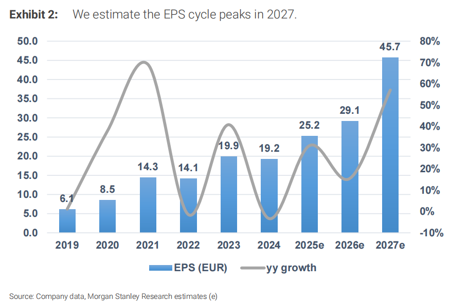
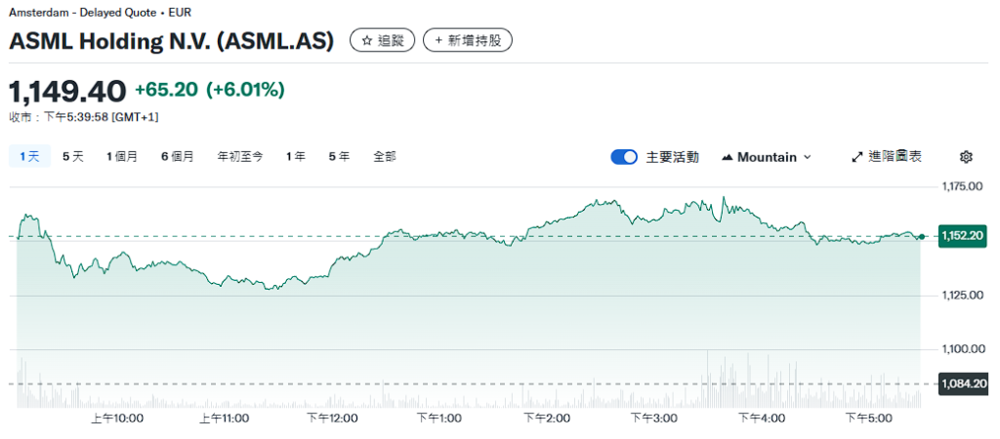
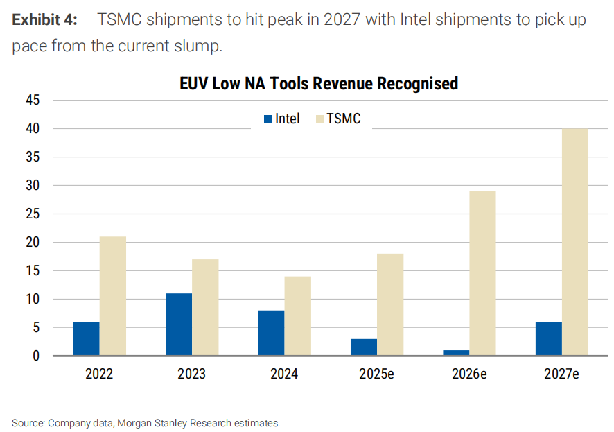
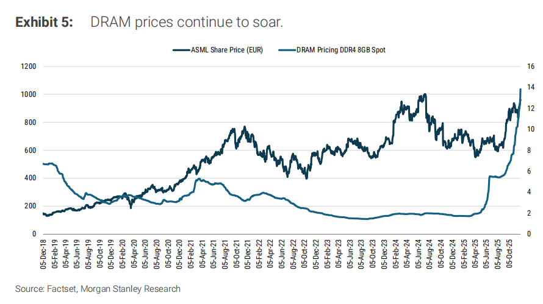
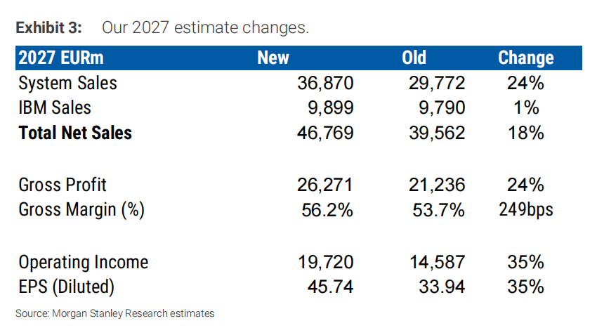

# 阿斯麦的"巅峰时刻"！大摩：先进制程扩产潮下，2027年或迎最强盈利增长

- 页面显示时间：2026-01-16T16:12:20+08:00
- 页面署名：董静
- 标注来源：未单列，见正文
- 原文：[华尔街见闻](https://wallstreetcn.com/articles/3763452)
- 取得时间：2026-11-04T16:04:00+08:00
- [HTML阅读版](article.html) · [来源记录](metadata.json)

## 导语

大摩称，受AI浪潮推动，预计2027年阿斯麦销售额达468亿欧元，每股收益同比激增57%创历史新高。这主要得益于台积电等逻辑代工的强劲需求及DRAM内存产能扩张。大摩将其目标价大幅上调至1400欧元，并维持“首选股”地位。

---

摩根士丹利称，随着AI浪潮推动先进制程和存储芯片的产能扩张，阿斯麦正站在史上最强盈利周期的起点。

1月16日，据追风交易台消息，大摩发布重磅研报，核心观点非常直接：2027年将是阿斯麦盈利增长的巅峰之年，预计阿斯麦2027财年销售额将达到约468亿欧元，EBIT将达到197亿欧元，毛利率提升至56.2%。 **预计2027年每股收益45.74欧元，较此前预期的33.94欧元上调35%，相比2026年预期的29.12欧元实现57%的同比增长。这将是公司有史以来最高的年度盈利增速。**

研报称，这一盈利爆发主要由三大引擎驱动： **先进逻辑代工厂的强劲需求、DRAM内存领域的大规模产能扩张，以及需求表现好于预期** 。该行对阿斯麦发出了极其强烈的看涨信号，将其目标价从1000欧元大幅上调至1400欧元，并维持“增持”（Overweight）评级及“首选股”（Top Pick）地位。

## 先进逻辑代工需求强劲超预期

台积电资本支出大幅提升成为关键催化剂。

研报称，台积电在4季度业绩发布会上给出2026年资本支出指引为520-560亿美元，中值同比增长32%，高于2025年的409亿美元。其中70-80%将分配给先进制程。台积电还暗示未来几年资本支出可能进一步增长。

基于此， **摩根士丹利将台积电2026年EUV设备采购量预期从约20台上调至29台，2027年更是从28台大幅上调至40台。分析师预计公司将提前建设A14制程产能，为2028年使用做准备。2025年预计台积电将接收约18台低NA EUV工具。**

除台积电外，英特尔和三星在工艺开发方面的改善势头也将显现。大摩预计两家公司在2027年将各自采购5-6台EUV工具用于代工/逻辑业务。综合来看，2027年预计约52台工具将发往逻辑/代工领域，远高于此前预期的25-30台。

## DRAM价格飙升将引发产能扩张潮

DRAM市场呈现出前所未有的景气度。

大摩表示， **4季度和1季度的DRAM价格保持极强劲势头，这主要由常规服务器CPU需求以及大型云服务商对2026-27年AI需求（尤其是智能体AI）驱动。**

产能稀缺导致HBM和通用DRAM的环比及同比价格增长达到近乎史无前例的水平。摩根士丹利预计这一趋势将至少持续1-2个季度，最终将促成DRAM制造领域的大规模产能建设，从而带动对阿斯麦EUV和DUV工具的需求。

该行分析师判断， **大部分产能投资将在2026-27年落地，为2027-28年的需求做准备。**

摩根士丹利预计阿斯麦2027年将实现约150亿欧元的DUV销售额， **如果NAND建设增长超预期，这一数字可能还有上行空间。**

基于对逻辑代工和内存领域需求的综合判断，摩根士丹利预计 **2027年阿斯麦将出货约80台EUV工具，创历史新高。这包括约52台发往逻辑/代工客户，其余发往内存制造商。**

## 需求表现好于担忧

研报指出，大摩的调研显示，领先内存芯片制造商以及主要厂商的需求持续强劲。分析师预计阿斯麦在本次财报中将谈到需求好于此前指引。

大摩表示，2026年销售额预计接近同比持平，而非此前公司指引的大幅下降15-20%。分析师还假设这一较好态势将延续至2027年。

## 短期催化剂：即将发布的Q4财报与强劲订单

阿斯麦将于2026年1月28日发布4季度业绩。摩根士丹利预期：

> **订单量：** 4季度订单预计为72.7亿欧元，强于3季度的54亿欧元。其中包括19台EUV低NA工具，主要来自台积电（9台）以及三星和SK海力士的内存需求。这将是阿斯麦最后一次披露订单数据。
>
> **销售额：** 预计96.75亿欧元，处于指引区间(92-98亿欧元)高端，同比增长4%。全年销售额预计达326亿欧元，同比增长15%，符合上季度指引。
>
> **利润率：** 4季度毛利率预计51.8%，接近指引中值(51%-53%)，环比提升20个基点。分析师维持对2026年利润率正面评论的预期。
>
> **2026年指引：** 预计公司将给出2026财年双位数销售增长指引(+12%)，约365亿欧元。管理层可能继续谈到下降，但会降低保守程度。

该行分析师预计，2027年阿斯麦将实现约468亿欧元的销售额，其中系统销售额369亿欧元，IBM业务营收99亿欧元。毛利率将从2026年的52.5%提升至56.2%，营业利润率将达到42.2%的惊人水平，EBITDA利润率则高达44.6%。

摩根士丹利维持阿斯麦为首选股，采用31倍市盈率估值，目标价1400欧元。牛市情景下，基于2027年每股收益50欧元和40倍市盈率，目标价可达2000欧元。

 

\~\~\~\~\~\~\~\~\~\~\~\~\~\~\~\~\~\~\~\~\~\~\~~

以上精彩内容来自[追风交易台](https://mp.weixin.qq.com/s/uua05g5qk-N2J7h91pyqxQ)。

更详细的解读，包括实时解读、一线研究等内容，请加入【 [**追风交易台▪年度会员**](https://wallstreetcn.com/shop/item/1000309) 】

 

 

 

 

 

风险提示及免责条款

市场有风险，投资需谨慎。本文不构成个人投资建议，也未考虑到个别用户特殊的投资目标、财务状况或需要。用户应考虑本文中的任何意见、观点或结论是否符合其特定状况。据此投资，责任自负。
