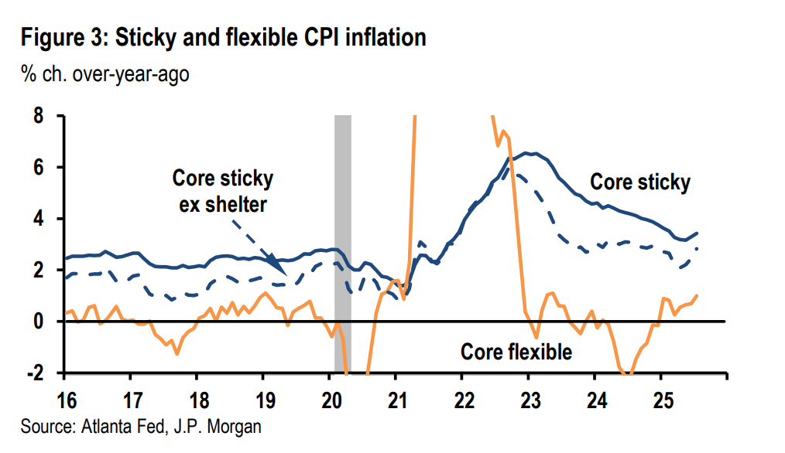
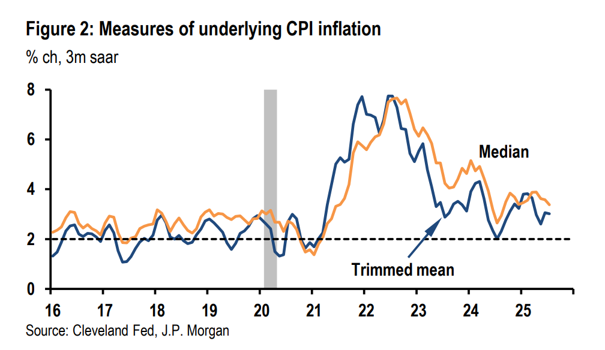

# 降息预期太乐观了？美国“粘性通胀”正在重新加速

- 页面显示时间：2025-08-18T15:09:09+08:00
- 页面署名：许超
- 标注来源：未单列，见正文
- 原文：[华尔街见闻](https://wallstreetcn.com/articles/3753527)
- 取得时间：2026-11-04T16:03:15+08:00
- [HTML阅读版](article.html) · [来源记录](metadata.json)

## 导语

目前市场对7月CPI报告的解读相对乐观。但摩根大通表示，多项替代通胀指标显示，通胀不仅未能继续下行，核心通胀的粘性部分正重新加速，且其坚挺程度还有相当部分与关税无关。除非经济陷入衰退，否则通胀的持续坚挺将不支持美联储采取更激进的宽松政策。

---

摩根大通警告，美国通胀正呈现出比预期更加顽固的态势，多项替代通胀指标均表明去通胀进程已经停滞，核心通胀的粘性部分正重新加速，这一趋势可能限制美联储进一步激进降息的空间。

目前市场对7月CPI报告的解读相对乐观，但摩根大通表示， **包括削减均值和中位数通胀在内的多项基础通胀指标显示，通胀不仅未能继续下行，核心通胀的粘性成份正重新加速，且** **其坚挺程度还有相当部分与关税无关。这意味着通胀可能在高于美联储目标的水平上保持粘性。**

分析师Michael Hanson警告，虽然联邦公开市场委员会(FOMC)目前专注于管理劳动力市场下行风险，但通胀偏离其目标的程度明显更大。除非经济陷入衰退，否则通胀的持续坚挺将不支持美联储采取更激进的宽松政策。

## 替代通胀指标发出警告信号

美联储对潜在持续高于目标通胀的担忧似乎并非空穴来风。

根据亚特兰大联储的统计拆分，传统核心CPI组成部分中（粘性+灵活），粘性组件继续略高于疫情前平均水平，并在近期有所加速。

基础数据显示，虽然波动较大的灵活组件在今年早些时候飙升后，已在三个月年化基础上重新回到负值区间，但粘性组件近月来重新加速。

历史上，粘性组件往往以服务业为主导，这种坚挺程度是在关税商品压力之外的额外因素。

摩根大通认为，克利夫兰联储的削减均值和中位数通胀指标为投资者提供了比传统排除法更可靠的通胀趋势判断。

最新数据显示，削减均值通胀在疫情前平均为2.1%，目前已从4月3.0%的低点反弹至7月的3.2%。 **中位数通胀的表现更加令人担忧，从疫情前的2.6%平均水平跃升至当前的3.6%。**

这些指标通过算法剔除每次CPI发布中的极端值，专注于价格变动分布的中间部分。削减均值排除了价格变动最高和最低的8%，而中位数则代表了CPI各项价格变动的精确中点。

从三个月年化增长率来看，削减均值基本持平，中位数近月来实际上有所缓解。 **但两个系列的运行速度仍保持在3%以上，相对于历史水平和美联储2%的通胀目标都偏高。随着关税传导效应变得更加普遍，这一趋势可能再次走高。**

## 货币政策前景面临挑战

分析师认为，当前的通胀格局为美联储货币政策决策带来了复杂挑战。

多项替代核心指标表明——通胀仍远高于美联储2%的目标，并可能继续走高。这种在非关税部门的通胀坚挺尤其值得关注，因为它指向通胀可能在令人不安的高位保持持续。

摩根大通分析认为， **除非出现经济衰退，否则通胀可能在不支持美联储更激进宽松政策的水平上保持粘性。**

这一判断为当前市场对美联储快速降息的预期蒙上了阴影，投资者可能需要重新评估货币政策正常化的时间表和幅度。

风险提示及免责条款

市场有风险，投资需谨慎。本文不构成个人投资建议，也未考虑到个别用户特殊的投资目标、财务状况或需要。用户应考虑本文中的任何意见、观点或结论是否符合其特定状况。据此投资，责任自负。
