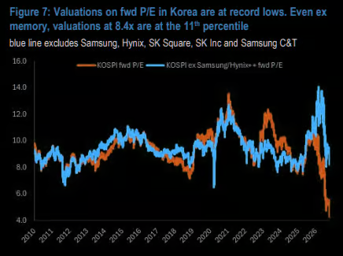
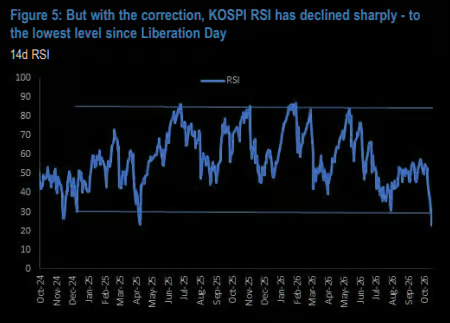
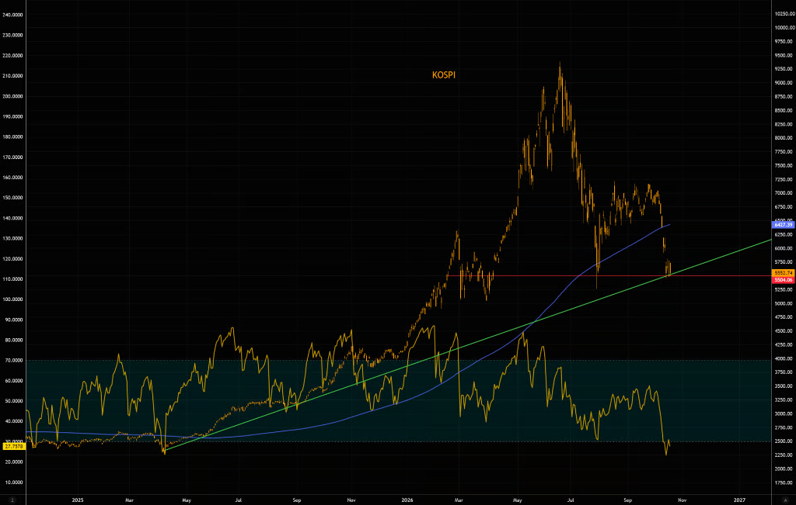
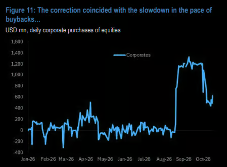
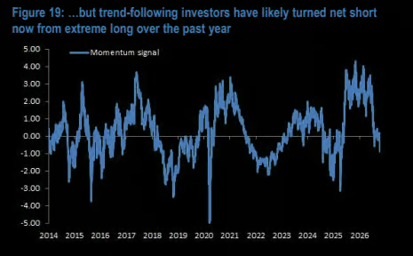
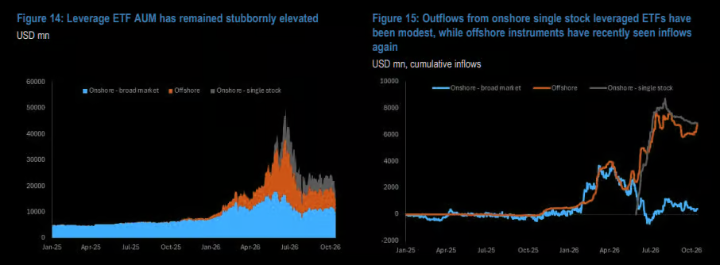
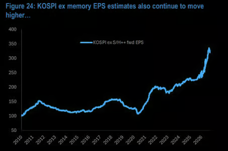
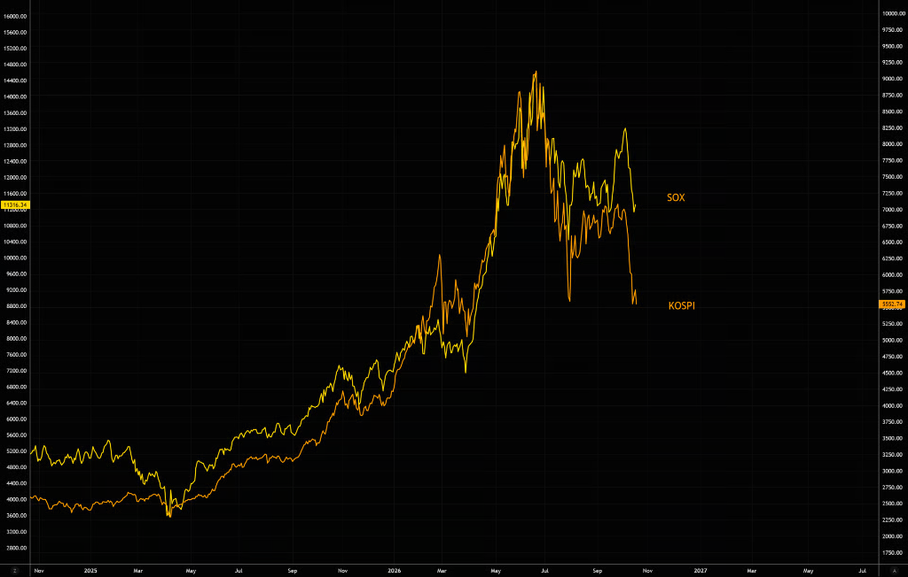

# 韩国跌出“历史级便宜”，为何无人接盘？

- 页面显示时间：2026-10-20T23:36:00+08:00
- 页面署名：杨宸
- 标注来源：未单列，见正文
- 原文：[华尔街见闻](https://wallstreetcn.com/articles/3784053)
- 取得时间：2026-11-04T16:03:47+08:00
- [HTML阅读版](article.html) · [来源记录](metadata.json)

## 导语

剔除三星、SK海力士等巨头的影响，KOSPI整体仅以8.4倍远期市盈率交投，处于历史第11百分位。而目前三星和SK海力士的股票回购相继收尾，外资净卖出，国内机构需求疲软，韩股恰在最需要支撑时失去了买盘来源。摩根大通指出，杠杆ETF持仓规模尽管遭遇大幅抛售却仍居高不下，新一轮抛售的可能性不能排除。

---

韩国股市估值已跌至历史极值区间，但买盘迟迟未能现身。KOSPI今年第三次遭遇五日跌幅超15%的重挫，远期市盈率压缩至历史最低水平，而基本面却未见明显恶化——这一罕见背离正在引发市场高度关注。

摩根大通指出，当前韩股估值与技术面均已发出强烈的逢低买入信号，但边际买家却正在加速消失。

**三星和SK海力士的股票回购计划相继收尾，外资持续净卖出，国内机构需求依然疲软，市场恰在最需要支撑的时刻失去了最重要的买盘来源。**

与此同时， **杠杆ETF持仓规模尽管遭遇大幅抛售却仍居高不下，持续形成机械性卖压。** 摩根大通警告，在这一悬而未决的杠杆风险彻底出清之前，新一轮抛售浪潮的可能性不能排除。

## **估值跌至历史极值，但"便宜"不代表底部**

KOSPI当前远期市盈率已降至历史最低水平。 **即便剔除三星电子、SK海力士等存储巨头的影响，KOSPI整体仅以8.4倍远期市盈率交投，处于历史第11百分位。**

与此同时，相对强弱指数（RSI）已跌至"对等关税"以来最低水平，超卖个股数量达到极端区间。

KOSPI当前正运行于长期重要趋势线附近，且大幅偏离200日均线。技术面已呈深度超卖，但正如市场老手所熟知的，超卖状态可以持续远超预期的时间。

估值与技术面的组合看起来愈发诱人，问题在于：便宜本身并不意味着抛售就此终止。

## **三大买盘来源同步撤退，支撑体系趋于瓦解**

支撑体系的坍塌，是本轮韩股下跌中最值得关注的结构性变化之一。

**自去年8月底以来，企业回购一直是市场最主要的支撑力量。然而三星已完成其回购计划，SK海力士也已接近尾声，这一关键买盘来源正在消退。**

与此同时， **外资持续净流出，国内机构需求依然有限。** 全球AI情绪降温之际，市场却恰恰失去了最重要的"接盘手"。三股力量的同步撤退，使KOSPI在技术面极度脆弱的时刻陷入买盘真空。

## **趋势策略资金从极度做多转向净空，长线资金观望**

仓位层面的逆转同样剧烈。趋势跟踪类投资者在本轮暴跌后已从极度净多头转为净空头。

这一转变从战术层面看或许是好消息——极端超卖叠加空头回补，为短线反弹提供了潜在动力。

但整体流动性图景依然脆弱：长线只做多投资者似乎仍在等待波动率企稳，尚未重新入场。在波动率出现实质性收敛之前，系统性买盘料难形成合力。

## **杠杆ETF持仓高企，机械性抛压仍未出清**

这或许是当前市场格局中最令人不安的环节。尽管市场已经历大规模抛售，杠杆ETF持仓规模却依然顽固地维持在高位。

摩根大通指出， **相关资金流出规模出乎意料地有限，而存续中的杠杆头寸在急跌日仍会持续形成机械性卖压。**

市场已经历了相当程度的仓位清洗，但杠杆头寸并未得到充分消化。这一悬置的风险敞口意味着，在其规模实质性缩减之前，新一轮抛售不能被排除在外。

这也是当前估值与技术面的吸引力，尚未转化为实际买盘的重要原因之一。

## **股价下跌而盈利预期上调，背离暗示流动性驱动而非基本面崩塌**

最耐人寻味的信号，来自价格与基本面之间的背离。 **三星和SK海力士股价遭到重挫，但两家公司的远期盈利预测在10月这轮调整中却持续上修。**

这一背离并不局限于存储板块。工业、金融和医疗健康等板块的盈利预期同样延续上行趋势，尽管价格层面所受冲击相对较小。

由此来看，当前韩股的重新定价，更多是由资金流向与风险偏好主导，而非基本面的全面恶化。这意味着，一旦抛售压力消退，反弹力度可能相当可观。核心问题在于：买家何时回归。

## **KOSPI与费城半导体指数背离加剧，全球AI情绪的隐患犹存**

一个值得密切追踪的重要信号， **是费城半导体指数（SOX）与KOSPI之间不断扩大的走势分化。**

美国半导体板块已呈现出初步企稳迹象，而韩股仍在持续承压。这一分化难以长期并行存在，终将出现收敛或共振。

若KOSPI无法守住当前关键支撑位，美股半导体的反弹势头可能很快遭遇阻力。作为全球AI产业链上最重要的晴雨表之一，韩国股市的走势或许正在预警更深层次的风险——其影响远不止于韩国本身。

风险提示及免责条款

市场有风险，投资需谨慎。本文不构成个人投资建议，也未考虑到个别用户特殊的投资目标、财务状况或需要。用户应考虑本文中的任何意见、观点或结论是否符合其特定状况。据此投资，责任自负。
