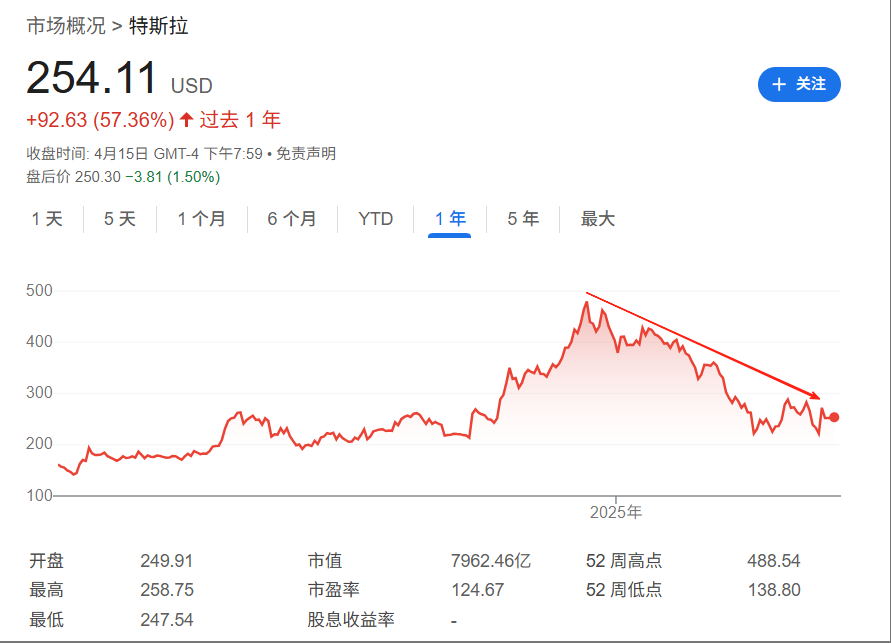
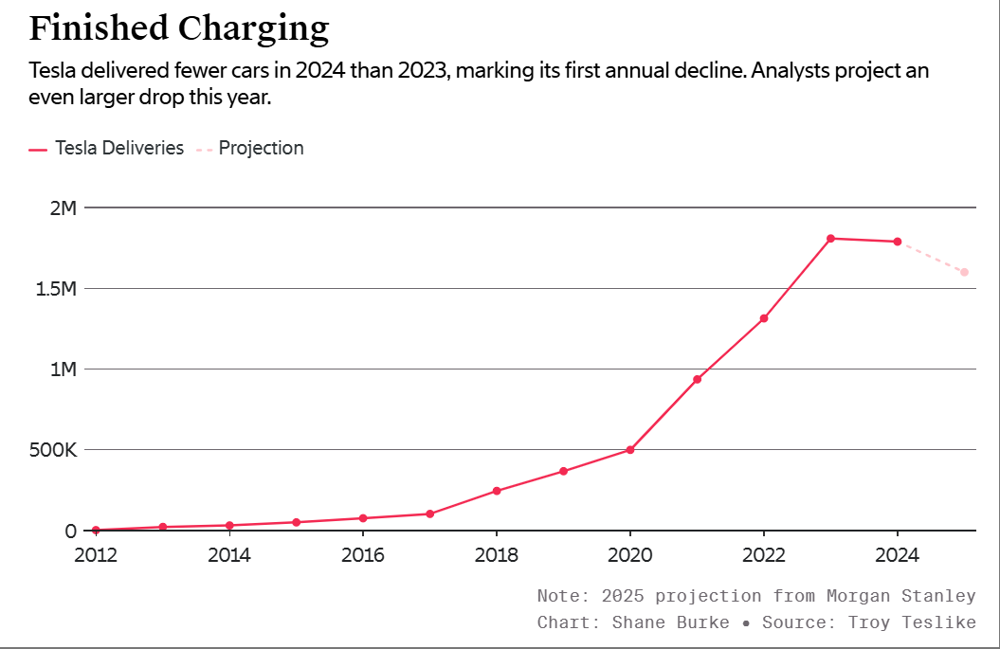

# 马斯克对电车失去兴趣？特斯拉内部质疑RoboTaxi前景黯淡、希望上廉价Model 2，马斯克置之不理

- 页面显示时间：2025-04-16T09:02:56+08:00
- 页面署名：董静
- 标注来源：未单列，见正文
- 原文：[华尔街见闻](https://wallstreetcn.com/articles/3745293)
- 取得时间：2026-11-04T16:04:04+08:00
- [HTML阅读版](article.html) · [来源记录](metadata.json)

## 导语

报道称，在马斯克看来，他推动电动汽车行业发展的主要目标已经实现。剩下的大多是一些更琐碎的事情，比如推出新车型以及迎合华尔街分析师的情绪。

---

据科技媒体The Information报道，马斯克似乎已对电动汽车业务失去兴趣，拒绝推出备受期待的2.5万美元经济型跨界SUV（Model2），转而全力押注无人驾驶Robotaxi和人形机器人等AI产品。

报道写道，马斯克早在去年年初就决定特斯拉不再是一家电动汽车公司。在马斯克看来，他推动电动汽车行业发展的主要目标已经实现。剩下的大多是一些更琐碎的事情，比如推出新车型以及迎合华尔街分析师的情绪。

马斯克拒绝了高管们提出的继续开发价格在2.5万美元的经济型跨界SUV的建议，转而全力押注无人驾驶Robotaxi和人形机器人等AI产品。这一决定不仅忽视了公司内部不利于Robotaxi的市场分析，还导致了三位高级高管的出走。

在转型至AI公司之际，特斯拉遭遇了销售下滑、品牌危机等负面因素，使得特斯拉股价自去年12月的高点以来已下跌近50%。

考虑到特斯拉的高估值，如果销售不反弹，可能进一步下跌。

投资者现在面临的是，是否相信马斯克的AI愿景能够补偿甚至超过电动汽车业务放缓带来的损失，而这一切都取决于Robotaxi能否实现马斯克预期的宏伟预期。

## 内部分析显示Robotaxi市场前景堪忧

特斯拉内部未公开的分析报告对Robotaxi的前景提出了严重质疑。

这款无方向盘、无踏板、无后视镜的无人驾驶电动车，在马斯克看来可能售出数百万辆并获得巨额利润。

然而， **内部分析显示，Robotaxi销售给个人和用于共享出行的数量可能只有数十万辆，且该车型可能永远无法盈利。**

分析师们计算出，随着Robotaxi的普及，美国汽车市场可能从每年1500万辆萎缩至约300万辆，因为无人驾驶车辆的使用时间是私家车的五倍。

不过，在排除农村地区居民、郊区有孩子的家庭和经常携带大型装备的活跃人群后，预计Robotaxi的年销量远低于100万辆。

更关键的是，特斯拉2024年在美国销售的63.37万辆电动车中，有很大一部分可能无法被Robotaxi取代。

分析师预计，在来自Waymo和其他初创公司的竞争下，特斯拉的市场份额将进一步缩小。

## 高管反叛与"Model 2之死"

2024年2月最后一周，在经过两年关于Model 2的反复辩论后，马斯克在特斯拉帕洛阿尔托办公室召开了一次重要会议，这是对2.5万美元车型进行最后辩论的机会。

特斯拉高级管理团队强烈支持同时生产Model 2和RoboTaxi，认为这款价格亲民的电动车每年可销售数百万辆，并为马斯克的AI雄心提供资金支持。

当反对意见不断积累，气氛变得紧张时，马斯克的坚定支持者Omead Afshar甚至问道："这是一场叛变吗？"

最终，马斯克做出决定： **Model 2项目彻底终止，特斯拉将转型为一家AI公司。**

"归根结底，我认为埃隆只是对制造大众高尔夫那样的汽车不感兴趣，"一位了解情况的人士表示，"他的态度是'让别人去做吧'。"

在那次会议仅六周后，三位曾为Model 2辩护的高管突然离职：动力系统高级副总裁Drew Baglino、全球公共政策和业务发展副总裁Rohan Patel以及车辆项目总监Daniel Ho。Patel表示：

> "我们有大量模型显示全自动驾驶(FSD)和Robotaxi的回报将是缓慢的，它将是起伏不定的。在美国以外，鉴于严格的监管环境或缺乏监管环境，这将非常非常困难。"

## 转型痛点：销售下滑与品牌危机

马斯克的决定使公司面临车型老化的问题，销售下滑开始显现。

从2019年至2023年，特斯拉的销售额年均增长50%，但去年下降了1%。今年第一季度，下滑幅度超过13%，多位分析师预测特斯拉交付量今年将再次萎缩。

马斯克的政治活动也对公司施加了进一步压力。他为特朗普的总统竞选投入了2.77亿美元，并利用X平台放大了有争议且常常不实的言论。

这似乎已经严重损害了特斯拉在美国和欧洲的品牌，导致德国等地需求崩溃，甚至出现对特斯拉车辆和经销商的攻击事件。

Wedbush Securities分析师Daniel Ives在4月6日给客户的一份报告中表示：

> 马斯克在华盛顿的工作已经造成了"品牌危机龙卷风，现在已经变成了F5级龙卷风"，并对特斯拉造成了永久性伤害。

风险提示及免责条款

市场有风险，投资需谨慎。本文不构成个人投资建议，也未考虑到个别用户特殊的投资目标、财务状况或需要。用户应考虑本文中的任何意见、观点或结论是否符合其特定状况。据此投资，责任自负。
