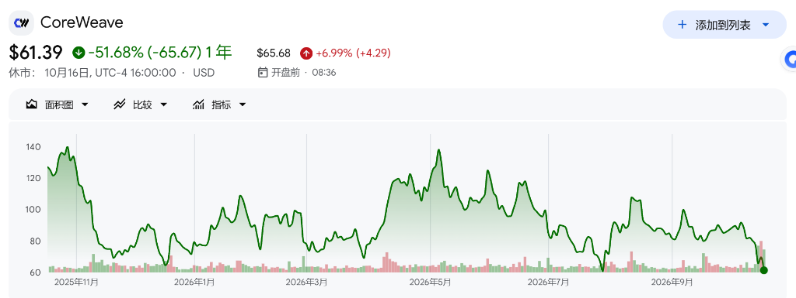

# 高盛上调CoreWeave至“买入”：市场高估了融资成本，低估了计算收费能力

- 页面显示时间：2026-10-19T20:53:26+08:00
- 页面署名：卜淑情
- 标注来源：未单列，见正文
- 原文：[华尔街见闻](https://wallstreetcn.com/articles/3783944)
- 取得时间：2026-11-04T16:02:17+08:00
- [HTML阅读版](article.html) · [来源记录](metadata.json)

## 导语

高盛将CoreWeave评级从“中性”上调至“买入”，目标价106美元，较最新收盘价61.39美元有约73%的上涨空间。高盛认为，市场过度担忧其融资成本，却低估了算力收费潜力：GPU及客户合同支持的资产抵押融资并不完全受公司债收益率左右，而每兆瓦年收入有望从目前的1000万美元升至1300万美元，带动投资回报率改善。

---

高盛认为，投资者对CoreWeave资金支付方式的担忧过度，而对其计算收费潜力的重视又严重不足。

据追风交易台，高盛分析师Gabriela Borges和Maura Hager周一将CoreWeave评级从"中性"上调至"买入"，目标价106美元。鉴于该股自8月11日二季度财报发布后已累计下跌43%、过去五个交易日单独下挫24%，收于61.39美元，106美元的目标价仍意味着约73%的上行空间。

高盛在报告中直接援引"Finance 101"框架， **指出CoreWeave的企业价值与其无杠杆内部收益率（uIRR）和加权平均资本成本（WACC）之间的利差高度相关，并认为市场正在低估uIRR的上修幅度，同时高估了WACC的上升空间。**

此次上调对市场情绪具有直接影响。

过去一周，CoreWeave无担保债券收益率攀升至13.5%至15%，信用违约互换（CDS）触及历史高位，德意志银行估算其未来12至18个月存在约350亿美元的融资缺口，上述因素共同压制了股价。高盛的核心反驳逻辑是： **无担保债券市场并不能代表CoreWeave真实的新增融资成本，因为该市场对CoreWeave的新发行已关闭数月，其主要融资工具是以GPU和客户合同为抵押的资产支持延迟提款定期贷款（DDTL）。**

## 融资成本：高盛认为市场看错了参照系

高盛报告的核心争议点在于：市场用来衡量CoreWeave融资压力的指标，究竟是否准确。

高盛指出，CoreWeave的主要融资方式并非传统公司债，而是DDTL——这是一种以特定客户合同、GPU基础设施及相关现金流为抵押的资产支持项目融资。 **贷款方承保的不是CoreWeave的整体信用状况，而是具体合同的现金流质量和底层资产的抵押价值。这一结构使得融资风险从CoreWeave的公司资产负债表转移至具体合同和基础设施资产，同时降低了再融资风险。**

基于此，高盛估算CoreWeave当前加权平均债务成本约为800至900个基点（以二季度利息支出年化25.6亿美元除以约300亿美元总债务计算）。对于新增融资， **高盛假设投资级客户对应的DDTL定价约为SOFR+300个基点（如与Meta合同挂钩的融资），高收益客户对应约为SOFR+600个基点，混合成本区间为750至1050个基点。高盛最终选取1000个基点作为保守基准，意味着新增融资成本较当前水平仅上升100至200个基点。**

高盛还援引市场数据作为佐证：DDTL 5.0和5.5均以不低于原始发行折价的价格交易，表明资产支持融资市场对CoreWeave的信心尚未崩塌。

## 收费能力：每兆瓦收入是整个牛市逻辑的支点

高盛牛市论点的另一半，建立在CoreWeave每兆瓦算力收入的上升预期之上。

高盛估算，CoreWeave目前的混合货币化水平约为每兆瓦年度经常性收入（ARR）1000万美元，但认为这一数字在未来24个月内存在上行偏差。

支撑依据包括： **短期合同（3至6个月）的签约价格已达每兆瓦4000万美元；CoreWeave在今年7月提价25%，10月再度提价10%；二季度签署的合同贡献利润率比近期合同高出5至10个百分点。综合新一代GPU和更高利润率的软件产品，高盛认为每兆瓦1300万美元是新签长期合同的"合理起点假设"。**

将1300万美元/兆瓦代入高盛的示例模型（5年期、200兆瓦合同，80%债务融资，融资成本10%，残值为零），可得出15%的无杠杆内部收益率，与11.8%的WACC之间形成约3个百分点的正利差。

然而，高盛的敏感性分析也揭示了这一逻辑的脆弱性：若以当前实际混合水平1000万美元/兆瓦计算，uIRR将跌至6.3%，在同等融资成本下利差变为负6个百分点。换言之，整个牛市逻辑的成立，依赖于CoreWeave每兆瓦收入在现有基础上提升约30%。

高盛对此的补充论据是残值。其基准情景假设GPU在五年后价值归零，并称这一假设偏保守，并援引A100合同续签至2029年、H100合同溢价续签作为参考。若考虑第六年的完整残值，uIRR将跳升至约20%至25%。

## 资本支出与自由现金流：2030年才能自给自足

高盛同时论证，CoreWeave资本支出最密集的阶段已经过去，新增产能占已安装基础的比例已见顶，这将限制未投产新产能对财务的拖累。

但高盛自身的模型数据揭示了这一路径的漫长与艰难：2026年和2027年自由现金流均为负282亿美元，2028年为负158亿美元；长期债务将从今年的440亿美元攀升至2028年的910亿美元；2026年预期利息覆盖率仅为0.3倍，2027年为0.7倍；净债务与股权之比预计在2027年峰值超过3000%。高盛预计资本支出将在2028年趋于平稳，自由现金流在2030年转正，届时CoreWeave实现自我造血。

高盛还提出一个反直觉论点：若融资成本对所有算力提供商普遍上升，供给增速将放缓，推迟产能过剩的到来，从而使现有产能"在近期更具价值而非更低价值"——这实际上是在将信贷收紧描述为CoreWeave的潜在利好。

## 目标价与估值：高于市场共识，折价于超大规模云厂商

高盛将目标价定为106美元，基于18倍Q5至Q8 EBIT估值（此前目标价139美元对应22倍），高盛表示这意味着三年后约10倍EBIT，相对于甲骨文折价约30%，相对于超大规模云厂商折价逾50%，以反映CoreWeave"较高的绝对债务水平"。

在盈利预测上，高盛明显高于市场共识：2028年收入预测高于市场均值11%，2028年EBIT高于均值24%，主要驱动因素是更高的每兆瓦ARR假设。高盛同时将2028年每股收益预测上调至3.36美元（此前预测为亏损1.15美元），但将2026年每股收益预测下调至亏损3.80美元（此前为亏损3.64美元）。

## 不可忽视的注脚

高盛在报告中坦承了主要风险：一旦供给追上需求，定价可能崩塌，届时第四至第六年的合同续签可能无法覆盖WACC，而CoreWeave仍被锁定在7至16年的数据中心租约中；微软（高盛估算约占12%）等超大规模云厂商可能将算力需求收回自建；此外，每兆瓦4000至5000万美元的现货定价对应同等水平的资本支出，意味着一年回收期，高盛承认这远超正常回报水平，市场可能正在质疑这一ROIC是否可持续。

值得注意的是，高盛在报告披露附录中说明，其正担任CoreWeave一项待定承销业务的主承销商或联席承销商，持有CoreWeave 1%以上股份，过去12个月已从CoreWeave获得投资银行业务报酬，并预计在未来三个月继续寻求相关业务。

此外，据此前报道，CoreWeave创始人在股价大幅下跌前已套现约33亿美元。

 

 

 

\~\~\~\~\~\~\~\~\~\~\~\~\~\~\~\~\~\~\~\~\~\~\~~

以上精彩内容来自[追风交易台](https://mp.weixin.qq.com/s/uua05g5qk-N2J7h91pyqxQ)。

更详细的解读，包括实时解读、一线研究等内容，请加入【 [**追风交易台▪年度会员**](https://wallstreetcn.com/shop/item/1000309) 】

风险提示及免责条款

市场有风险，投资需谨慎。本文不构成个人投资建议，也未考虑到个别用户特殊的投资目标、财务状况或需要。用户应考虑本文中的任何意见、观点或结论是否符合其特定状况。据此投资，责任自负。
