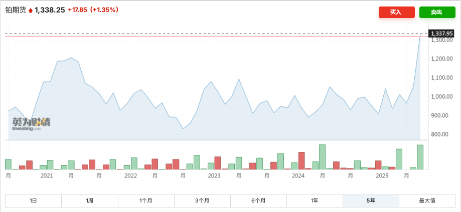

# 黄金“滞胀”=铂金新高？突破1300美元大关，铂金今年已涨45%

- 页面显示时间：2025-06-19T09:54:30+08:00
- 页面署名：李笑寅
- 标注来源：未单列，见正文
- 原文：[华尔街见闻](https://wallstreetcn.com/articles/3749416)
- 取得时间：2026-11-04T16:03:31+08:00
- [HTML阅读版](article.html) · [来源记录](metadata.json)

## 导语

当黄金价格攀升至历史高位后，投资者开始向价值链下游寻找机会，在“黄金疲劳”和中国珠宝需求激增的推动下，铂金价格飙升至五年高点。

---

“黄金疲劳”催生新的避险选择，铂金正成为贵金属市场的新焦点。

周三， **铂金价格突破1300美元大关，创下近五年新高，年内涨幅高达44%。** 与之相比，黄金价格今年来虽累计上涨近30%，但目前在3400美元/盎司下方盘整，显得有些乏力。

MKS PAMP研究与金属策略主管Nicky Shiels指出，铂金的上涨是全球货币贬值交易的延续：

> “投资者正在寻找美元对冲工具，黄金之外，白银和铂金成为下一个热点。”

全球指数提供商Indxx产品创新主管Vaihab Agarwal将这种现象称为“黄金疲劳”，即当黄金价格攀升至历史高位后，投资者开始向价值链下游寻找机会。

目前，白银已经吸引了大量关注，价格触及十三年高点36美元上方，而铂金正成为下一个受益者。

## 结构性供应短缺

世界铂金投资委员会(WPIC)数据显示，2025年铂金市场将连续第三年出现显著赤字，预计短缺量高达96.6万盎司，高于此前预估的84.8万盎司。

WPIC研究总监Edward Sterck表示， **“铂金市场处于结构性赤字状态”，现有地上库存仅能支撑三个月需求。预计这种赤字将持续到2029年。**

与此同时，TD证券高级商品策略师Daniel Ghali警告，供需失衡引发的价格挤压正在自我强化：

> “随着价格上涨，实物支持的ETF资金流入进一步消耗市场浮动库存，最终可能导致价格发现机制推高‘平衡点’，往往超出市场预期。”

## 中国珠宝市场需求增加

汽车需求仍然是铂金市场的主要驱动力，占全球消费量的80%。然而，一些分析师强调，随着金价走高开始抑制黄金的需求，铂金的珠宝市场正呈现出强劲增长态势。

Aberdeen Investments ETF投资策略总监Robert Minter指出，虽然黄金、白银和钯金都受益于发达市场持续财政支出对相关货币价值的冲击，但铂金的表现主要受中国铂金珠宝需求推动。

美银分析师也指出，珠宝需求是铂金市场第二大板块。该分析师指出，经过多年需求下滑后，有迹象显示中国消费者对铂金珠宝的兴趣正在反弹。

> “考虑到市场规模差异， **黄金珠宝向铂金的1%转换就能增加70万盎司需求** ，这将使我们的赤字预测几乎翻倍至160万盎司。”

数据显示，中国一季度黄金珠宝销量同比下降32%，而铂金珠宝制造同比增长26%。

## 价值洼地还是泡沫前夜？

尽管市场普遍看多铂金，但也有不同声音。

CPM集团董事总经理Jeffrey Christian近期表示，铂金市场并非如表面那样紧张。他指出，若剔除投资需求，仅从工业和消费需求看，2024年铂金市场实际盈余2.6万盎司，2025年预计盈余32.9万盎司。

> “全球铂金库存充足，供应短缺的说法存在误解。”

Christian认为存在"误解"，因为大宗商品市场研究方法论是用新增供应减去制造消费需求来计算市场平衡，而投资需求并不包含在制造需求中。

他表示， **大多数商品的投资需求都是“秘密的”，而且“估算投资需求极其困难，而且很容易出错”。** 而事实上，全球铂金库存量巨大，基本面表明铂金供应过剩。

风险提示及免责条款

市场有风险，投资需谨慎。本文不构成个人投资建议，也未考虑到个别用户特殊的投资目标、财务状况或需要。用户应考虑本文中的任何意见、观点或结论是否符合其特定状况。据此投资，责任自负。
