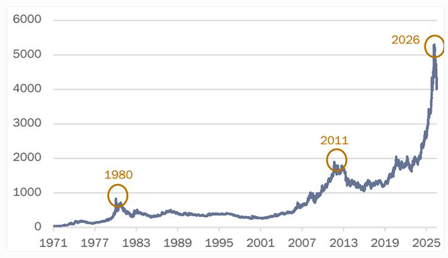

# 黄金牛市何时终结？系统性风险恐慌消退，利率重新占据主导

- 页面显示时间：2026-10-15T15:31:55+08:00
- 页面署名：董静
- 标注来源：未单列，见正文
- 原文：[华尔街见闻](https://wallstreetcn.com/articles/3783694)
- 取得时间：2026-11-04T16:03:32+08:00
- [HTML阅读版](article.html) · [来源记录](metadata.json)

## 导语

嘉盛银行认为，黄金牛市终结的信号从不是某个价格，而是恐惧的消散——历史上两次周期终结均源于"最坏担忧被消除"，而非问题真正解决。当前三大终结条件——地缘缓和、财政整固、金价与实际利率重回负相关——均未满足，本轮牛市"很可能尚未终结"。

---

黄金的长期牛市从不死于价格，而 **死于恐惧的消散** 。

瑞士私人银行嘉盛银行（Bank J. Safra Sarasin）资深投资策略师Thomas Bollinger在最新研报中指出，自1971年布雷顿森林体系瓦解以来，黄金经历了三轮完整的长周期，每一轮的终结都不是因为问题被解决，而是因为市场最坏的担忧被消除——届时， **黄金作为“B计划”的吸引力迅速瓦解，利率重新成为定价主导因子** 。

本轮黄金上行周期自2019年启动，目前已进入第七年，实际金价年化回报达12.3%。 **驱动这一轮周期的两大支柱——地缘政治分裂导致美元体系可及性下降，以及高政府债务引发的通胀稀释担忧——目前均未出现实质性缓解。** Thomas Bollinger在研报结论中明确写道， **本轮周期的终结“很可能还没有发生”。**

分析认为，这表明 **黄金在多资产组合中的价值并非来自分散化效果，而是来自对系统性风险的保护** ；减仓黄金的信号，不是某个价格水平，而是地缘紧张缓和、财政整固推进，以及金价与美债实际利率重新回归负相关关系。

## 三轮周期，同一逻辑：货币体系最被怀疑的时刻

Thomas Bollinger将黄金周期定义为"实际金价（经美国广义CPI平减）长期显著上行的一段时期"，以此剔除通胀干扰，使跨周期比较成为可能。

根据LSEG Datastream月度数据（1971年1月至2026年6月），三轮上行期的表现如下：

- **第一轮（1971—1980年）** ：实际金价年化回报24.5%，年化波动28.8%，最大回撤-49.7%；

- **第二轮（2001—2012年）** ：实际金价年化回报15.4%，年化波动17.4%，最大回撤-26.4%；

- **第三轮（2019年至今）** ：实际金价年化回报12.3%，年化波动16.5%，最大回撤-28.1%。

相比之下，两段下行期的年化回报分别为-7.7%（1980—2001年）和-6.4%（2012—2018年）。自1971年以来的全区间年化回报仅为5.0%，最大回撤高达-82.4%，充分说明 **长期持有黄金的回报高度依赖于所处的周期阶段** 。

报告称，三轮上行期发生在截然不同的经济与地缘政治背景下，但共享同一底层逻辑： **它们都出现在全球货币与金融体系最受质疑的时刻** 。第一轮的核心问题是“美元能否继续充当锚定货币”；第二轮是“金融危机后货币与金融体系的稳定性”；第三轮则是“锚定货币的中立性”与“主权债务的可持续性”。

## 周期如何终结：恐惧消散，而非问题解决

嘉盛银行认为，理解黄金牛市的终结机制，比预测价格顶部更具实际意义。

**1980年的终结** ：美联储主席Paul Volcker以大幅加息对抗通胀，市场意识到恶性通胀螺旋不会失控，对货币体系的最坏担忧被消除。

**2012年的终结** ：美国国会债务上限之争虽导致AAA评级被下调，引发对技术性违约的恐慌，但最终美国并未违约；与此同时，欧元区在主权债务危机中推出大规模救助措施并完成希腊债务重组，欧元区解体的风险被排除。

Thomas Bollinger强调， **这两次终结都不意味着根本问题被解决** ——1980年美国财政并未整固，2012年欧元区结构性问题依然存在。关键在于， **市场最坏的担忧被消除之后，黄金作为"B计划"的吸引力迅速下降，定价因子从"恐惧"切换回"利率"，下行周期随即开启。**

报告还指出，在周期顶部附近，往往会出现一次戏剧性的"最后冲高"（blow-off top）。价格在恐慌情绪中被推至极端水平，随后在担忧消散后急速回落，但金价通常会在最终进入下行趋势之前再度靠近前高——这是因为市场需要时间确认相关措施是否足以遏制结构性问题。 **一旦这成为市场共识，定价主导因子便从恐惧切换回利率，下行阶段正式开始。**

## 2022年的脱钩：这一轮的定价逻辑已经改变

在2012年至2022年间，金价与美债实际利率保持着稳定的负相关关系——实际利率上升，金价承压；实际利率下降，金价受益。新冠疫情期间的负实际利率环境曾给黄金带来显著提振。

**然而，这一关系在2022年突然断裂。** 美联储大幅加息推动实际利率快速上行，按照历史规律，金价理应承压，但实际走势截然相反。

Thomas Bollinger指出，这次脱钩的原因不是货币，而是地缘政治。俄乌冲突爆发后，西方对俄罗斯实施大规模制裁，俄罗斯央行储备被冻结乃至部分没收，俄罗斯被排除出SWIFT系统，其接入美元体系的渠道受到严重限制。

这一系列事件产生了深远影响： **黄金的主导功能重新向价值储藏手段转移** ，并已成为仅次于美元的第二大储备资产。央行购金趋势早在2010年代便已开始，近年来明显加速。与此同时，金融危机、欧债危机与疫情期间积累的高额政府债务，令众多投资者担忧实际债务负担将通过通胀被稀释，进而形成来自私人投资者、机构投资者与央行的结构性需求。

研报还指出，多年来实物黄金持续由西向东流动，中国正在多个国家布局交易所与仓储基础设施，进一步强化了黄金在平行结算体系中的战略地位。

## 组合配置：黄金的价值在于系统性保护，而非分散化

Thomas Bollinger在研报中对黄金在多资产组合中的作用进行了量化分析，结论与市场通行认知存在重要差异。

研报以50/50美国国债与美股平衡组合为基准，与加入20%黄金的40/40/20组合进行对比（研报明确说明这并非推荐配置，而是为清晰展示效果而设定的示意比例）。

**关键发现：黄金与50/50平衡组合的相关性长期接近零，但在两轮已完成的上行期（1971—1980年、2001—2012年）中，加入黄金并未明显降低组合波动。** 这意味着，黄金对组合的贡献并不在于一般意义上的分散化，而在于在系统性风险暴露期间为组合提供针对性保护——这种保护在上行周期中尤为珍贵。

研报同时指出，当前周期中含黄金组合的超额回报已处于历史高位，而当前市场估值相对偏高，意味着 **未来数年的预期回报可能低于本轮周期迄今已实现的水平** ，投资者应对此保持清醒预期。

## 三个验证条件：何时应当减仓黄金

Thomas Bollinger在研报中给出了判断本轮周期是否接近终结的三个可观测条件，并设定了具体的验证窗口：

**① 地缘分裂是否出现实质性缓和。** 核心观察点包括：对俄制裁是否松动、被冻结的央行储备是否解除、平行结算体系是否出现实质性退潮。验证窗口为2026年四季度至2027年上半年相关制裁与结算安排的政策进展。

**② 政府债务担忧是否被政策消除。** 核心观察点包括：主要经济体是否推进财政整固，或通胀是否回落至债务实际负担不再令市场担忧的水平。验证窗口为2027年主要经济体财政预算与通胀数据。

**③ 金价与美债实际利率是否重新回归负相关。** 这是最直接的机制性信号。 **若两者重新呈现负相关，意味着定价因子已从"恐惧"切换回"利率"，本轮周期转入下行阶段的信号将正式触发。** 验证窗口为2026年四季度起的月度持续观察。

Thomas Bollinger在研报结论中明确表示，上述条件目前均未满足，本轮黄金周期的终结"很可能还没有发生"。对于持有黄金头寸的投资者而言， **判断的关键不是盯住价格，而是持续追踪这三个条件的演变** ——一旦市场最坏的担忧被消除，历史经验表明，黄金将迅速失去其作为"B计划"的吸引力。

风险提示及免责条款

市场有风险，投资需谨慎。本文不构成个人投资建议，也未考虑到个别用户特殊的投资目标、财务状况或需要。用户应考虑本文中的任何意见、观点或结论是否符合其特定状况。据此投资，责任自负。
