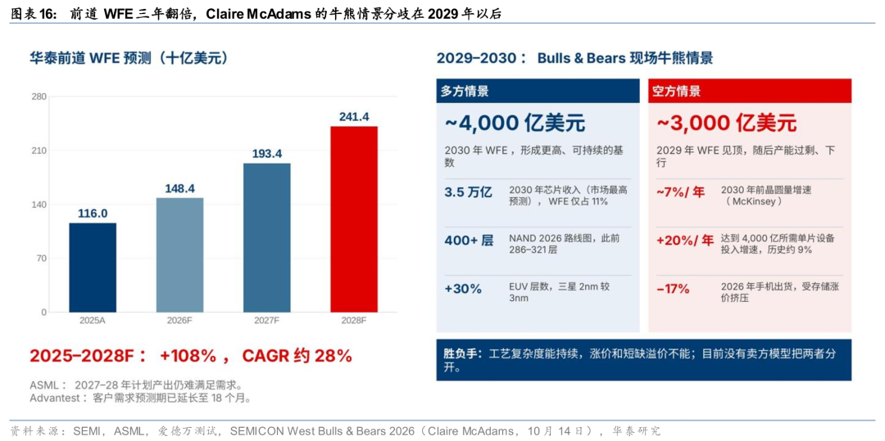
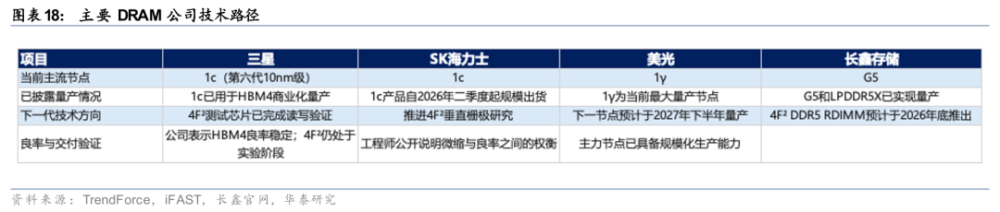

# AI投资的资金、电力与存储周期担忧：2026年10月走访

华泰团队参加OCP、SEMICON West并走访美国投资人后，把AI投资的焦点归为资金、电力和高价周期的兑现。技术逐渐可做，仍须有主体先支付设备与建设成本，承受等待送电和客户回款的时间，再由实际服务收入维持下一轮投入。文章所呈现的是机构筛选后的访谈与分析，没有公开抽样设计；以下保存2026年10月23日的信息与预期。

## 市场先为谁承担风险重新开价

半导体股票在7月回撤后修复不一，机构因而转向追问集中持仓和资金周转。CoreWeave给出了更具体的融资读数：同一只2032年到期、票息9.625%的美元债（US21873SAK42），指示到期收益率由6月18日9.48%升至10月15日14.54%，股票同期回撤。更高的二级市场收益率，意味着投资人按更低价格承接既有约定现金流，可能提高公司再融资时需要提供的补偿；实际新借款条件还取决于抵押、期限和工具设计。

图4另列CoreWeave 2030年债G-spread约872bp、Alphabet参照券约42bp，显示不同发行人的资金条件明显分化。G-spread相对国债曲线，YTM还含基准利率，两者均须连同具体券理解。9月18日扩大至37亿美元、票息2.875%的可转债附转换权，低票息反映了另一种投资人回报安排，不能用它抵消普通债收益率走高的观察。[CoreWeave](../10_concepts/CoreWeave.md#bond-history-20261015)据此成为观察AI扩张融资条件的窗口；10月16日经营/项目债及10月31日CDS各自保存。

集中敞口还可能将融资压力变成卖出压力。文章以Situational Awareness对照Archegos：前者6月30日13F中SNDK与美光占申报持仓55.6%，据Reuters 7月30日报道，大部分公开股票组合售予Citadel，涉及经纪商融资。市场下跌时，杠杆和集中敞口会提高补现金、降仓位的敏感度，但本案没有明确追保或违约证据，不能按Archegos的结果定性。[保证金驱动的流动性螺旋](../20_mechanisms/保证金驱动的流动性螺旋.md)解释条件过程；[图1—6](../40_sources/S-WS-3784266.md#figure-index)保存指数、持仓比较和工程路线。

工程见闻也影响现金时序：OCP展示CPU、内存池、铜光互连、供电与冷却的协同，追求每瓦有效产出；800V等规模导入可能后移至2027年下半年以后。样机可行和规模交付之间的距离，会改变客户何时能够提供服务及回款。

## 钱先付出去，合同随后兑现，终端付费再把现金带回来

本篇最大的资金疑问在于周转间隔。云厂商先采购设备、取得机房和建设容量，客户按合同使用服务并支付费用，模型和应用经营者再争取终端用户付费。若建设增长快于现金回收，经营者需要动用存量现金、举债、发行股权或引入项目资本，且要在服务收入尚未成熟时承担融资成本。客户订单充足能改善未来收入可见度，仍需有人跨过部署前的付款期。

华泰用2030年全球数据中心TAM约2.798万亿美元，与五集团经营现金流情景约1.466万亿美元相对照。1.332万亿美元差额表达规模压力；全球产业与五集团覆盖不同，2027—2030年OCF还假设每年增长20%，因此没有证明行业已存在等额未融资项目。

近期支出已占据很大现金流空间：截至2026年6月30日单季，四集团OCF约1717亿美元、现金购建PPE约1651亿美元，占约96%，合计尚余约67亿美元（原图取整）；这还未包含新增非现金融资租赁，集团支出也跨AI及其他业务。将短期现金投入与未来订单并列，比只看订单总额更能理解为何融资仍重要。

微软商业RPO、Google Cloud和AWS backlog、Oracle整体RPO的覆盖不同；Oracle截至8月31日，其余截至6月30日。微软约30%在未来12个月确认、Google约50%在未来24个月确认，指向收入兑现窗口，现金还取决于预付款、账期和履约。take-or-pay的最低付款义务可让供应方更有把握覆盖固定投入，同时把需求不足时仍要付款的风险交给客户；若客户本身靠外部融资支付，其融资变化又会影响整条回款链。

因此需要同时看合同责任、服务交付与付款能力。年化收入、资本承诺、租赁义务和已到账资金各有作用，不能汇总为一个“融资已解决”读数。逐图范围与媒体数字的证据层级集中在[来源记录](../40_sources/S-WS-3784266.md)。

## 供电费用和闲置风险由谁承担，决定规划能否变成起租

新数据中心需要电源、输配网和接入能力。若扩建成本普遍分摊给用户，既有居民与企业可能先承担电费压力，地方阻力随之增加；若专门费率、最低付款和社区协议把更多成本交给数据中心，电网回收更确定，项目的经营成本和闲置风险则上升。经营者需要在更贵的可接入容量、较低利用率和等待期间的利息之间选择。

文章引用EIA全国商业名义零售电价2020—2025年上涨26.6%、2026年1—7月均价同比涨5.6%，说明争议的成本背景，未识别AI单独贡献。AEP Ohio的100MW合同按至少82.5MW计费需求，使客户即便使用不足，也承担一定预留容量费用。这有助于避免电网为未兑现需求扩建后回收不足；相应成本进入数据中心的服务定价与融资测算。

截至报道，16州提出暂停类议案；纽约至少50MW项目的部分环境许可暂停、马萨诸塞超过25MW项目的框架，分别将环境评估或社区协议带入审批。议案、行政审查与有效禁令须分开。作者据此建议跟踪11月中期选举后的政策。图11保存当时预测，不能当选举结果或把所有投票变化归因于数据中心。

Hyperion一期2GW、远期5GW规划，以及云厂商全球新增容量，展示了需要承接的规模。真正带回现金还要经过许可、接入、送电、起租；规划地点和GW不能替代这些进度。[数据中心](../10_concepts/数据中心.md#power-permits-20261023)保留这一交付过程，[投资扩张的资源挤出与政策约束](../20_mechanisms/投资扩张的资源挤出与政策约束.md)解释公共资源与成本分配。[图9—13原图](../40_sources/S-WS-3784266.md#figure-index)保留电价、规划、选情及公司期间。

## 高售价鼓励扩产，新增合格供给又可能改变定价

存储涨价提高厂商现金与扩产激励，也抬高AI和消费终端的成本。固定规格DDR5从2025年初3.75美元升至图示2026年4月35美元，期末约为起点9.3倍、累计涨833%；NAND 512Gb TLC从2.52至24.87美元，约9.9倍、涨887%。文章另引9月30日对第四季DRAM涨10%—15%、NAND涨15%—20%的预测。前者是所画价格历史，后者尚待兑现，均不代表HBM报价。

高价和更高端产品组合可以使销售金额远快于晶圆数量增长。行业金额预测因此未必等比例转成长期实物需求；反过来，新工艺如果需要更多设备步骤，也能使设备支出持续快于晶圆量增长。这两种解释决定市场在问什么：高收入来自可持续的复杂度，还是会被扩产消化的短缺价格？

华泰7月预测2025—2028年WFE从1160亿至2414亿美元，增长108%。其范围、版本与[SEMI的全部设备和后来修订](../40_sources/S-WS-3784266.md#equipment-versions)不同，不能接成一条实现序列。图16论坛强情景为2030年WFE约4000亿美元、形成更高持续基数；较弱情景为2029年约3000亿美元见顶后过剩。达到4000亿美元所需每片晶圆设备支出约每年增20%，高于所引历史9%，是争论的假设门槛。

在设备交付、安装和量产爬坡期间，今天的高价可能仍维持，也可能已吸引足够供给。ASML当时称2027—2028年计划产出仍难满足需求，给近端设备紧张提供支持；它还没有决定2029年以后新增芯片是否都有买家。[半导体设备与材料](../10_concepts/半导体设备与材料.md#equipment-forecasts-20261023)维护复杂度、订单到产出的共同过程。

长鑫让新增供给问题落到具名主体。文章称其G5/LPDDR5X已量产，4F² DDR5 RDIMM拟年底推出，计划阶段、产品认证和可售出货需要分别观察。4F²的密度机会只有经过外围电路、良率和客户验证，才形成可售比特；通用解释见[存储母项](../10_concepts/HBM与存储芯片.md#memory-cycle-20261023)。

文章援引招股书称长鑫DRAM收入份额从2025年第二季3.97%升至第四季7.67%，本轮未独立重建。图19左侧是三星、SK hynix和美光的DRAM季度营收份额（%），分母为相应DRAM市场收入，未显示长鑫，不能用来验证上述数字；右侧是集团整体毛利率，不能代替DRAM利润率。

若长鑫及其他新增产能形成同档次合格出货，客户可替代来源增加，供需紧张可能缓和，成熟产品定价和利润随之受压；若认证、良率或需求增长吸收了新增供给，高价可能维持更久。[长鑫存储](../10_concepts/长鑫存储.md#roadmap-20261023)维护自身兑现。图20的光伏、LCD份额史为竞争提出问题，不能作为DRAM必走路径；[图14—20定位](../40_sources/S-WS-3784266.md#figure-index)保存完整比较。

## 完成任务的价值，怎样成为可持续付费

华泰将Muse视作变现亮点：应用若能替用户检索、比价、协调日程和推进经营流程，收费可以联系省下的时间与任务价值。用户给出目标，后台执行，再对下单等关键动作确认；任务成功和真实接入关系到用户是否愿意持续付款。

截至10月23日，报道实际列出的收费是20美元和100美元月费的有限订阅测试；“按任务收费”是价值方向，未证明已经逐任务计费。文章经Social Media Today转引Sensor Tower称22天下载超500万，经The Information称周用户超300万。下载、活跃、付费是不同阶段，只有付费转化、留存、续费和收入对应服务成本，才能判断是否把采用转成资金回收。

[Muse](../10_concepts/Muse.md#history-20261023)记录该独立窗口，并与10月12日成本/增长分析相连：执行越多任务可能提高价值，也增加推理、VM和存储支出。两篇估计的用户范围和假设不同，不能据下载量乘订阅价算收入，或将成本情景当实际账单。[图21应用时间线](../40_sources/S-WS-3784266.md#figure-21)补充作者的产品判断。

## 按哪些时间窗口检验当时认识

以下检验由本库于2026-11-16依据报道已有期限整理，尚未加入后来结果。华泰的M7相对SOX等配置排序保留机构判断归属。

| 窗口与主体 | 当时预期或问题 | 能区分解释的新观察 |
|---|---|---|
| 11月中期选举后，各州与具体项目 | 作者建议关注政策是否改变落地节奏 | 实际许可、社区协议、费用分担与送电/起租日期；比竞选表态更能判断约束是否解除或转成更高成本。 |
| 2026年第四季及年底前后，存储与长鑫 | 第四季涨价预测、年底产品计划 | 同规格合同价、产品认证和合格出货；若供给兑现同时价格走弱，支持扩产缓解短缺，若未出货则尚不能用新架构解释价格。 |
| 2027—2028年，设备商与晶圆厂 | 交付紧张与资本开支扩张 | 订单转交付、客户验收、投片及合格产出，与需求和库存同看，判断新增设备是否真正扩供。 |
| 2029年以后，存储与设备 | 论坛可持续高基数/过剩下行分岔 | 持续加工复杂度、同质价格和利用率；复杂度支出维持而价格溢价消退，可将长期工艺需求与周期涨价分开。 |
| 随后经营披露，Muse | 任务价值能否支持持续收入 | 同范围付费人数、续费/留存、实际收入及服务成本。采用增长且收入覆盖成本改善，才更支持商业化兑现。 |

资金条件按各自日期继续积累：CoreWeave报价、新融资条款、交付和回款的匹配，可以检验投资人是在暂时重估价格，还是公司获取资金与履约的能力已变化；本文没有为其虚构固定融资结果日期。

[本地全文](../../../../materials/wallstreetcn/SourcePost/美国投资人在担心什么？/article.md) · [22图完整目录与核读说明](../40_sources/S-WS-3784266.md#figure-index)
