# AI投资的资金、电力与存储周期担忧：2026年10月走访

华泰团队参加OCP、SEMICON West并走访美国投资人，10月23日文章把讨论重心从“技术能不能做”转到“谁出钱、谁供电、什么时候收回投入”。这是机构筛选后的访谈和分析，未提供样本数量或抽样方法，不能据标题推定为美国投资人的代表性调查。本文保存当时问题及论证，尚无后来结果。

## 股市拥挤与债市价格：同一AI主题的资金条件分化

图1从2023年初、图2从2026年7月29日分别归一化，展示SOX、台湾加权、KOSPI、日经225和A股半导体的路径。行业结构、计价币种与起点不同，它们呈现不同篮子的市场定价，不给出“AI实际需求”统一读数。作者据此提出集中持仓与恐高情绪。

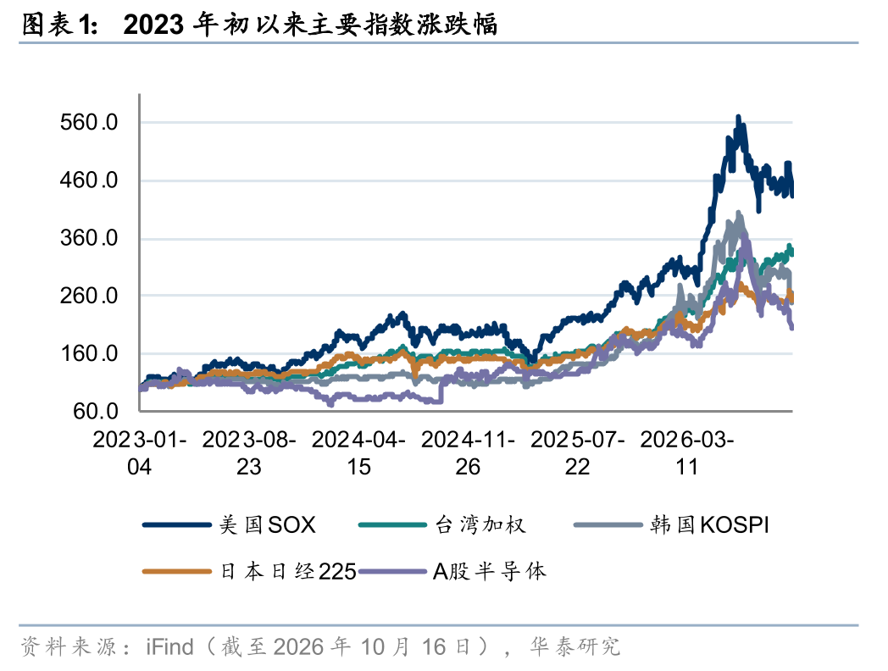

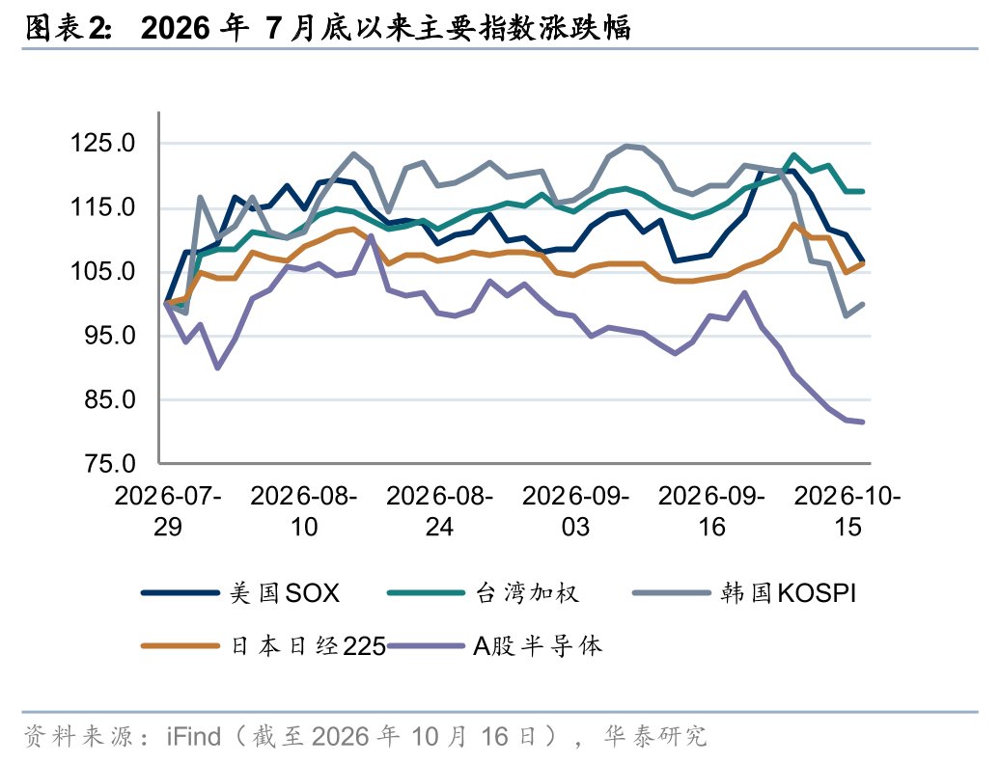

债市把资金条件落实到具体发行人。图3同一2032年到期CoreWeave债的YTM从6月18日9.48%升至10月15日14.54%，而股票也有回撤；图4的2030年参照债G-spread约872bp，与Alphabet约42bp相差很大。前者含基准利率与信用、流动性补偿，后者是相对国债曲线的利差，均不能直接称为CDS。文章引美国十年期国债10月5—16日从5.31%到5.09%，窗口与债券起点不同，不作简单差值分解。

图3还标出季度指引、9月扩大至37亿美元的可转债及10月Gartner警告/公司回应。可转债2.875%票息附转换权，与普通债YTM不能直接相比。消息与价格同图提供发生顺序，没有独立识别每条消息的因果贡献。[CoreWeave主体页](../10_concepts/CoreWeave.md#bond-history-20261015)承接历史。

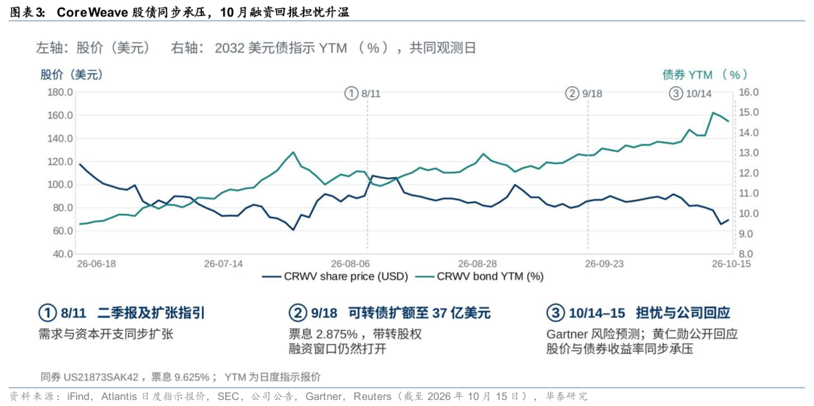

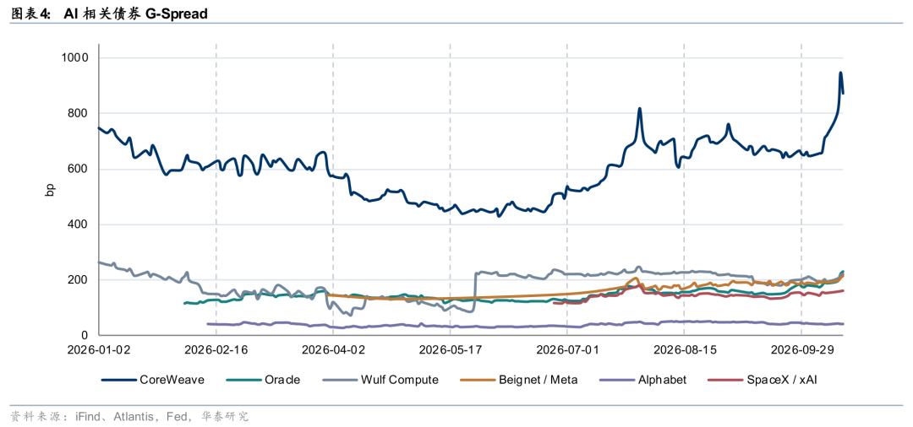

文章又借Archegos回顾高集中度敞口和杠杆的风险。Situational Awareness的2026年6月30日13F中SNDK、美光合计55.6%是申报持仓比例，不能当作完整基金净资产权重。文中引Reuters称7月30日大部分公开股票组合售予Citadel，包含经纪商杠杆融资部分，但没有明确追保证据或违约事实。因此两者可比较的是集中敞口下的强制去杠杆可能性；不能将交易出售直接定为另一次Archegos。[保证金驱动的流动性螺旋](../20_mechanisms/保证金驱动的流动性螺旋.md)解释条件机制。图中两轮指数按峰值对齐，只描述既有路径，不给出后来走势预测。

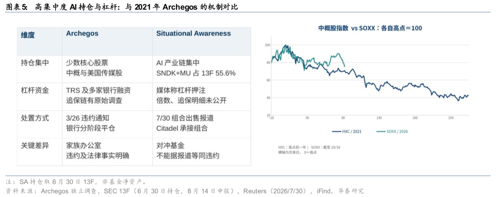

OCP见闻同时表明，产业仍在优化完整系统每瓦计算效率：CPU、内存池、互连、供电和冷却协同，铜与光也可按场景共存。图6把Computex和OCP展品、技术方向及2027年前后目标放在一起。技术展示、标准演进、客户部署分别有时间表，不能将Kyber、800V等预期统一写成已规模交付。

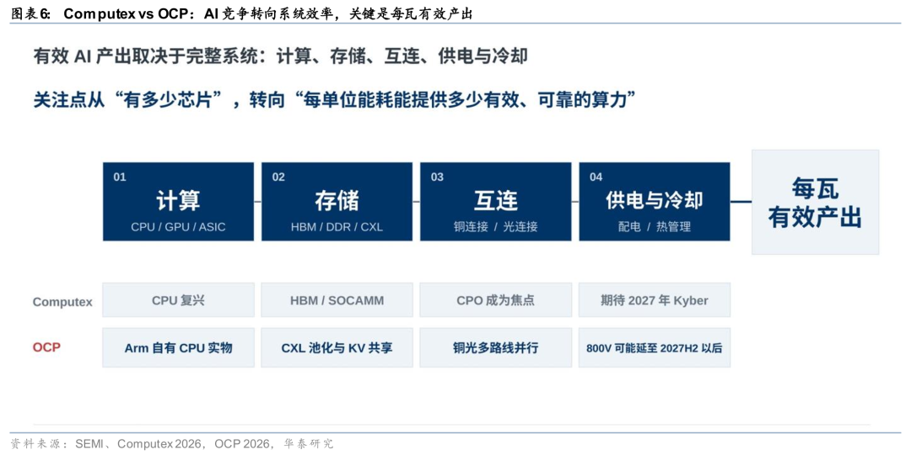

## 资金：行业支出规模、集团现金流与合同回款

图7把全球数据中心TAM与微软、亚马逊、Alphabet、Meta、Oracle五集团经营现金流并列。2030年约2.798万亿美元与1.466万亿美元相差1.332万亿美元，说明资金压力值得研究，但行业与五集团范围不同，集团现金还要支持其他经营与股东回报，也可通过债务、股权、项目融资等渠道筹措。差额没有证明全行业已存在等额未获融资项目。2027—2030年现金流又是假设每年增长20%的情景，TAM也为预测。

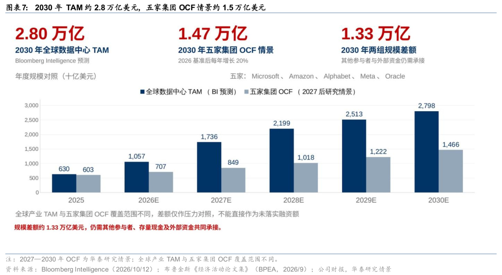

图8使近期压力具体化：截至2026年6月30日单季四集团OCF约1717亿美元、现金购建固定资产1651亿美元，后者约占96%，未包括新增非现金融资租赁。不是全部支出都属于AI，四集团单季差额也不是全行业融资缺口。

未来合同收入提供回收线索，却不等于当期现金。图示微软商业RPO、Google Cloud及AWS backlog与Oracle整体RPO，范围不同；Oracle截至8月31日，其余截至6月30日。微软约30%未来12个月确认、Google约50%未来24个月确认，是收入确认预期。客户支付、预付款、取消条款和供应商履约另决定现金。take-or-pay安排可提高最低付款确定性，也可能使需求减弱时客户仍承担合同义务；不能将所有合同额当为同质量无条件现金。

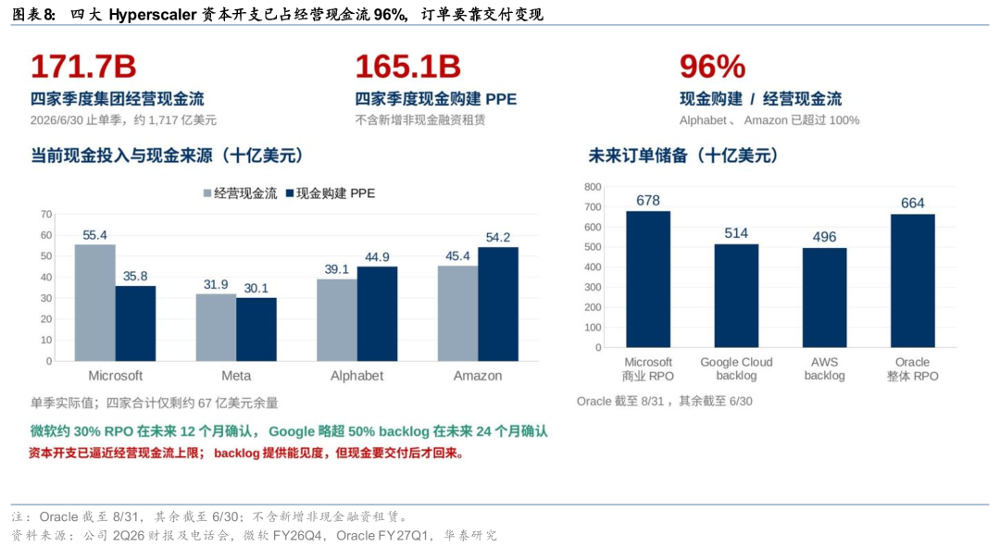

文中引OpenAI、Anthropic年化收入、资本承诺与媒体估算的债务/租赁总量，提供扩张规模的背景。年化收入不是完整年度已实现收入，资本承诺不是已到账融资，各项债务、租赁与合同采购也不能未经去重相加为统一负债。作者的实质疑问是：先投入的资金能否在设备、合同与终端付费间顺利周转。

## 电力：大规模规划经过成本、地方政治与送电约束

图9的EIA全国商业零售名义电价，2020—2025年涨26.6%、2026年1—7月均价同比涨5.6%，展示成本背景，未识别AI单独贡献。右侧DataCenterMap的地点统计混合运营、在建和规划，也不能用地点个数推算实际GW。

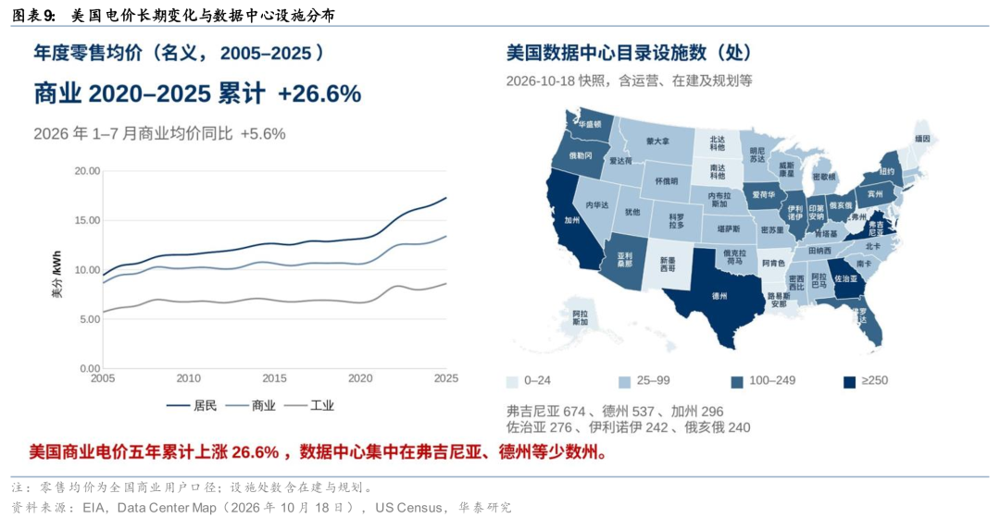

Meta Hyperion一期2GW、远期5GW的规划，直观体现供电、用地与公共设施规模。曼哈顿叠图是尺度示意，不能当成实际耗电测量；远期5GW与一期2GW也不可简单相加成投运7GW。

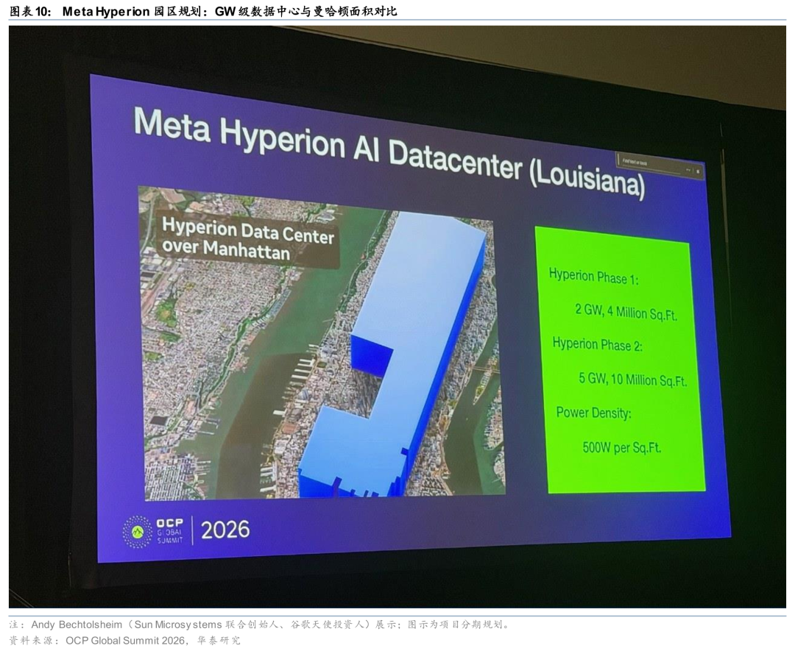

电价与环境成本如何分配，会影响地方居民和政治人物支持。图11保存当时席位预测/民调及作者关于数据中心争议的分析；表内预测不等于选举结果，党派变化也不能全部归因于数据中心。文章引《经济学人》近站居民投票意愿差异，没有给出样本与识别方法，保留线索身份。

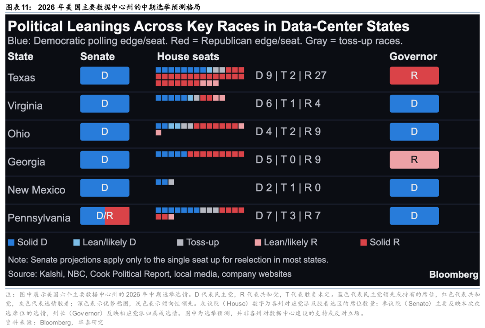

图12中16州为提出暂停等议案，提出、通过与实施有不同约束。纽约州至少50MW项目的部分环境许可暂停、马萨诸塞超过25MW项目的框架也有各自适用条件。AEP Ohio的100MW合同按至少82.5MW计费需求，体现成本回收和闲置容量风险分配，不要求每小时实际消耗82.5MW。本轮没有另核法规原文，不能把历史转述当成制作日现行法律清单。

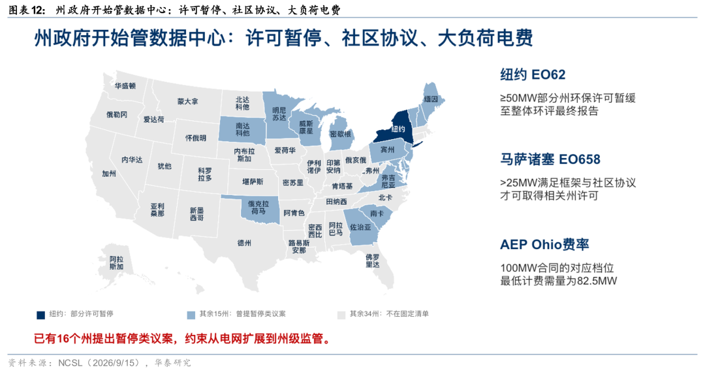

图13的公司自建/租赁地点及新增GW进一步说明交付尺度，微软财年、AWS自然年与未披露数据分别保存：未披露不代表零。既有规划、取得接入、实际送电、客户起租之间的间隔决定现金回收。[数据中心](../10_concepts/数据中心.md#power-permits-20261023)更新这条链，[资源挤出与政策约束](../20_mechanisms/投资扩张的资源挤出与政策约束.md)解释成本传导。

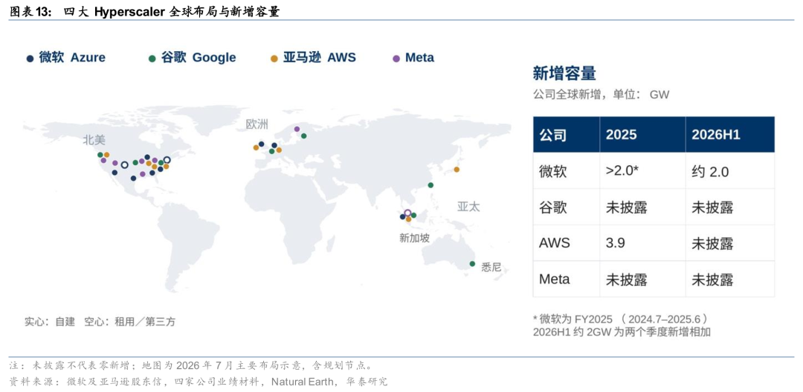

## 存储与设备：销售金额暴涨是否代表长期实物需求

图14同时放入WSTS销售额、Yole出货/晶圆预测和SEMI长期目标。2026、2027销售额为预测；销售金额、芯片颗数和等效晶圆聚合方法不同，不能简单把差额全部归为售价。作者担心金额增长中有价格和组合因素，未来供给若扩大，历史高毛利可能不能延续。

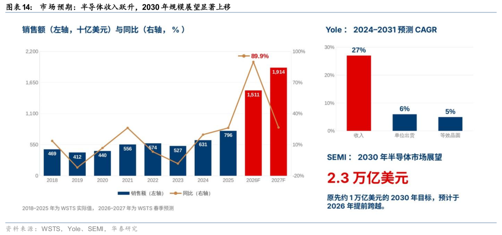

图15固定规格DDR5合约价从2025年初3.75美元到图示2026年4月35美元，价格成为9.3倍、累计约涨833%；NAND 512Gb TLC从2.52至24.87美元，成为9.9倍、约涨887%。不是“上涨9.3倍”，也不是HBM价格。图引9月30日第四季DRAM涨10%—15%、NAND涨15%—20%仍是预测。右侧每平方英寸晶圆对应收入包含涨价和产品组合；台积电平均晶圆收入也不能作为这些固定规格价格的直接对照。

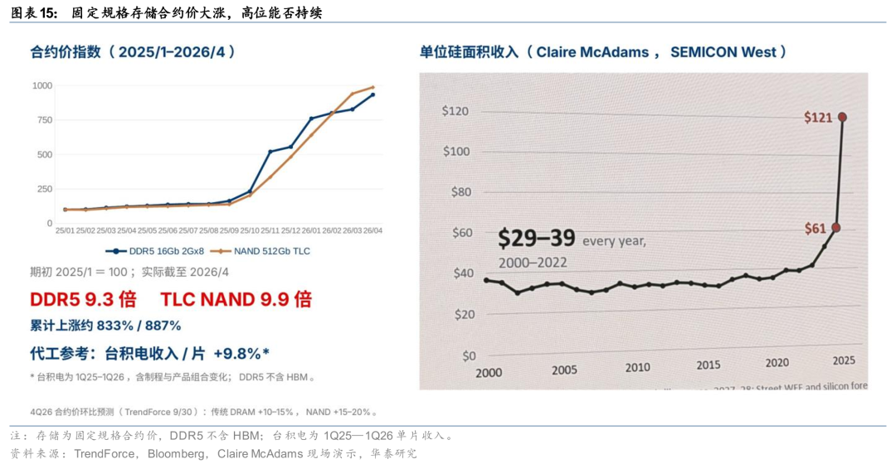

设备是作者担忧的下一环：高芯片价格支持客户扩产，但设备金额增长可能同时来自更多加工步骤和短缺溢价。图16中华泰7月WFE预测、SEMI7月全部设备预测与9月修订的范围、版本不同。论坛的强情景2030年WFE4000亿美元、较弱情景2029年3000亿美元见顶，均是条件情景；强情景所需每晶圆设备支出约每年增20%，不能当成已实现的技术事实。新设备随后到厂时，终端需求和芯片价格可能已变。[设备与材料](../10_concepts/半导体设备与材料.md#equipment-forecasts-20261023)承接长期判断。

架构变化又能改变供给能力。4F²相对6F²在同一F下单元面积小三分之一，但外围电路、良率与认证决定完整芯片可售比特。图17路线来自ASML，图18产品时序混有量产、验证和计划；它们不能直接推出各公司同等成本优势。

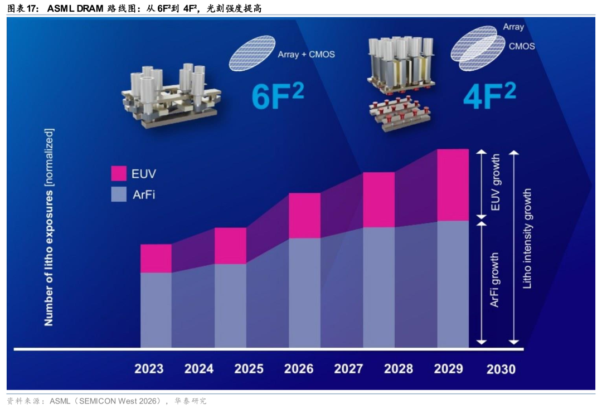

文章称长鑫G5/LPDDR5X量产，并计划年底推出4F² DDR5 RDIMM，收入份额数字引自招股书。本轮没有独立取得底层文件。图19左侧仅为三星、SK hynix、美光的DRAM收入；右侧为公司整体毛利率，三星包含其他业务、美光按财季。不能用该图核长鑫份额，或把整体利润当作DRAM利润。

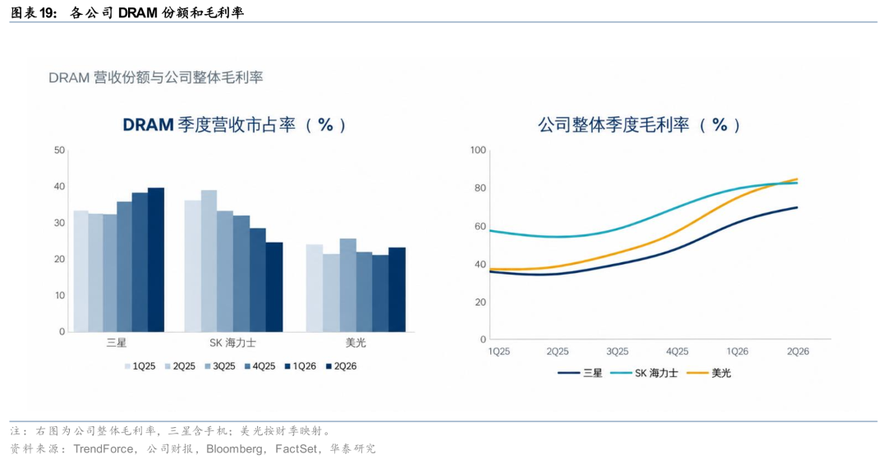

图20用中国光伏和面板份额扩张提示后进入者竞争；不同产业的产品认证、设备、政策和历史阶段不同，属于作者提出的风险类比，不能复制为长鑫未来份额路径。[长鑫存储](../10_concepts/长鑫存储.md)承接具名主体的计划与兑现，[HBM与存储芯片](../10_concepts/HBM与存储芯片.md#memory-cycle-20261023)承接价格和供给逻辑。

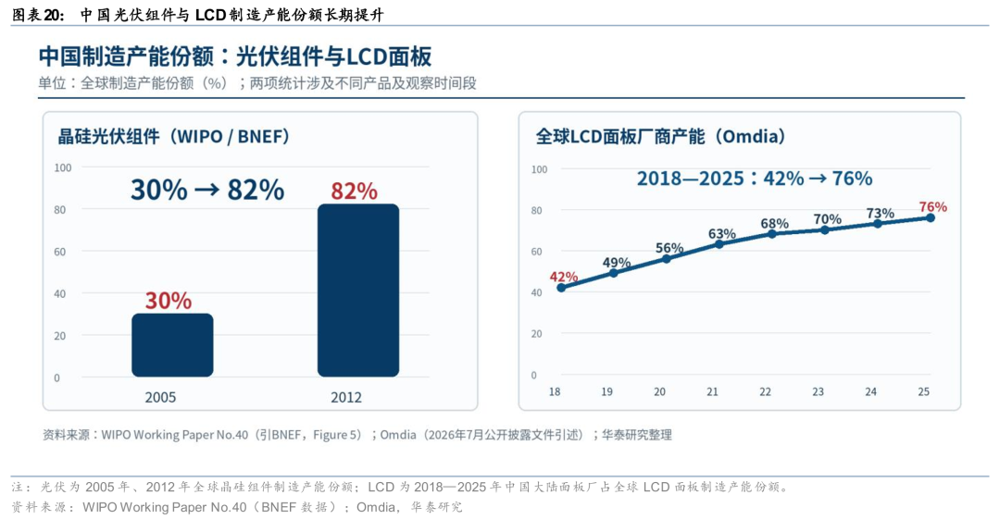

## 变现线索：从用户时长到替用户完成任务

作者把Meta Muse视作亮点：应用若进入检索、比价、日程协调和小企业流程，付费意愿可以与省下的时间和完成任务价值相关。图21为作者的应用发展时间线，图22为设计展示；最终下单仍由用户授权确认。演示未提供真实任务成功率或付费用户经济性。

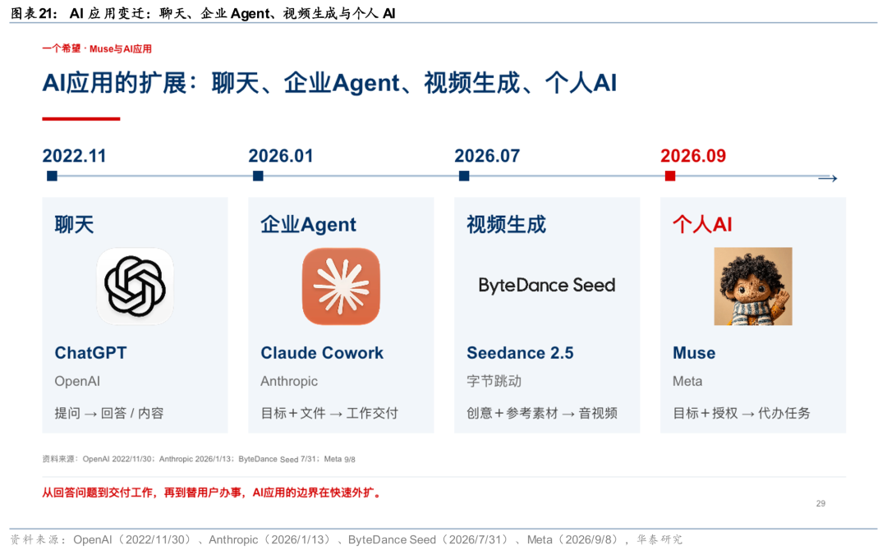

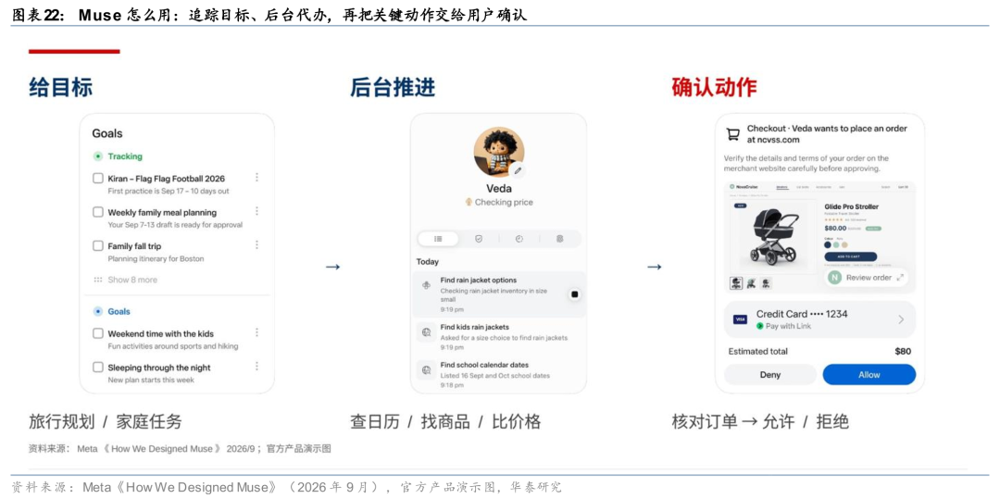

“按任务收费”在文中主要是价值方向，实际列出的收费为20美元与100美元月费的有限订阅测试。第三方称22天下载超过500万、周用户超过300万，下载、活跃与付费是不同指标，不能据此算收入。作者明确把付费人数、留存、续费列为待观察，尚无后来验证。本篇将它留在[Meta](../10_concepts/Meta.md)关联的事件线索，后续产品成本专题再形成连续认识。

## 当时判断与后续更新入口

华泰偏好M7相对SOX等排序，是10月走访后的机构配置观点，不作为图谱的交易指令。其可继续检验的判断是：融资报价和合同回款能否承接资本开支，送电与许可是否推迟起租，存储涨价能否被新供给消化，以及实际付费能否支撑应用收入。上述问题须按主体和日期接入新材料；本文没有把后续结果回填进当时判断。

[本地原文](../../../../materials/wallstreetcn/SourcePost/美国投资人在担心什么？/article.md) · [来源与逐图核读范围](../40_sources/S-WS-3784266.md)
