# 2026年1月黄金急涨回调与美元信用替代争议

华尔街见闻于2026-02-02转述中金刘刚、项心力等的研究，页面署名董静。作者试图解释黄金短期急涨急跌与长期储备替代为何能同时成立：价格关口可以迅速触及，信任、配置与制度调整则沿不同时间尺度发生。本记录保留文章完整论证、33张图和当时条件判断；未补入2月之后的市场结果。[来源与核读范围](../../40_sources/S-WS-3764710.md)。

## 先看短期：涨价、波动与私人持有怎样共振

文章称2026年1月金价一度升破5500美元／盎司，月内最大涨幅约25%，随后单日跌幅超过10%；它把沃什提名描述为回调的催化剂。作者用图1展示2022年后金价与实际利率的偏离，用图2展示其美元、实际利率、不确定性和动量四因子拟合近期误差扩大。这些图片描述相关路径与作者的样本拟合，没有给出参数、估计窗口和可复算残差，本库不将其注册为通用金价模型。

图3的14日RSI接近90，图4显示黄金隐含波动率指标相对2025年初显著抬升。图4将不同资产波动率指数归一到2025-01-01=100，曲线高低表示相对各自起点的变化，不能直接当成各资产绝对风险大小。图5的0.98是两年滚动相关性，既可能来自追涨，也可能来自共同消息或买盘作用；它不提供因果份额。

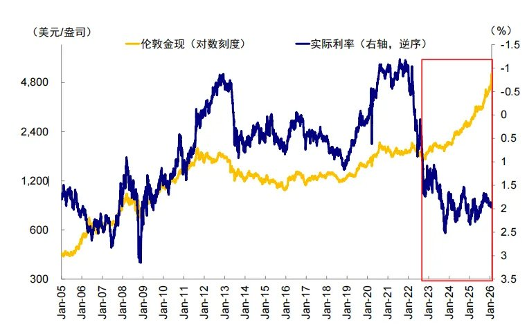

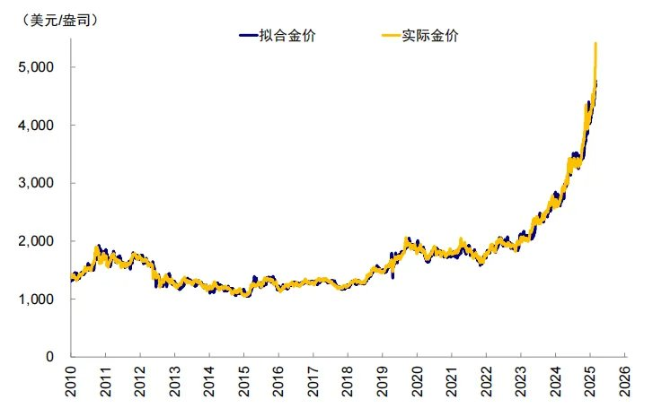

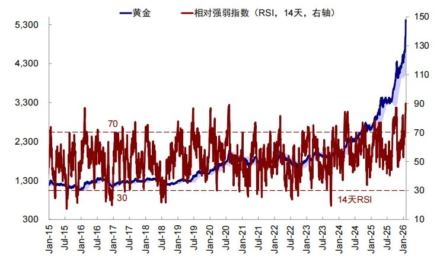

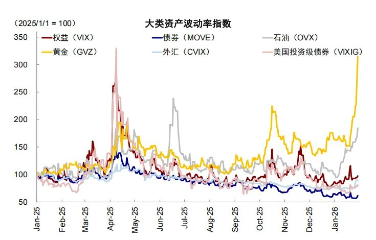

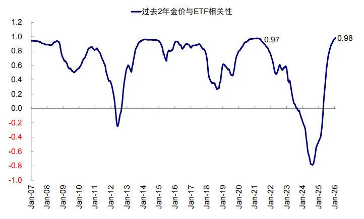

## 5500美元关口：比较两类存量值，仍要回到持有意愿

作者将存量黄金市值38.2万亿美元与美债存量38.5万亿美元并列，比值约0.99，称其为1980年代以来首次接近。这是一种名义规模比较：金价上升可在黄金数量变化很小时迅速推高分子，美债分母则受发行和统计范围影响。全球存量黄金包括首饰、官方与私人持有，不能当成央行可自由调配的黄金。图6—7没有在本地版本提供可复算的存量序列及债务估值细则。

两类存量接近可以成为市场叙事和配置讨论的参照，没有使持有人必须交割、偿债或改配的合同约束。作者真正提出的条件是：若边际储备管理者因此更重视美元资产的集中与真实回报风险，新的配置意愿可能形成持续需求。这个过程需要具体数量与行为证据；“触及5500”本身不构成内在价值上限或下一步价格预测。基础区别见[黄金的存量比较](../../10_concepts/黄金.md#stock-comparison-202601)。

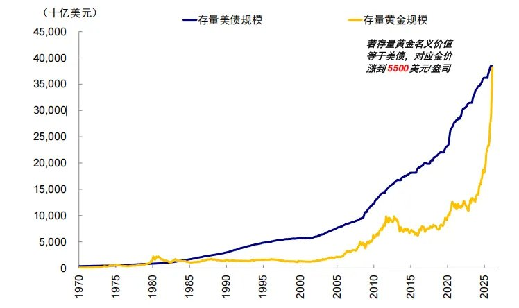

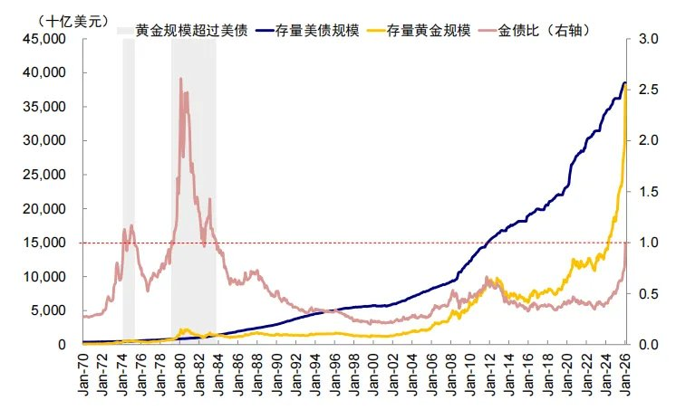

## 上涨解释：美元、机会成本、风险保护与买家结构

作者先逐条比较候选解释。按文章观察，2022年9月以来美元指数从114降至约96，黄金从1622美元／盎司上涨约239%；2022年以来金价与美元回归R²为0.2339，1970—1980年为0.5695。两个R²是特定样本的拟合指标，不等于美元造成了23%或57%的涨幅。

文章又列实际利率在2022年9月至2023年10月由约1%升至2.5%，2025年11月以后由1.7%升至1.97%，与金价同升。这个观察说明其他因素可能抵消[机会成本](../../20_mechanisms/黄金的机会成本机制.md)的作用，未把该机制永久取消。图11中的政策不确定性同样可反映风险保护需求，但双轴同向不能单独识别其价格贡献。

买家结构提供另一条线索。中金图16列2022年以来中国、土耳其、印度黄金分别增加357.1、253.2、132.6吨；图12的新兴央行同比净增在2023年初附近较高，后续放缓。正文将低点与高点写成“2024年8月至2024年1月”，时序倒置，本次保留原图，不据该句补造精确峰值月份。GLD则据文章从2024年3月约821吨回升到约1087吨。分主体看，官方购买放缓可以与某些私人渠道持有回升并存。

[SPDR黄金信托GLD](../../10_concepts/SPDR黄金信托GLD.md)让私人产品渠道具备一个持续观察位置。吨数、份额、费用耗金与AUM分别核对；金价与持有量的共同上升还要与其他基金、场外及官方数据比较。本次没有复算GLD逐日序列。作者称其规模占黄金ETF约27%，该比例的精确产品集合与统计日未在转述中展开。

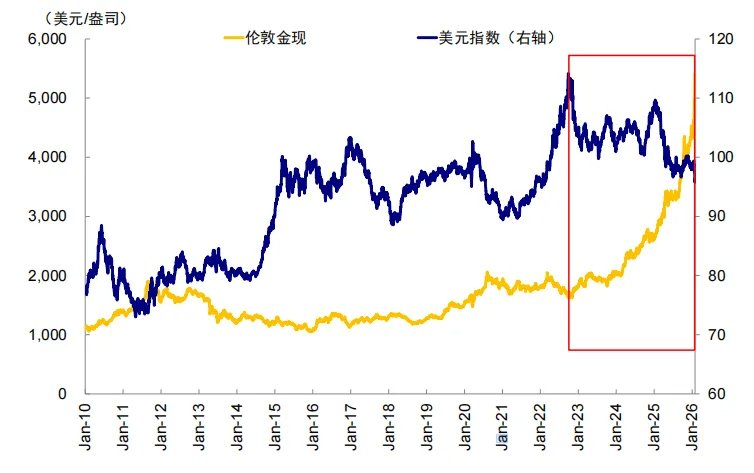

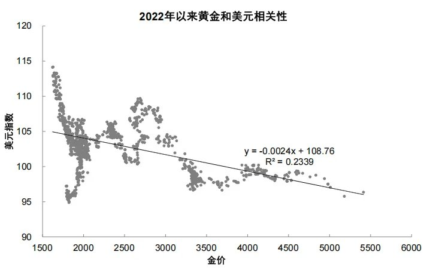

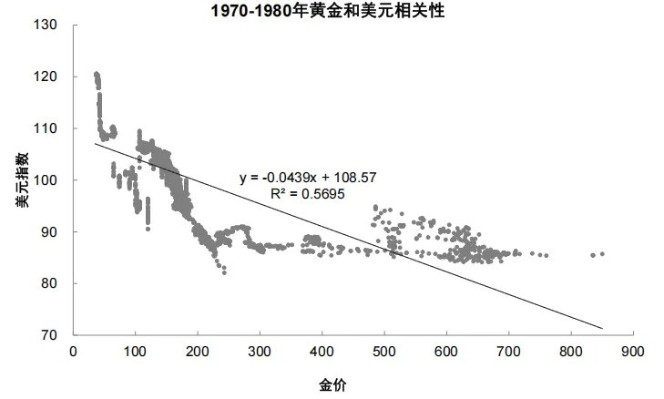

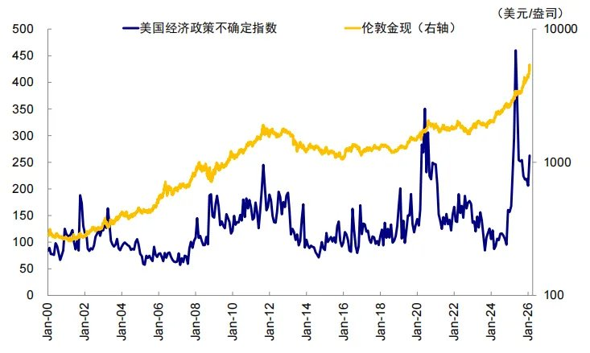

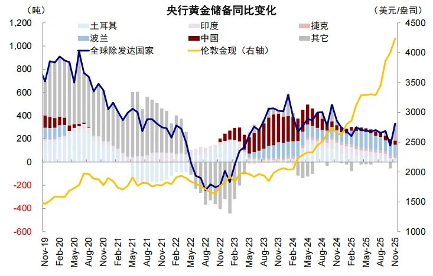

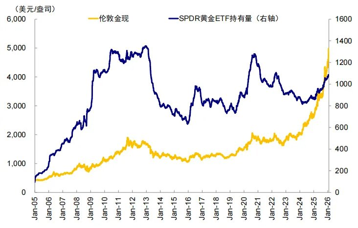

## 美债风险为何进入黄金讨论

中金把其担忧概括为偿债支出更刚性、外国持有占比下降与黄金相对市值上升。图14的“利息覆盖率”实际定义为利息支出／财政收入，较高意味着收入中用于付息的比例更高；该文图末标18.5%，图28的2025年均值则为19.8%，并非可以直接拼接的同一时点。原文提到评级机构15%“警戒线”，没有给出评级方法原件，本次不把这个值设为普遍评级触发规则。

外国投资者持有比例由2014年约34%降至2022年约23%、其后约25%，还涉及美债总发行变化与私人、官方的构成。占比下降可以伴随持有美元金额上升，不能只凭份额指定全球储备管理者的动机。美债真实回报、价格和法律可动用性分别影响持有，本文没有依据原文“美债不可能违约”的表述将支付风险设为零。

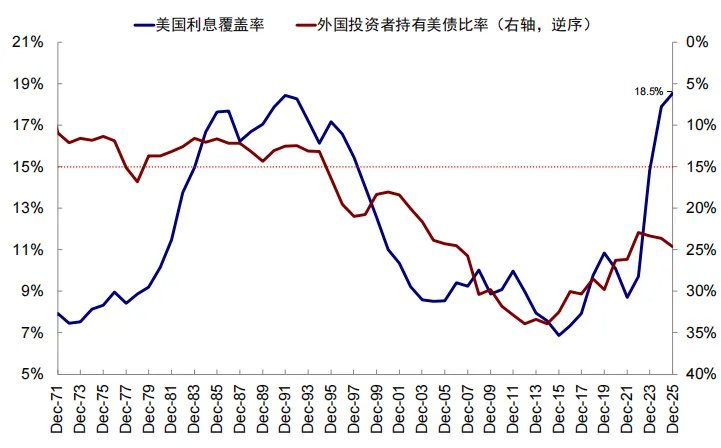

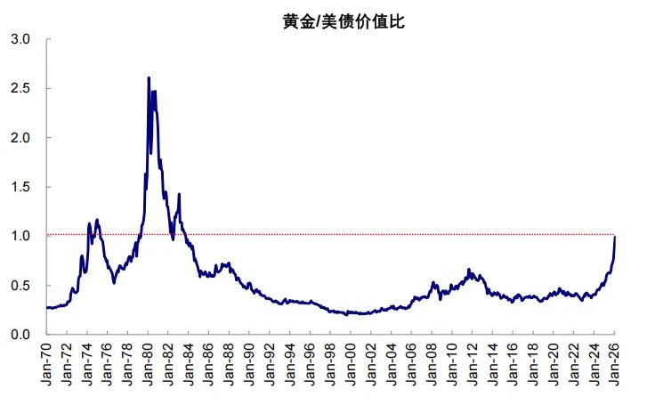

## 国家配置比较：官方黄金与国家名下美债并不覆盖同一批持有人

图16是官方黄金数量，图17则按国家列美债累计持有变化：图题为2024年以来，正文另以2025年以来列英国1657亿美元、日本1411亿美元、比利时1064亿美元的增加。两个起点各自保留，不能用一组数字替代另一图的完整累计量。

图18按交易时段切分金价，文章列2025年以来亚洲、欧洲、美洲累计约33.5%、9.7%、11.2%，2026年初约11.4%、0.3%、2.0%，截止1月29日。时段不是最终买家的国籍，也没有识别谁持有何种资产。图19则按基金地区分ETF流量，单位百万美元，文中2026年初亚洲、北美、欧洲分别约49.5、48.9、33.6亿美元，截止1月23日；这些地区基金流量与交易时段收益不是同一统计维度。

图20以黄金占外储15%和国家名下美债／外储50%划分象限。其美债数据明确含官方与私人，黄金则为官方储备，无法据此直接重建央行资产组合。加拿大和挪威美债比值达372%和242%，恰好表明分子跨出了官方储备范围。若私人部门持有或托管归属变化，它们仍可进入国家统计。图中高于坐标范围的国家用空心符号及括号值标出；读数应取其标注，不能沿压缩后的点位外推。

图21再比较2025与2023年比例变化。黄金涨价本身提高市值占比，美债分子和储备分母也会变动。作者将不同国家分成相对偏好美债、偏好黄金或双重持有等阵营，适合保存为研究框架；确认主动改配仍要核官方身份、数量、交易和托管。详解在[美元信用与储备多元化](../../20_mechanisms/美元信用与储备多元化.md#country-holder-scope)。

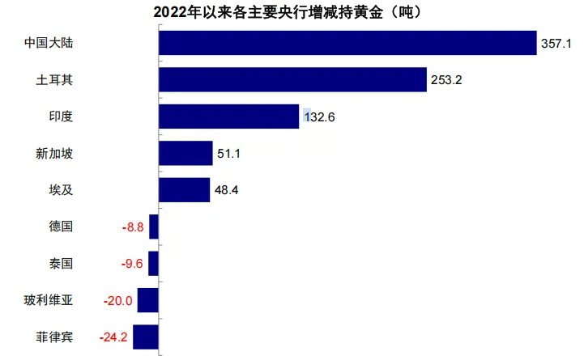

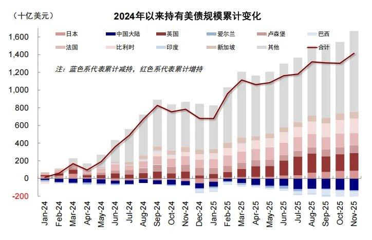

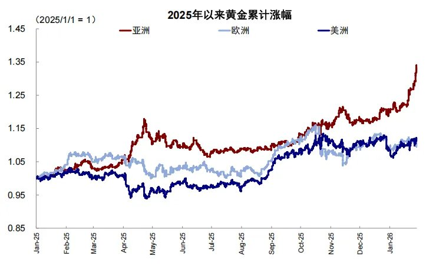

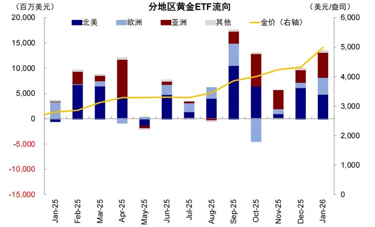

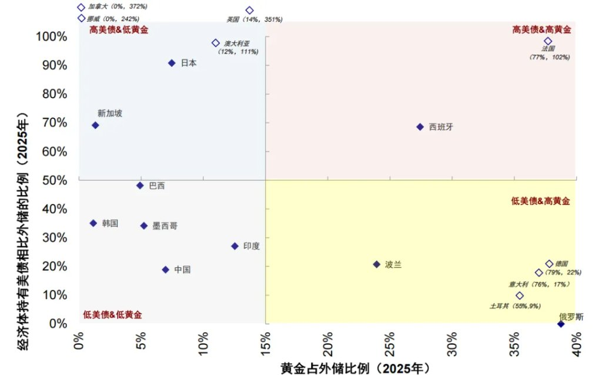

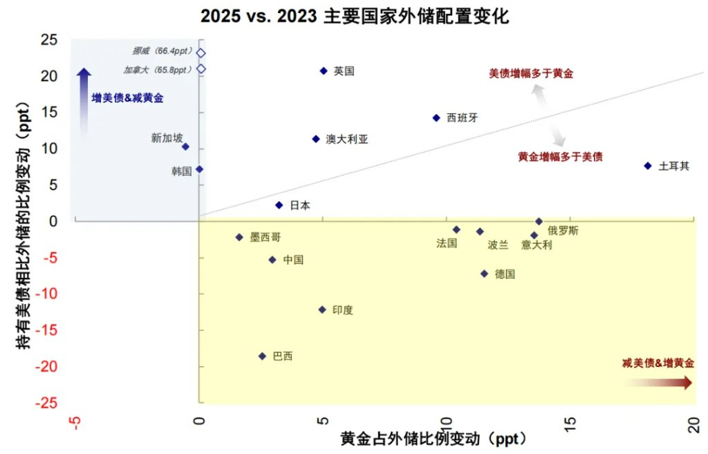

## 局部资产分散与美元体系继续运转可以并存

作者同时援引不同功能的量：2025年三季度美元在全球外汇储备份额约57%；含黄金总储备口径下黄金占28.6%、外国官方持有美债占21.3%，黄金按1月30日价格重估；2025年12月SWIFT支付份额美元50.5%、欧元21.9%，贸易融资份额美元79.5%、人民币8.3%。这些量的分母、覆盖与时期不同，不能拼成统一的“美元地位指数”。SWIFT资料还只覆盖其统计范围，并非全部全球支付。

作者的推断是美元体系可能局部松动、储备逐步分散，同时交易网络、流动性、收益与容量继续支持美元使用。黄金对无发行人依赖的保护有价值，但日常美元支付仍需要可用货币及流动资产。比较新增黄金配置与支付使用，可以观察不同功能变化的快慢；单看黄金市值不能判定支付体系已切换。

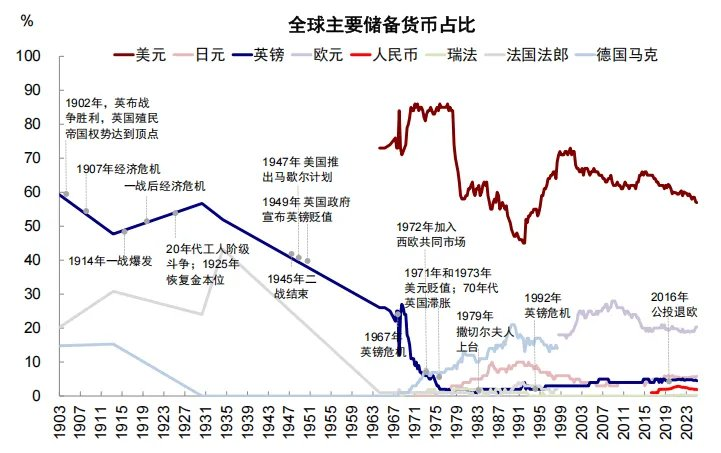

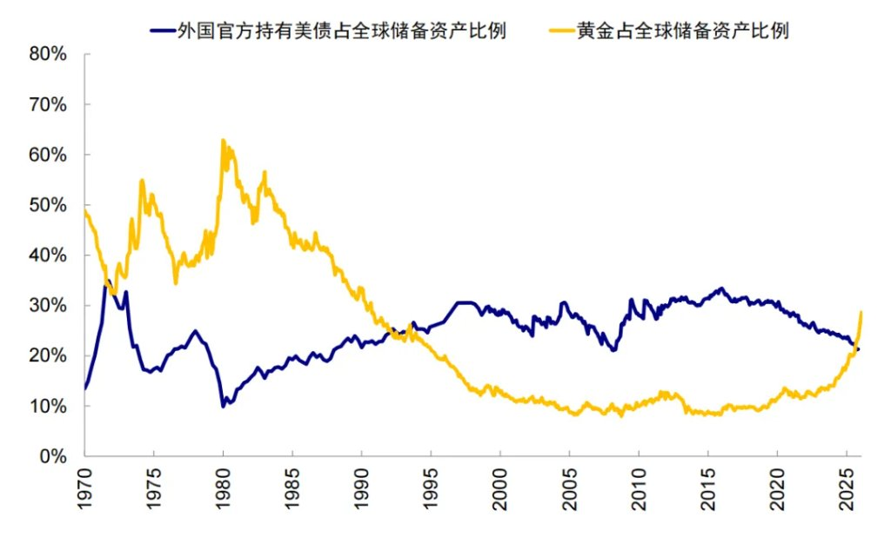

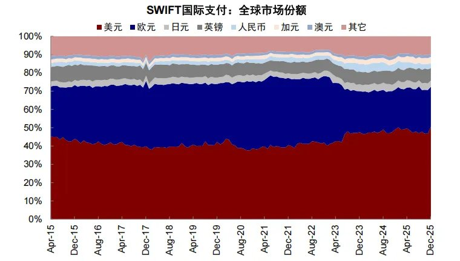

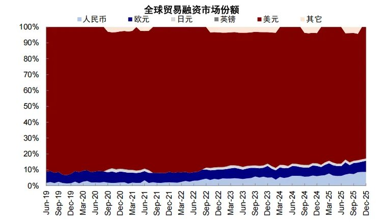

## 1970—1980年代比较：相同规模关系没有给出相同后续路径

中金图26列两段黄金名义规模超过美债的窗口：1974年4月至1975年4月，持续13个月，距黄金高点8个月、涨幅约9%；1979年5月至1983年9月，持续53个月，距高点7个月、涨幅244%。这两段是作者按其存量序列划定的事后窗口，不构成当前金价必然再涨相同幅度的样本规律。

第一段的叙述连接美元浮动、第一次石油危机、通胀与政策反复；随后供给侧通胀放缓和美国政府拍卖黄金等变化进入回落解释。第二段连接伊朗革命、第二次石油危机及实际利率变化，继而讨论沃尔克1979年10月后紧缩与1980年代美元走强。文章所列有效联邦基金利率从11.4%升至19.1%、实际利率随后转正，属于历史回顾，并非当时投资者已知的完整路径。

图28的债务表以十亿美元计：1979年5月为805，即0.805万亿美元；正文后文却写“1979年8万亿美元”，数量级不一致。本记录采用图中单位说明该差异，不据这句正文重建债务史。表中1979年5月债务／GDP31.1%、利息支出／收入9.2%，2025年期内均值121.5%、19.8%，为作者讨论政策代价的对比；长期制度、通胀及经济结构同时不同，不能据两比率推算今天可承受的精确利率。

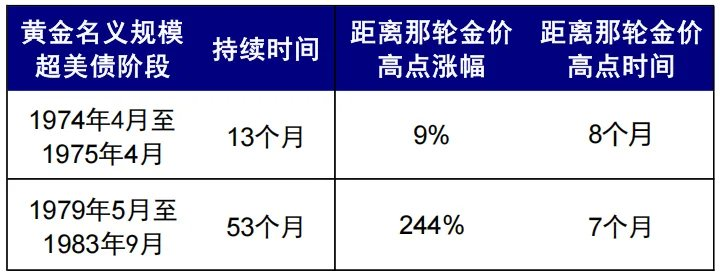

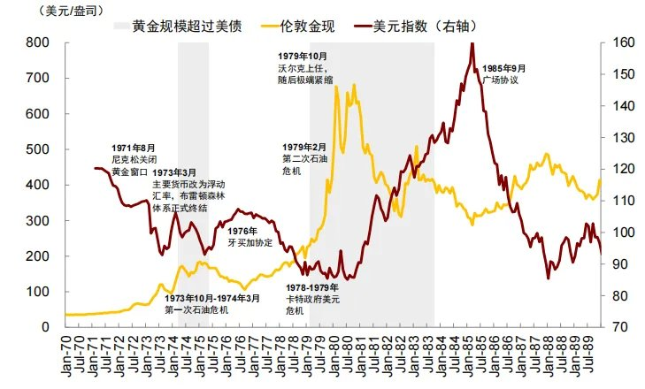

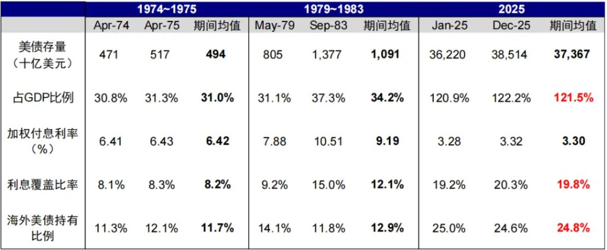

## 当时的政策判断：如何重塑信任，以及代价落在哪里

作者用低通胀、低利率和美元主导地位“三选二”描述政策张力。它是对当时通胀、债务与政治条件的判断，尚未给出这三个目标在任何状态下都无法同时改善的定理。图29汇总沃什自2025年以来主张降息、缩表和机构分工的发言；本文按文章转引保存，未另核其每次完整演说。

作者设想AI提高效率、抑制通胀后，为降息腾出空间，同时缩表重塑资产负债表纪律。但短端政策利率、长期收益率与融资成本分别受到预期、供给和风险溢价影响，缩表也会改变私人部门持券及资金条件。图30显示公共持有可流通美债以中长期为主，图31显示美联储持仓也以中长期为主；正文21.6%的短债占比与图30末端约15%未能按同一口径直接匹配，本次不据此计算确切腾挪规模。

图32—33的两个QT窗口尤其说明，资产负债表收缩与黄金方向并非简单一一对应：作者表中2017年10月起缩表后1个月、3个月、全程金价为−0.4%、1.8%、12.9%；2022年6月起为−1.9%、−8.0%、129.2%。后一个全程在图中定义至2025年12月，前一个至2019年8月。窗口长度、共同消息与起止时点不同，这些总回报不能当作QT独立处理效应，也不据图中窗口确认所有制度安排的实际终止日。

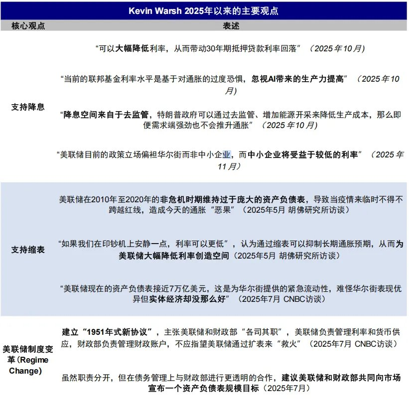

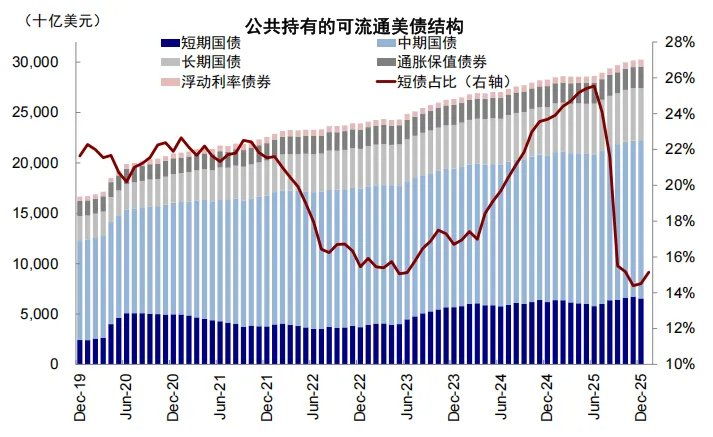

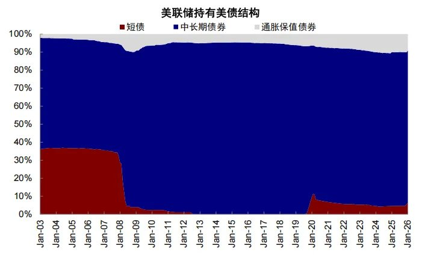

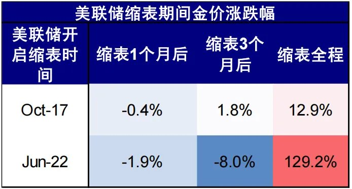

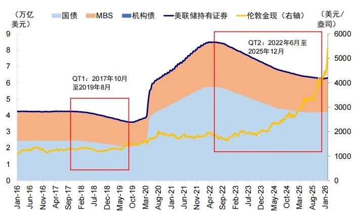

## 截至2026年2月2日的判断及其检验方向

中金判断，彻底终结黄金趋势需要看到美国在财政纪律、货币约束、盟友合作或真实资产回报方面重建信任；行政卖金或税收可能造成短期冲击，但未必解决长期配置动机。作者没有给出终极金价目标，也明确两段历史的后续涨幅相差很大。

这组判断包含不同期限：短期回调涉及拥挤、波动和政策催化；较长配置变化涉及储备管理目标及美元资产保护能力。原文没有给每条路径明确兑现期限，本记录不补成量化概率或交易阈值。作者的“定投”建议保留在原文，本库不将其转为图谱的投资指令。

本库于2026-11-16按当时资料形成的条件推演是：若后续多个官方管理者在估值调整后仍增加黄金数量，且有公开授权或风险理由对应，局部储备替代解释会增强；若仅有涨价提高的黄金份额，应降低对实际改配规模的判断。若私人产品持有量转弱而官方数量仍增，可以同时出现短期价格压力和较长配置需求。再研究实际利率、美元、财政付息和制度动作，才能区分几种驱动。本文没有接入后来结果来裁定它们。

## 关联

[黄金](../../10_concepts/黄金.md#stock-comparison-202601) · [SPDR黄金信托GLD](../../10_concepts/SPDR黄金信托GLD.md) · [央行购金与黄金需求结构](../../20_mechanisms/央行购金与黄金需求结构.md) · [美元信用与储备多元化](../../20_mechanisms/美元信用与储备多元化.md#country-holder-scope)。
