# 924两周年的恒科回撤：居民信用、盈利与资金分化

2026年10月13日，中金刘刚、张巍瀚借恒生科技接近2024年9月24日水平，追问：经济总量、出口与AI产业仍增长，为何指数回报与盈利如此弱？本页整理这篇当时分析，观点和图表归原作者；新增的口径辨析在相应段落说明。文章中的年末政策、11—12月投放及产业催化均保留为当时预期。本次没有用之后的行情倒推其正确性。

[原材料](../../../../../materials/wallstreetcn/SourcePost/中金：924两年后有何变化？/article.md) · [来源记录](../../40_sources/S-WS-3783497.md) · [后续11月2日观察](港股价格底、信用周期与股权供求：2026年11月观察.md)

## 问题从哪里出现：总量增长与组合回报分离

文章记恒科年初至10月9日下跌23.9%，从2025年10月高点回撤接近40%。图2以2024年9月24日为100，标2025年10月2日170.7、2026年10月8日104.0；正文另一比较窗口又列相对924上涨7.2%。这些数有不同日期或选点，不能合成一条精确同日行情。作者回顾自己2025年末以来的谨慎判断，将此前上涨主要解释为政策脉冲和资金再平衡，认为并不自动打开持续牛市空间。

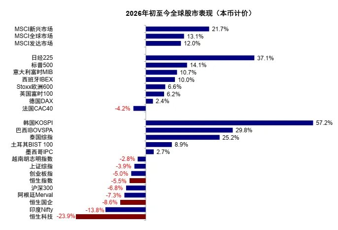

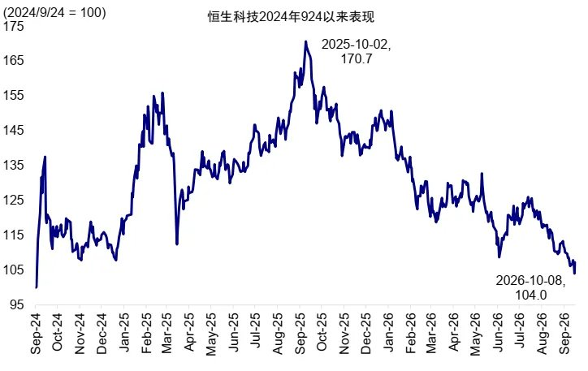

## 信用分到谁，比总量是否增长更能解释业务需求

作者把恒科称作“大号消费指数”：其业务分组中的互联网35%、电动车14%、电商13%、消费电子10%，合计72%；这些企业的广告、交易和产品销售受到居民支出影响。恒指多了本地金融、银行、电信等业务，暴露不同。这是研究者的业务分类，不能替代恒生正式行业，也不说明全部收入都来自内地家庭。指数选样规则和权重定义见[恒生指数与恒生科技指数](../../10_concepts/恒生指数与恒生科技指数.md)。

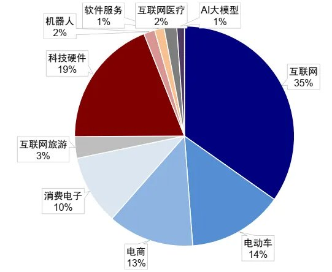

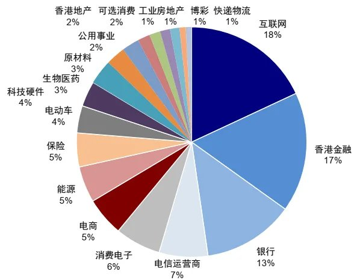

中金认为，924之后财政支持及居民端补贴曾带动信用修复；2025年三季度后居民信用脉冲转弱，2026年3月低于924水平，企业信用却仍有科技和出口链条支撑。企业投资改善可以与居民消费偏弱并存；这给出了指数内部消费与科技分化的一条解释线索。信用、股价与政策还可能受收入预期、房地产等共同因素驱动，图中的共同起伏没有分离各自因果贡献。

图5—6采用作者信用脉冲，未给完整公式、季调与分组底稿；双轴走势不能校准固定领先期。图7是作者标注的企业/居民“存量社融同比”，正文另说居民贷款余额首次净减少，二者不能互作官方同口径确认。融资流量、存量增速与信用脉冲的区别见[社融结构与实体需求](../../20_mechanisms/社融结构、信用脉冲与实体需求.md#logic-1)。

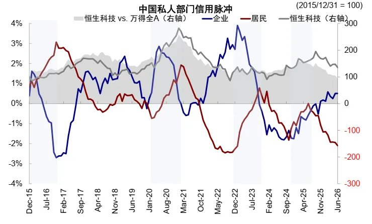

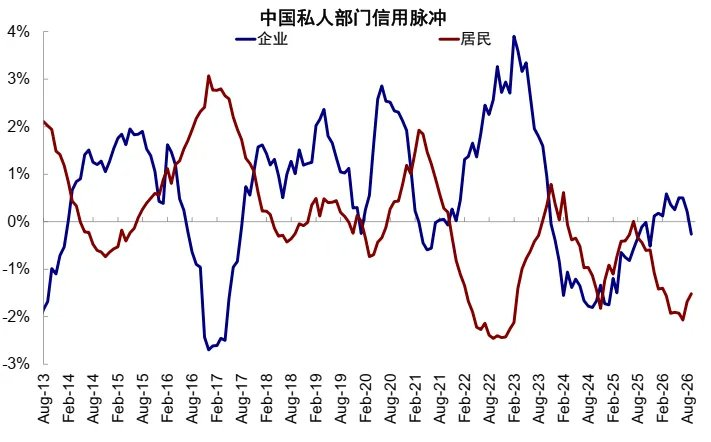

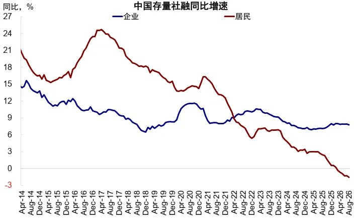

作者的政策解释是：收入与信心修复缓慢、地产拖累之外，2026年财政更多倾向科技产业，对居民端的支持相对减少；其广义赤字率估计8.1%，2025年8.5%，属于作者广义口径。零售图反映以旧换新相关品类先强后弱，不能单凭它估计补贴政策净效应，基数、提前购买和品类构成都可能影响走势。

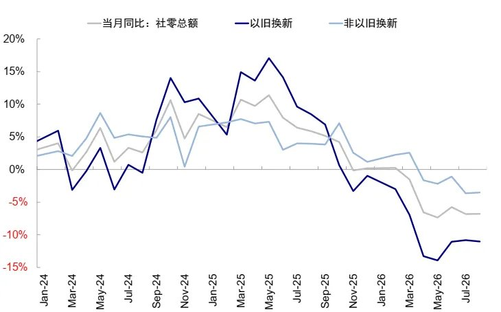

日本1990年代三轮反弹被作者用作类比：1992—93年约12.8个月涨54%，1995—96年约12.6个月涨44%，1998—2000年约16个月涨79%，其间均有财政或金融支持。作者借此强调刺激消退、资产负债表问题未解决时，较大反弹也可能留在长期震荡中。这是筛选的历史比较；政策、银行重整与经济条件同时变化，不能由三个案例断言财政收缩单独结束每轮行情，也不能据“一年左右”设定港股反转时钟。

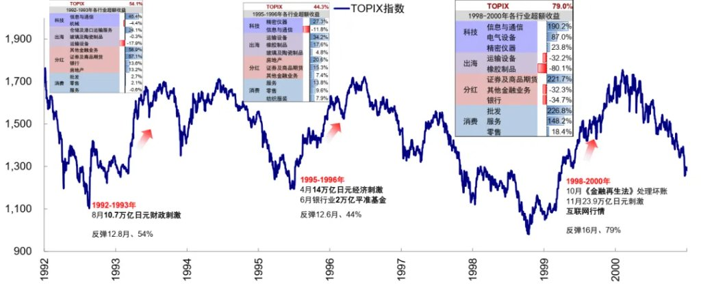

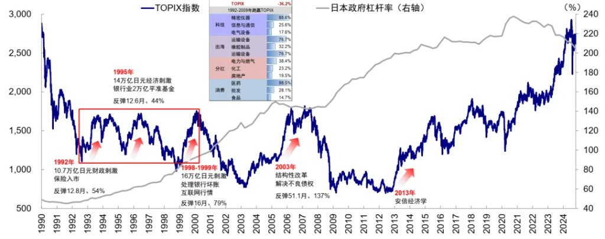

## 科技行情并不覆盖每一个科技指数

作者认为2025年的计算芯片、云厂商主线，到了2026年更偏存储硬件；港股硬件覆盖不足，平台公司的AI研发、资本开支与收入兑现也未充分抵消消费走弱。图11的计算芯片和存储使用右侧对数轴，其他线使用左轴；线条高低不能直接作为同刻收益比较，更不能当作算力实物需求。

图12的Artificial Analysis表现指数与每token价格比较的是特定模型及其测试/报价。它能帮助检查模型能力与成本位置；不能独立证明企业全部研发能力落后，也不能由模型测评直接推断商业化利润。文中“平台落后”的综合判断还需公司经营和投资证据。

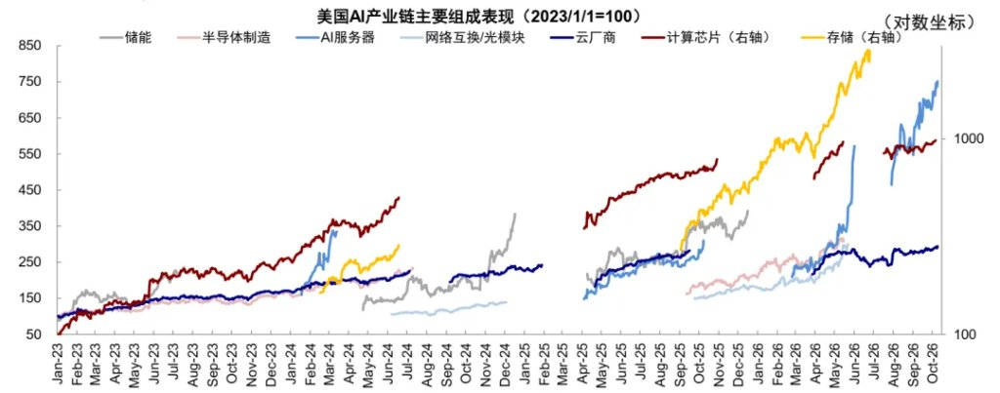

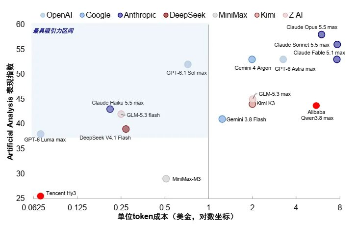

## 资金承接变弱，发行供给增加；持仓比例不能当净流量

正文比较2025全年南向净流入约1.4万亿港元与2026年前9个月4418亿港元。时间窗口不等长，不能直接把两个总额相除写成同长度流入下降约70%。图13月度柱以十亿港元计量。作者同时提出资金与行情互相强化：价格和预期改善吸引买方，走弱又促使撤出，因此资金方向本身不能完成基本面归因。

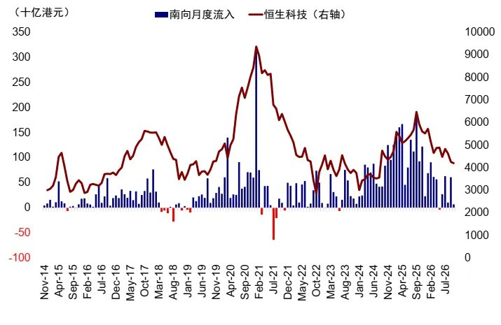

内地可投港股的主动偏股公募，港股市值占股票投资市值由2025年二季度32.1%降至2026年二季度15.1%；按基金总规模作分母的蓝线则由28.0%降至13.0%。这是两种持仓比例，股价变化、申赎与主动配置都能改变它们，不能据比例下降倒推出等额净卖出。EPFR图涵盖其全球、全球除美、亚洲除日与新兴市场基金样本，主动基金中国股权重截至2026年8月约6.0%，2025年中约7.2%；它不是全体外资持有中国股票的比例。

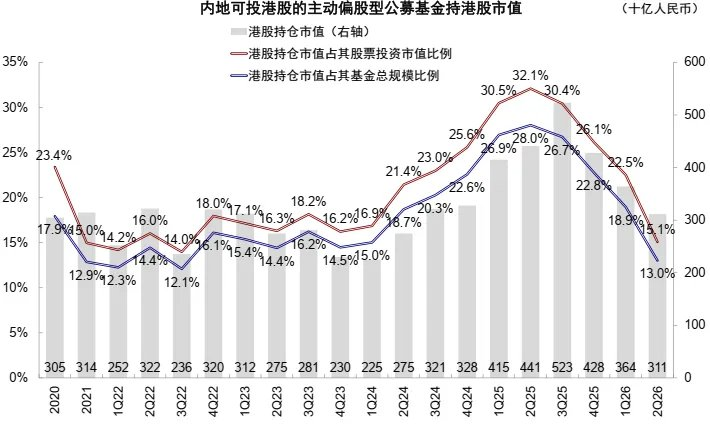

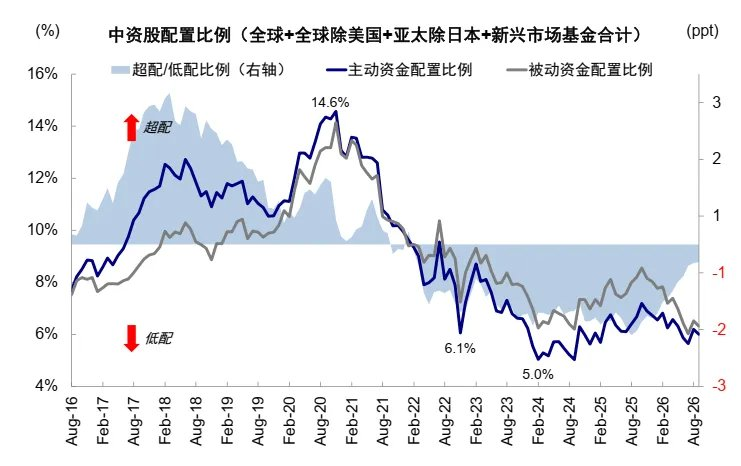

正文称2026年IPO与再融资7150亿港元，超过2025全年6138亿。图16按十亿港元显示2025年IPO287、再融资359（合计646，即6460亿）；2026年IPO388、再融资336（合计724，即7240亿），与正文两年总数均不一致。本次未获得统计底表，分别保留，不能择一混填港交所官方年度表。发行增加可提高新增股权承接需求，但金额并不直接给出净买盘缺口，回购、分红、原股东出售及投资者现金配置也需考虑。[IPO与再融资](../../10_concepts/IPO、再融资与退市.md)保存工具区别与后续材料。

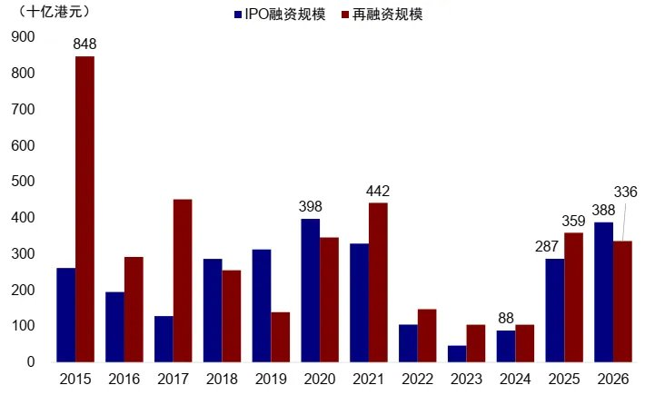

## 924以来回报拆开看：盈利、估值与成分分化

作者将恒科相对924的7.2%上涨分为盈利贡献2.8%、估值4.4%；恒指与MSCI中国约涨25%、17%，万得全A约50%，科创50与创业板约118%、88%。这批比较依赖各自选点、样本、币种和回报版本。原文没有完整说明图17的分解算法，不能把结果当作可由本文复算的通用定价模型。

其中无风险利率代理按南向成交比例动态加权中债与美债，作者记美债收益率由3.7%升至5.2%，对恒科估值的贡献为−13.7%，风险溢价改善贡献+18.1%。这保留为作者的归因输出；成交权重不是全体投资者边际要求回报的直接观测，未列期限和复算底稿也限制了跨期复用。

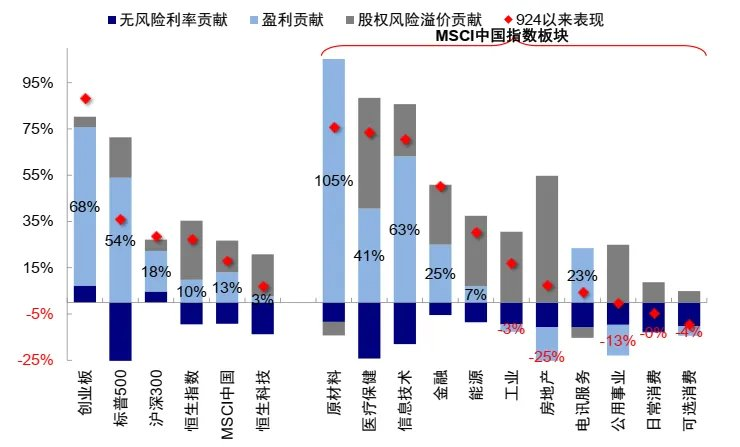

通信设备、半导体与电子设备自924涨约114%、113%、108%；酒店餐饮、个人用品跌逾30%。因此“科技强、消费弱”既发生在市场之间，也发生在港股内部；不能由指数总回报抹平成所有港股科技都弱。

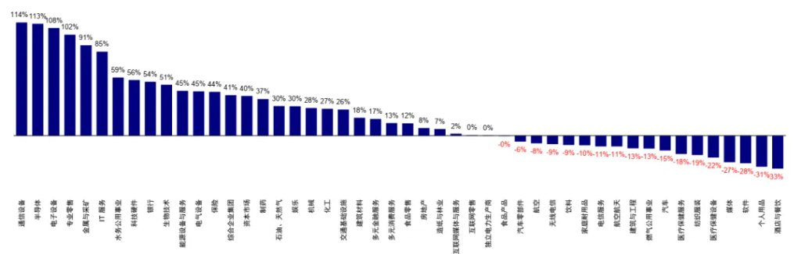

文章列恒科12个月动态PE约14.2倍，接近其所选924前14倍；动态EPS累计约增2.5%，恒指与MSCI中国约增10%。同文创业板EPS正文约增69%，图20图注写65%、图中末值168.3；图19恒科起点标签13.2，与正文14倍也不完全一致。缺少精确选点和底表，本页不把这些差异修造成同一精确时间序列。动态PE和EPS使用未来盈利预测，预测上调与已实现利润增长需要区分。

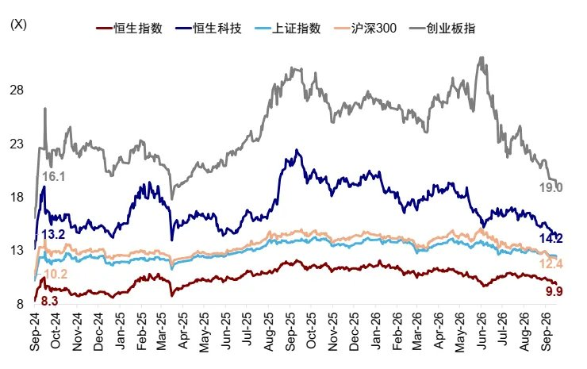

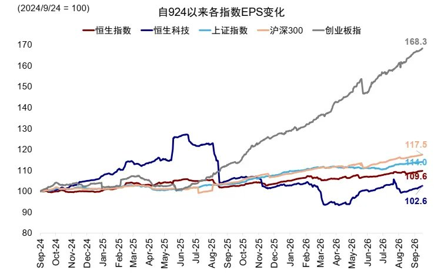

## 实际增长进入股东回报，还要经过价格、利润与资本使用

作者比较2025年名义GDP：美国约5%、中国约4%；中国实际增速约5%却更高。图21年度序列不能与正文不同时间窗口的美国实际增速约2.2%混用。实际产出数量与名义销售收入之间隔着价格，公司收入又取决于业务地区、行业和份额，指数成分并不覆盖整个经济。

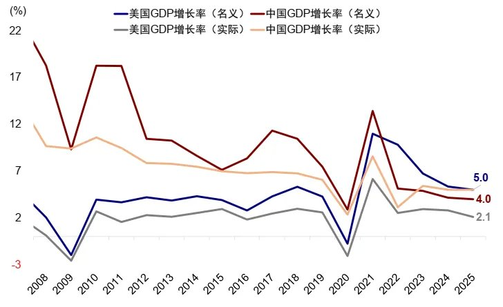

收入之后还有两层：第一，价格竞争、原材料成本与汇兑损失可能压低利润率；第二，扩产、存货和应收款占用资金，利润增加也未必改善周转和资本回报。借债扩产还改变杠杆与风险；ROE较高也可能含杠杆贡献，需要与回款和负债一起看。

中金列2026年上半年港股非金融企业毛利率22.8%、净利率6.4%，仍低于2018年上半年25.8%、8.3%。文中消费毛利率由2025上半年29.6%降至2026上半年28.8%，净利率9.4%降至7.3%；信息技术毛利率17.4%升至18.9%，半导体净利率3.8%升至9.0%。图22“科技”曲线与正文“信息技术”的数值不完全对应，分组样本未详述，不能用图中科技线直接复核IT精确值。这组数保留为文章财务比较，没有再核上市公司样本和报表。

作者还列制造业应收账款回收周期超过70天、产成品库存周转21天，用来说明营运资本被占用。它们不是所有恒科公司的共同账期，也不能按这两项直接计算恒科ROE。更有用的阅读次序是：先找具体成分收入，再看价格/成本进入利润，最后看新增资产、回款与分配是否支持股东资本回报。

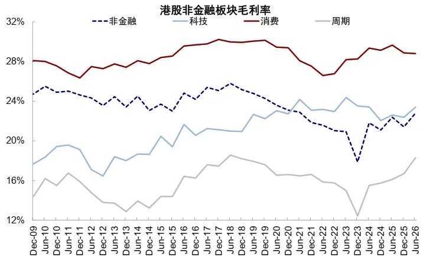

## 当时怎么判断反弹与趋势逆转

截至10月13日，中金列恒科14.2倍动态PE、约2.9%股权风险溢价、14日RSI一度27.7，以及近期南向回流，判断短期反弹的潜在回报较有吸引力。这些指标给出当时的价格、情绪与承接状态；RSI阈值不能确认未来一定上涨。图24的“胜率”“赔率”构造和样本没有披露，不能把图中坐标解释为校准的真实上涨概率或通用择时模型。

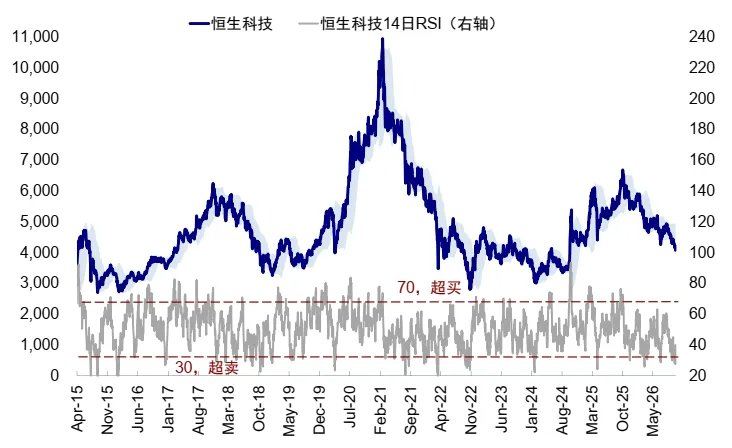

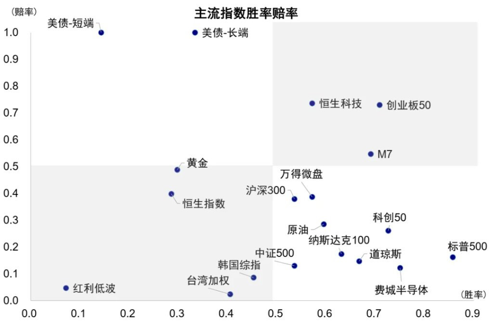

作者对持续逆转提出两组条件：财政更多直接支持居民，带动家庭信用与消费修复；或互联网龙头在AI技术、业务兑现上出现新的产业催化。其当时估计，5500亿元地方政府债务结存限额主要于11—12月投放，较去年同期多约500亿元，可能小幅抬升四季度广义财政赤字脉冲，但对居民端仍需更多支持。此处没有补核财政原始公告，额度、发行、拨付和居民支出是不同环节；预期不等于已实现量。

在配置层面，作者当时等待科技产业催化、加息担忧缓解和年底财政信号，未出现时偏向红利对冲，并列能源、交运、保险等行业的相对位置。这是10月13日研究观点的历史记录，不转写为本库当前交易建议。本文未追踪随后行情来验证反弹、5500亿元执行或模型研发是否兑现。

从本库维护角度，这篇文章最可复用的解释是：同一宏观改善进入不同部门、业务和融资用途，形成不同收入与回报。后续材料应在同口径时间线上检验居民信用、财政支付、成分盈利修订与资金承接的变化；[11月2日分析](港股价格底、信用周期与股权供求：2026年11月观察.md)作为之后的研究判断独立保留，不能反向改写本文事前立场。
