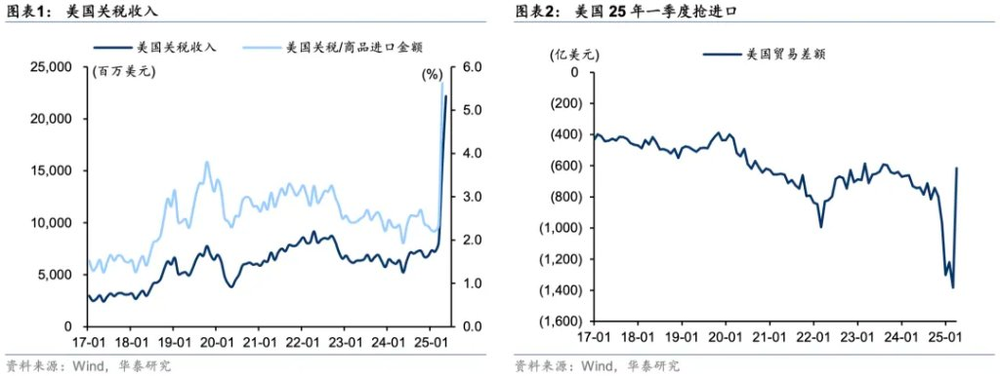
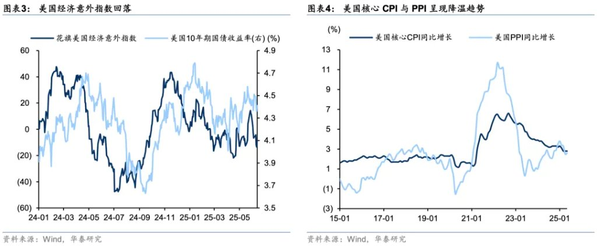
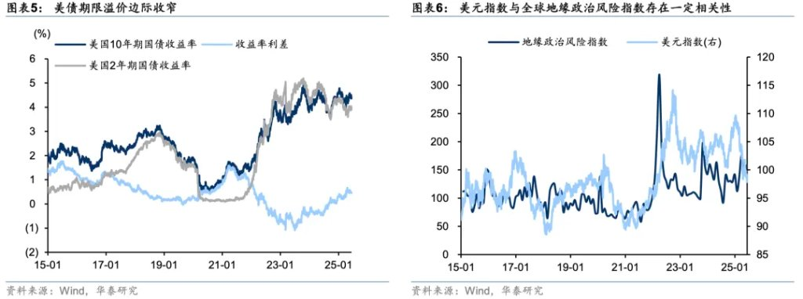
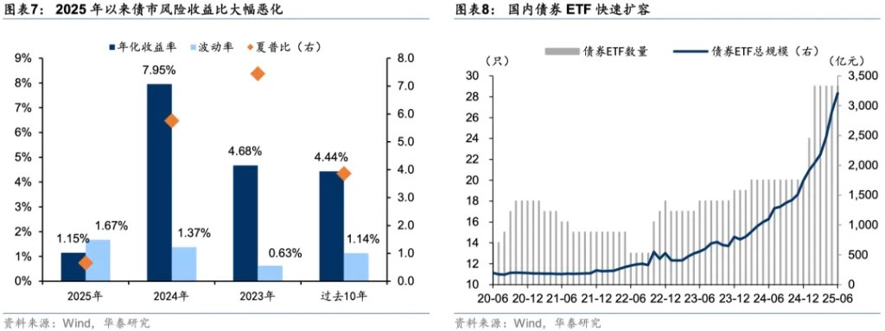
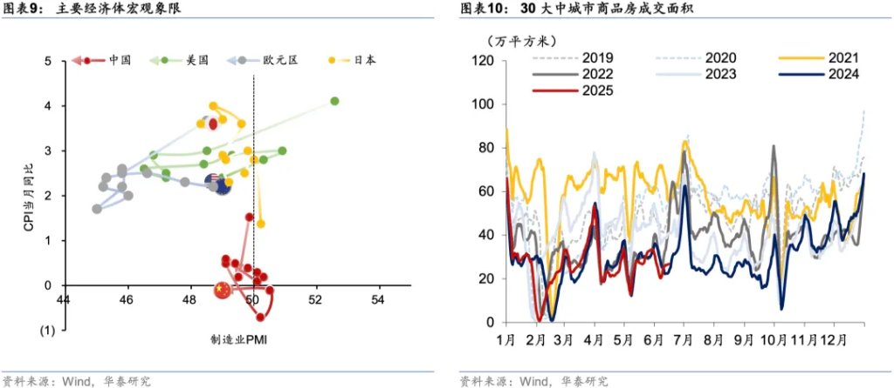
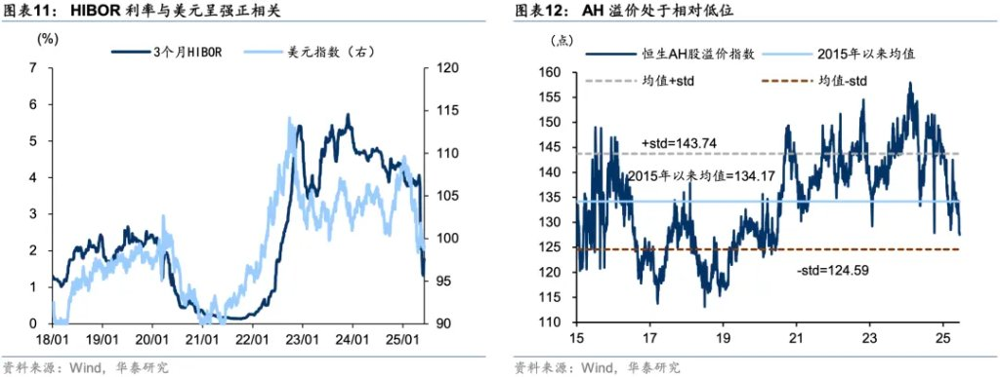
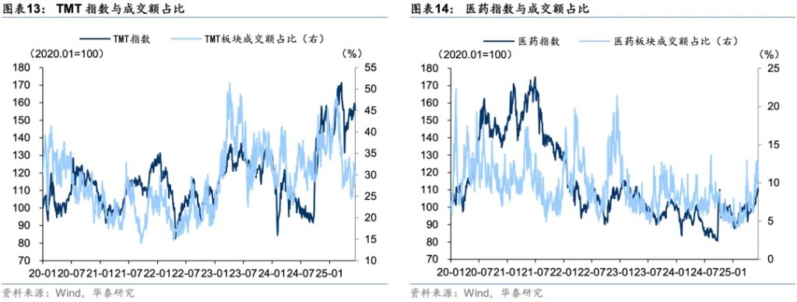
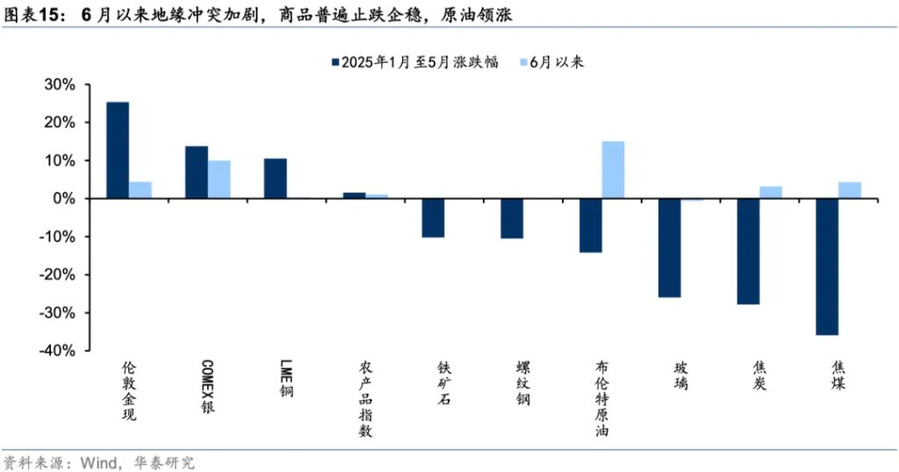
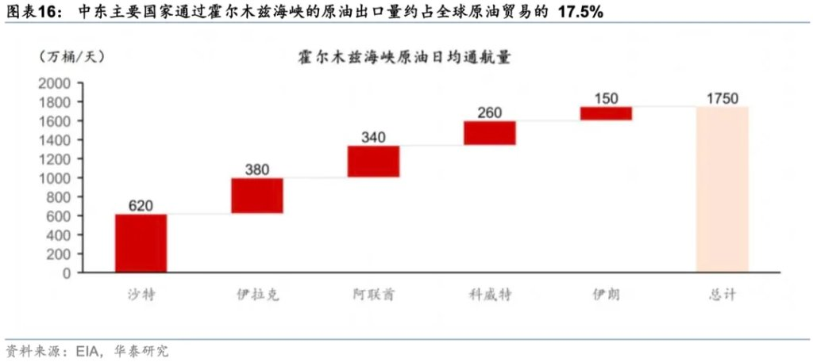

# 五组市场叙述与条件预期差：华泰2025年6月跨资产判断

2025年6月19日，华尔街见闻董静转述华泰证券张继强、陶冶、王建刚的资产配置研究。团队认为，市场关注正在从关税消息转向经济数据和地缘局势；先前流行的几种判断，可能在不同期限遇到反向信息。本文的“五大共识”是团队归纳的市场叙述，未附调查或统一定价提取，因而不能把它们视为所有投资者已持有的同一预期。

下文保留五组论证和全部9张原图，分别问：哪些证据已经可见，哪一步仍是作者的推断，什么变化会支持其预期差。原文有删减，日期止于2025-06-19；2026-11-16是本库整理日，没有加入后来行情。[来源与实读范围](../../40_sources/S-WS-3749421.md)。

## 关税消息平静以后，经营影响才可能逐步显露

华泰归纳的第一项叙述是：伦敦经贸会谈形成协议框架后，短期摩擦升级风险下降，关税对行情更多成为扰动。其反向判断是，情绪修复可以早于实际需求变化，市场对消息的敏感度降低，未表示企业已经消化了税负。

作者用三条路径展开。美国一季度抢进口形成库存，估计超额进口可支持2—3个月，企业能够先卖库存、暂缓提高售价；高利率、关税与资产波动又会压低消费意愿；本轮先有关税、后有拟议减税，需求支持与成本冲击的时序有别于2018年。团队认为这可能使当时通胀传导较弱，后来减税落地仍可能增强需求和价格压力。它是对政策组合的机构解释，本篇没有条款乘数和对照估计来单独识别各项作用。

库存是在税率变化前还是之后报关、由谁承担税款，都会改变当期成本。实际终端价格还取决于汇率、供应商让价、企业毛利和消费者承受能力。[关税的跨境成本分担](../../20_mechanisms/关税的跨境成本分担.md)维护这一过程。作者又把中国一季度抢出口接到三、四季度外需和企业盈利，称新增30%关税将陆续显现；该比例按转载当时表述保存，本轮没有逐商品核税率与豁免。

图1左侧是关税收入及其与商品进口金额的统计比值，右侧是贸易差额。前者会受进口组成、征收和统计期间变化影响，不能当作每一种商品的法定税率；贸易差额突然扩大也未独立给出库存能维持几个月的证据。

图2的花旗经济意外指数衡量公布数据相对预测的偏离，回落可以来自实际数据变弱、预期变高或两者共同变化；它不同于经济活动水平。右侧为核心CPI、PPI同比，未单列服务通胀。因此，作者的“软数据回暖、硬数据降温”仍需各自原始序列验证，图形并未直接完成这组软硬拆分。

## 长期债务担忧，可以与阶段性美债上涨并存

第二项叙述把美国债务、信用评级和政策不确定性，连到长期收益率易上难下及美元长期走弱。华泰认为，其中一部分压力短期可能已被价格吸收；若美国需求降温、政策利率预期转低，下半年美债收益率仍可能阶段性下降。以伊冲突若继续推高能源，又会抬高通胀和政策路径的不确定性，抵消这一方向。

长期收益率包含未来短率预期及承担期限风险的补偿；两个部分可以朝不同方向变化。[期限溢价](../../10_concepts/期限溢价.md)说明所需分解，不能只凭收益率水平判断哪项已充分定价。转载称期限溢价和主权CDS近期回落，但未提供CDS序列、模型及具体数值。

图中内部图表5虽题为“美债期限溢价边际收窄”，实际只画十年、两年国债收益率与两者利差。两年债也包含自己的预期和风险补偿，10Y−2Y无法直接替代十年期模型期限溢价。该图能够观察曲线相对变化，未验证标题中的分解。

作者另把财政部100亿美元国债回购视为需求支持。本轮没有取得该次操作的公告、接受金额和成交时刻；按[财政部2024年项目说明](https://home.treasury.gov/system/files/221/TreasurySupplementalQ22024.pdf)，回购用于现金管理及提供旧券出售机会，所需支出仍进入融资需要。它与美联储为货币政策持有证券分属不同主体，不能把回购金额直接当成央行净扩表或财政缺口消失。[国债供给机制](../../20_mechanisms/国债供给的定价机制.md)连接融资、久期与实际承接。

美元方面，华泰同时提出短期停止下跌的可能：美国基本面若企稳、科技股重新吸引资金，加上外部地缘风险增加美元现金需求，去美元化可能阶段性放缓。图3右侧将全球地缘风险指数与DXY按独立刻度并列，未给相关系数和控制因素，不能据同向片段设定固定汇率反应。国内政策不确定与外部冲击可以对美元产生不同作用，[美元指数](../../10_concepts/美元指数DXY与广义美元指数.md)也不同于全球储备份额。

## 低利率压低票息，不排除基本面弱于预期时的债价机会

第三项叙述是国内利率低位震荡、主动取得超额更难，债券指数基金适合扩容。华泰的预期差落在具体信息：若关税拖累外需，消费和地产恢复不足，三季度基本面对债市仍偏多。更弱的需求和价格可以使市场下修政策及融资利率路径，固定现金流债券价格由此得到支持；若能源冲击扩散到国内价格或风险补偿，方向还会受其他因素牵制。

内部图表7列2025年年化收益1.15%、波动1.67%，相对2024年7.95%/1.37%、2023年4.68%/0.63%及过去十年4.44%/1.14%。2025为尚未结束的年内窗口，转载没有明确所用指数、提取日、无风险基准及年化规则。这张历史比较没有测量所有主动管理人的alpha；能否取得超额还取决于比较基准、承担的久期和信用风险及费用。

图表8显示债券ETF数量和总规模上升，约至2025年6月；它提供产品扩容观察，不显示新进入资金的逐户去向。[债券ETF](../../10_concepts/债券ETF.md#growth-202506)解释底层债券风险、净值与交易价、申赎和组合持续运作，避免把选择指数产品等同于不再选择利率方向。

图5左侧把主要经济体制造业PMI水平与CPI同比放在象限中，右侧比较不同年份30城商品房成交面积；样本和观测日期需各自保留。华泰文字还列5月PPI降幅扩大、各线二手房价环比下降、6月交易转弱和部分补贴暂停，作为内需支撑不足的依据。新房面积曲线无法直接验证二手房价格或消费金额，这些文字数据本轮未另取底表。

## 港股表现与AH配对价差，要沿各自样本研究

第四项叙述认为港股胜过A股，创新药、新消费、稳定币等是热点。华泰担心部分方向已累积较大涨幅，提出短期调整及AI、机器人主线回归的可能；同时预期AH溢价短期企稳，长期则可能随港股活跃度提高而收窄。

[港股市场](../../10_concepts/港股市场.md)覆盖多种公司，[AH溢价](../../10_concepts/A／H溢价.md#outlook-20250619)只比较合资格同一公司两类股份、经换汇后的相对价格；港股整体跑赢无法直接还原AH样本变动。稳定币的发行与储备基础见[既有对象](../../10_concepts/稳定币.md)，本篇仅把它作为当时热点标签，未提供新的产品合同或业务数据。

AH图给出2015年以来均值134.17、加减一倍标准差143.74和124.59。作者称已降至近五年低位，推断短期再降空间有限；历史低位本身没有规定价格下限或回归概率。若外部冲击使H股要求回报提高，或其融资环境较A股收紧，配对价差可能扩大；仍要对照同公司股价、换汇和两地约束。三个月HIBOR与DXY的并列曲线，也未单独识别其中介过程。[市场分割机制](../../20_mechanisms/A／H溢价的市场分割机制.md#logic-3)解释资金和汇率条件。

图7的TMT涵盖科技、媒体与通信相关行业，另一图是广义医药；各自指数以2020年初归一，并配成交额占比。广义医药不等于创新药，成交份额也没有直接测到持仓、杠杆或同一投资者的退出约束。它们能提示交易重心变化，无法仅据此确认热点已经拥挤到必须回调。团队列微软、英伟达业绩超预期作为AI回归线索，本轮没有把这句转述扩成新财务核验。

## 单国出口可被替代，与共同航道受阻，是不同的供给情景

第五项叙述重视黄金、铜等稀缺资源，担忧商品总需求难起色；华泰指出，原油也能在地缘风险上升时显著反弹，不能只按长期排序判断短期表现。文中称6月从低点反弹超过20%，图8的布油“6月以来”柱约15%，起点和提取窗口不同，二者不拼成同一回报。

作者称伊朗产油约300万桶／日、约一半出口，OPEC闲置超过400万桶／日，认为数量上能覆盖单国潜在出口缺口；更大的尾部则是霍尔木兹海峡是否受阻。图9按沙特620、伊拉克380、阿联酋340、科威特260、伊朗150万桶／日合计1750万，图题写约占全球原油贸易17.5%，正文粗写近20%的石油贸易。按1750万除以17.5%反推，全球分母为1亿桶／日；图题未交代这一分母的统计范围，本轮也未独立核原油贸易总量。因此17.5%保留为图题列报，未确认为已核的全球贸易份额。贸易与消费、原油与全部石油产品的分母有别，该量也不表示已损失的运输。

纸面闲置产能变成受影响炼厂可用的原料，还需启动时间、合适油种、港口和航线；邻国产能若也经同一受阻海峡，就难按总量抵销航道风险。[原油供给冲击logic-1](../../20_mechanisms/原油供给冲击的宏观传导.md#logic-1)维护这一约束。华泰认为随着局势明朗，短期地缘溢价可能回落，长期稀缺资源仍有配置意义；没有给油价点位、各情景概率或中断时长。

作者的“赔率思维”要求把已支付价格与不同情景的可能得失相连。供给稀缺只说明一侧约束，需求替代、扩产和当时价格同样改变持有结果，不能由资源名称预先确定安全边界。

## 五个分支怎样一起更新

这些判断的期限并不统一：关税经营影响落在后续季度，美债讨论2025年下半年，国内债市重点为三季度，AH同时保存短期与长期分支，油价则区分短期冲突与长期资源约束。本库2026-11-16的解释是，需求降温可以同时支持债券、压低部分商品需求，地缘供给风险却可能先推高能源、改变通胀与美元融资需求。后续应按主体和日期检查库存消耗、实际消费与盈利、政策路径、配对股价及可交付油流，分别修订这些前提；本轮未记录其后成败。
