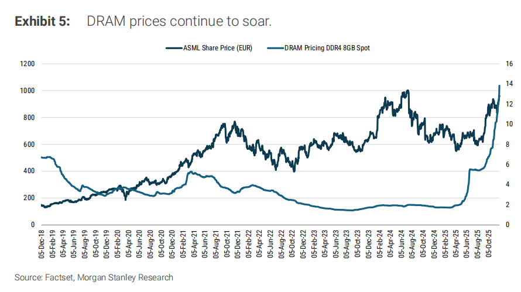
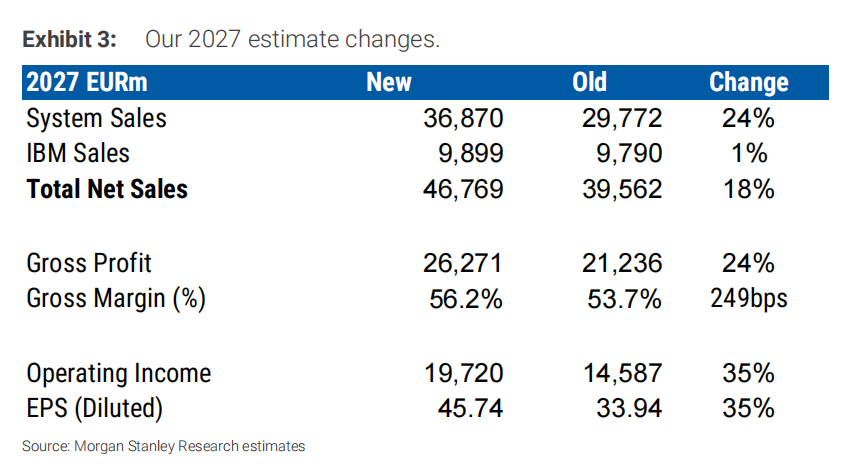
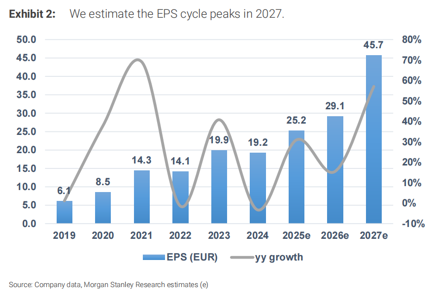
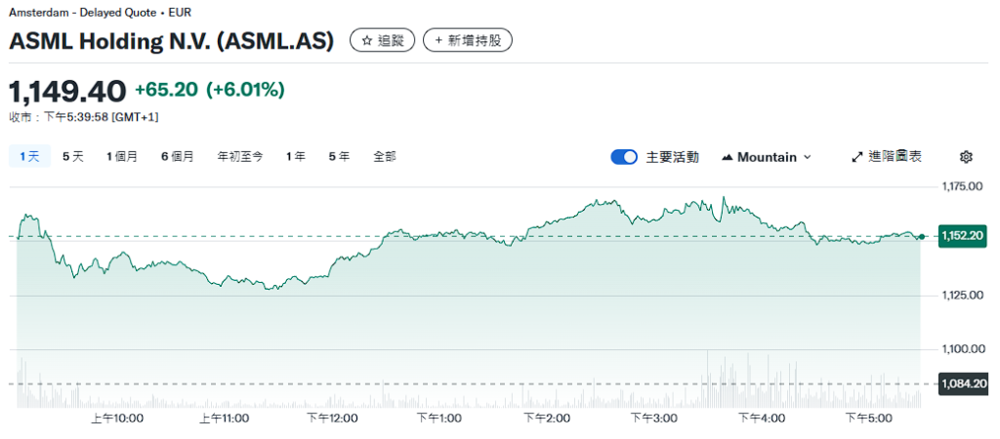

# 先进逻辑与DRAM扩产：ASML的2027盈利预测

> 执笔：`/root/scale_27`；模型、档位继承且不可独立核验。2026-11-16整理。1月16日华尔街见闻转述摩根士丹利观点；1月28日官方结果另节补录。

2026年1月，市场问题是：AI带动的先进逻辑和存储投资，能否在2027年转成ASML显著更高的盈利？摩根士丹利把台积电预算、存储涨价与客户扩产计划接到设备需求，再接到系统销售和利润率。它给出一组可在后来检验的数量与期限，尚未证明终端AI投资回报已经实现。

## 先进逻辑：预算上升如何进入低NA EUV预测

台积电1月15日官方托管电话会印刷第4页列2025年资本支出409亿美元，2026年预算520亿—560亿美元，其中70%—80%用于先进工艺。预算中值540亿美元，相比409亿美元约增32%。这是台积电的经营计划；光刻采购台数由大摩另行预测，不能将全部预算算给ASML。厂房、配套设施、其他设备及不同工艺共同使用预算。

同一页管理层强调，每千片/月产能所需资本，N2高于N3，A14还将提高。工艺步骤、工具价格和复杂度上升，可以使支出增长快于名义晶圆产能；预算增加32%不能直接推出晶圆产量增加32%。最终可售芯片还取决于投产、良率、裸片面积与客户产品导入。[TSMC](../../10_concepts/TSMC.md)与[晶圆制造](../../10_concepts/晶圆制造与先进制程.md)提供基础。

大摩将台积电2026年相关EUV台数预期从约20提高到29，2027年从28提高到40，理由包括提前建设A14产能，为2028年使用准备。它还预计Intel、三星2027年逻辑/代工业务各对应5—6台，合计逻辑/代工约52台，明显高于此前25—30台预期。这些客户分配和提前建设判断来自机构；本文未取得客户逐台采购合同或完整研报。

**图3的纵轴口径是“EUV Low NA Tools Revenue Recognised”。** 台积电2025e/2026e/2027e分别18/29/40，Intel约3/1/6。正文把这些量称为采购或出货，图却明确是收入确认；本页以图题标识该序列，不将它同时作为下单、发货和收入台账。2025在图中仍是估计，不能按发布日期自动改成已实现。三星没有出现在这张客户图中，其5—6台仅见正文转述。

ASML的设备订单、制造出货、满足收入确认条件、现金收付和客户量产各有时间表。大摩的2027增长判断需要客户建设按期、设备可交付并确认收入。即使客户2028年才使用，设备收入可能较早出现；提前确认的具体条件仍由合同决定。[ASML](../../10_concepts/ASML.md)已解释这些时点，以及低NA EUV、High-NA和DUV的分工。图3没有支持High-NA采用台数，本文也未据此新增产品节点。

## 存储：涨价为何吸引投资，投资又怎样改变供给

大摩把服务器CPU需求和云厂商2026—2027年AI需求列为存储景气来源，判断强劲价格还会延续1—2个季度，促使DRAM厂在2026—2027年投入，为2027—2028年需求准备。较高的预期销售回报提高扩产意愿，随后设备订单可能增加；要形成新的合格存储供给，还须经过厂房、设备安装、工艺爬坡、封装测试及客户认证。若需求在产能到来前放慢，先前涨价诱发的投资反而可能扩大后来的供给压力。

图4价格线对应**DDR4 8Gb现货**，ASML股价采用欧元，左右纵轴数值不同。图示2018—2025历史及2025年末该规格快速涨价，既不是HBM合同价格，也没有代表全部DRAM售价。文章同时谈HBM与普通DRAM，须保留产品差别。两条线同图没有识别存储价格上涨对股价的独立因果贡献。[HBM与存储芯片](../../10_concepts/HBM与存储芯片.md)解释产品与产能转换约束。

大摩预计2027年DUV销售额约150亿欧元，NAND建设若超预期仍可能上行；2027年EUV总台数约80，其中逻辑/代工约52，其余归存储。80为正文预测总量；图3提供的是其中部分客户低NA收入确认估计，不能拼作完整机型交付表。NAND新增投资是DUV预测的条件，不是该期已经发生的订单。

## 盈利上修：系统销售增加占主导，毛利率也须兑现

图5把大摩2027预测从旧版改到新版。金额均为百万欧元，EPS为欧元/股：

| 指标 | 旧预测 | 新预测 | 修订 |
|---|---:|---:|---:|
| 系统销售 | 29,772 | 36,870 | +24% |
| 装机基础管理销售（IBM） | 9,790 | 9,899 | +1% |
| 总销售 | 39,562 | 46,769 | +18% |
| 毛利润 | 21,236 | 26,271 | +24% |
| 毛利率 | 53.7% | 56.2% | 图列+249bp |
| 营业利润 | 14,587 | 19,720 | +35% |
| 稀释EPS | 33.94 | 45.74 | +35% |

这里IBM指Installed Base Management，即服务与现场选件，ASML官方公告有定义，与IBM公司无关。新增总销售约72.07亿欧元，其中系统增加70.98亿，装机基础业务增加1.09亿；按表内取整数核算，约98%的销售上修来自系统业务。本次上修因此主要依赖新增系统收入，而非服务稳定增长就能自然达到。

大摩同时把毛利率提高约2.5个百分点。更多高价值系统、产品组合及业务规模可能有利于利润，但图5没有提供机型单价、交付成本、研发费用和税率的完整桥接，本文不能独立复算EPS。不能把设备台数按一个固定单价换成销售，再把销售增幅直接当作EPS增幅。

图1的2027 EPS约45.7欧元，是图示年份最高水平；正文预计相比2026年29.12增约57%。但图内2021年由8.5升至14.3，同比约68%，灰线也高于2027。故正文“史上最高年度盈利增速”没有得到该图支持；本页保存2027盈利显著增加的机构判断，不沿用该最高增速断言。

估值方面，大摩采用31倍市盈率，目标1400欧元；45.74×31约1418，反映目标取整。牛市情景采用EPS50与40倍PE，得到2000欧元。后者同时提高盈利和估值倍数，不是只改变设备需求；这两组假设是机构情景，未给发生概率。图2的1149.40欧元、+6.01%报价截图未显示明确交易日期，也不能用于证明单篇研报造成当日涨幅。

## 财报前预期，以及1月28日实际披露

1月16日转载中的短期预期针对即将公布的2025年第四季：大摩预计订单72.7亿欧元（前季约54亿），含19台低NA EUV，台积电约9台，其余提及三星和SK海力士；收入96.75亿、毛利率51.8%。它预计2026收入约365亿欧元、同比约12%。

正文另有“2026销售接近持平，原指引降15%—20%”一段，却没有说明地区或业务范围，与后文全公司+12%不相容。原研报未取得，本页不把该句自动改成中国区预测，也不将它记为公司总额指引。正文还称这是最后一次披露订单，本轮核读的官方公告不足以独立确认后续披露政策，暂不当作制度事实。

**后续结果，2026年1月28日公开。** ASML官方Q4 2025公告列同一季度净预订131.58亿欧元、净销售97.18亿、毛利率52.2%。净预订定义包括已获书面授权的系统订单和通胀调整；大摩转载中“订单”未给定义，表面上同指季度新增订单，但缺完整研报，故可并列比较数量，不能声称底层调整项完全一致。实际净预订明显高于72.7亿研究预期；收入与毛利较该研究预测略高。订单量以金额计，不能用131.58亿欧元倒推出19台低NA是否兑现。

同次公告预计2026总净销售340亿—390亿欧元、毛利率51%—53%；365亿处于收入区间中值。管理层指客户对AI持续性和中期扩产更积极，预期EUV与装机基础业务增长。这为机构需求判断提供后续支持，但仍未验证2027年80台、467.69亿收入或45.74 EPS。原[ASML页](../../10_concepts/ASML.md)保留2026年10月14日更晚信息，此处不把后来数据写进1月16日的预测依据。

## 如何继续判断这条投资链

**本库条件推演，2026-11-16整理：** 这份材料使ASML可作为先进逻辑与存储厂未来制造投入的观察对象。订单增长先说明客户更愿意承诺购买设备；交付及收入说明设备商兑现程度；客户合格芯片与最终应用收入则检验需求能否持续。几个环节依次改善时，对设备景气的判断才更有支撑。

若客户延迟工艺导入或厂房就绪，收入可能跨年移动，即使长周期需求没有消失，也会改变2027盈利。若存储价格回落，扩产意愿可能先降，而此前设备仍继续交付。若设备吞吐量、升级效率提高，相同客户产能目标需要的新机台数也可能变化。需要比较按机型的收入确认、客户投资版本、实际合格产出和存储分产品价格；本文没有足够数据计算固定台数到晶圆产能的比例。

[来源与逐图核读](../../40_sources/S-WS-3763452.md)。
