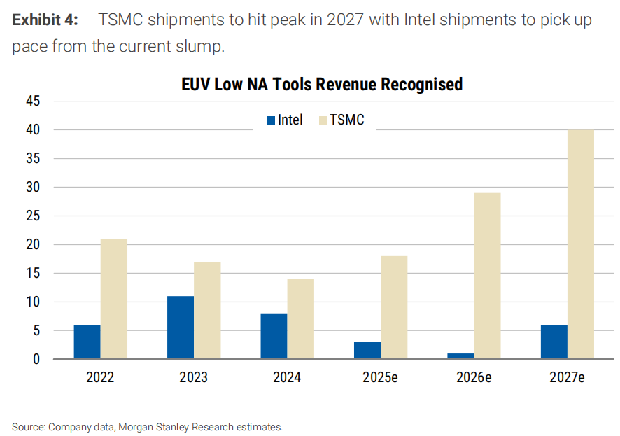

# 先进逻辑与DRAM扩产：ASML的2027盈利预测

2026年1月，摩根士丹利判断，AI带动的先进逻辑和存储投资，将使ASML在2027年迎来显著盈利增长。它先从客户预算和存储价格判断扩产意愿，再估计设备收入及利润率。理解这项预测，要看客户为什么提前投入、设备收入何时出现，以及收入增长能否转成利润。

## 先进逻辑：客户提前投资，设备收入早于芯片产出

台积电1月15日电话会列2025年资本支出409亿美元、2026年预算520亿—560亿美元，其中70%—80%用于先进工艺。预算中值同比约增32%，为设备需求提供支持，但厂房、配套设施及多类工具共同使用这些资金，光刻采购台数仍需另行判断。

投资增加也有技术原因：管理层指出，每千片/月产能所需资本，N2高于N3，A14还将提高。更复杂的工艺和更昂贵的工具，可使支出增长快于名义晶圆产能；最终合格芯片产量还取决于良率、裸片面积与客户导入。[TSMC](../../10_concepts/TSMC.md)和[晶圆制造](../../10_concepts/晶圆制造与先进制程.md)解释这些经营条件。

大摩据此将台积电2026年相关EUV台数预期从约20提高到29，2027年从28提高到40，理由包括提前建设A14产能，为2028年使用准备。它还预计Intel、三星2027年逻辑/代工业务各对应5—6台，使该领域合计约52台，高于此前25—30台。这些客户分配与建设时间是机构判断。

图3明确采用**低NA EUV收入确认台数**，与正文“采购/出货”的措辞有区别。客户计划、下单和交付须经过合同确认条件才能成为ASML收入；客户把设备用于合格芯片量产又更晚。因而2028年使用的产能，可能支持较早的设备收入，但客户若延后厂房就绪或验收，2027年的盈利时点也会变化。通用收入时点与机型分工见[ASML](../../10_concepts/ASML.md)。

## 存储：涨价提高扩产回报，也为后来供给埋下条件

大摩将服务器CPU需求和云厂商2026—2027年AI需求列为存储景气来源，预计强劲价格再持续1—2个季度，推动DRAM厂在2026—2027年投入，为2027—2028年需求准备。较高售价提高预期投资回报，扩产意愿由此传给设备商；新厂安装、工艺爬坡、封装测试和客户认证则决定供给何时增加。若需求在新产能到来前放慢，先前涨价诱发的投资可能加重后来的价格压力。

图4展示的价格是**DDR4 8Gb现货**，只能说明该规格的变化；HBM合同价及其他DRAM产品需分别观察，股价与价格同图也没有识别独立因果。[HBM与存储芯片](../../10_concepts/HBM与存储芯片.md)提供产品和产能转换基础。

大摩预计2027年DUV销售约150亿欧元，NAND建设若超预期仍有上行空间；EUV总台数约80，其中逻辑/代工约52，其余归存储。80为正文总量预测，图3则是部分客户低NA收入确认估计，两者不足以组成完整机型交付表。支持这项销售预测的关键，在于客户扩产承诺最终转成能够交付并确认收入的设备需求。

## 盈利上修依赖新增系统，也依赖毛利率提高

大摩将2027总销售从395.62亿提高到467.69亿欧元。系统销售上修约24%，装机基础管理业务（IBM，即服务与现场选件）仅上修约1%；按图中金额分解，约98%的销售增量来自系统。这说明本次判断主要押在客户新增设备投资兑现，既有设备服务的稳定增长承担不了同样幅度的上修。

盈利预期还包含更高利润率：毛利率从53.7%升到56.2%，营业利润与稀释EPS均上修约35%，EPS达到45.74欧元。高价值机型和规模增长可改善组合与成本摊薄，但如果交付成本上升或新产品爬坡较慢，收入达到预期也可能没有相应利润。设备台数、机型价格与成本应分开检验。

相对大摩2026年29.12欧元的EPS预测，2027预期增长约57%。这是图示年份最高EPS水平；原文“史上最高年度增速”却不成立于图1展示的历史，2021增速更高。[图1及复算](../../40_sources/S-WS-3763452.md#figure-1)保留了这个区别。

估值亦包含独立假设。大摩采用31倍市盈率，目标1400欧元；牛市情景采用EPS50欧元与40倍PE，得到2000欧元。后一情景同时提高盈利与估值倍数，材料未给其发生概率。完整估值复算和报价截图说明见[来源笔记](../../40_sources/S-WS-3763452.md#valuation)。

## 财报前预期与1月28日实际

**1月16日研究预期。** 对即将公布的2025年第四季，大摩预计订单72.7亿欧元，前季约54亿；低NA EUV约19台，其中台积电约9台，其余提及三星、SK海力士。它预计当季收入96.75亿、毛利率51.8%，并预计2026全年收入约365亿、同比约12%。

原文另称“2026销售接近持平，原指引降15%—20%”，未说明地区或业务范围，与上述全公司+12%不相容。缺原研报，本页保留此范围缺口，不将该句改成公司总额指引。

**1月28日后来披露。** ASML官方Q4 2025公告列净预订131.58亿欧元、净销售97.18亿、毛利率52.2%。同一季度的净预订明显高于研究所称订单72.7亿，收入和毛利率略高于其预期。不过，官方净预订含已获书面授权的系统订单及通胀调整，转载未给研究订单定义，底层调整项能否完全对应仍不清楚；金额也无法直接验证19台的客户及机型分配。

同次公告给出2026总净销售340亿—390亿欧元、毛利率51%—53%的指引，365亿处于收入区间中值。管理层表示，客户对AI持续性及中期扩产更积极，预期EUV和装机基础业务增长。这支持设备需求增强的解释，2027年的80台、收入及EPS仍待对应年份检验。[ASML页](../../10_concepts/ASML.md)另存10月14日较晚信息，两次披露均不回填为1月16日已知依据。

## 按原预测期限继续检验

以下为**本库2026-11-16后补的研究设计**，依据上述历史材料提出；它没有宣称已查齐这些窗口的后来结果，也不是大摩1月16日原话。观察分别针对价格持续、设备兑现、盈利和客户实际需求。

**从1月信息日起随后1—2个季度：涨价能否形成扩产承诺？** 分别看普通DRAM固定规格现货/合同价格、HBM合同及客户平台需求，再对照三星、SK海力士、美光的预算和设备采购承诺。价格延续且投资由意向进入预算、订单，支持“高回报推动扩产”。若只有DDR4现货上涨，而其他产品价格、客户订单和预算走弱，原文对广泛存储景气的外推会被削弱。价格仍强但投资未增，则须查是厂房、设备供给限制还是厂商主动克制，不能直接归为需求不足。

**2026—2027年：设备需求如何进入收入？** 比较客户预算版本、设备订单的取消或重新排程、厂房就绪与安装验收日期，以及ASML分机型收入确认。预算维持、订单仍有效，只因厂房或验收延后而跨年，主要削弱2027的兑现时点；预算削减、订单取消并伴随终端客户减少采购，则更支持需求弱化。两种情形对长周期判断不同。新机台数减少时还要看升级和吞吐量：若它们补足客户能力，较少新机可能来自投资方式变化。

**2027年：系统销售上修能否变成预计盈利？** 分开核系统和装机基础业务收入，并对照机型组合、毛利率、营业利润及同口径稀释EPS。系统收入和毛利率都接近研究假设，才较完整地支持这次盈利上修；总收入相近但靠服务增加补上系统缺口，说明实际路径有别。系统增收而利润率或EPS不足，应查生产与交付成本、产品组合、研发费用、税率和股数，而不能直接反推客户没有需求。若只是确认收入跨年，应与前一窗口的交付记录互证。

**2027—2028年：客户新增能力是否被真实需求使用？** 看逻辑厂新节点合格产出、客户产品导入和利用率，存储厂则看合格比特/堆栈、认证、出货、库存与分产品价格。有效产出增加且客户持续承接，支持提前扩产有需求基础；产出增加却库存累积、价格下滑或利用率降低，会削弱原需求解释，并提示前期投资可能放大供给压力。若新设备台数偏少，而客户通过升级、生产率或良率提升维持有效产出，就需要修正“台数到能力”的估算，不能单凭机台数判断AI需求强弱。

[来源、全部原图及校读记录](../../40_sources/S-WS-3763452.md)。
