# 港股价格底、信用周期与股权供求：2026年11月观察

华尔街见闻页面显示2026-11-02 09:35:49，署名董静，转述中金刘刚、张巍瀚等《市场如何见底？》。本文依据本地版本及32份原图整理，主要市场截面截至2026年10月30—31日，机构持仓部分截至三季度。2024年案例为后来回看，不代表当时已经知道全年最低点；2027年解禁安排属于作者在2026年讨论的未来供给。

文章的核心判断是：较低估值和低机构配置可以带来短期反弹条件，但公司回购、一级发行与居民信用对持续修复有不同作用。2024年股东回报支持价格先企稳的经历，提供了一个对照；当时的相似条件并没有在2026年完整重现。原文的各项观察与作者解释在下文分别保存。

## 从近期下跌提出问题

图1以2024-09-24为100，标注恒科2025-10-02为170.7、2026-10-30为95.9。图2以2024-09-23为100，比较恒科、创业板和科创50；标注A股两组合较6月高点回撤接近45%。基日不同的图不能按归一化数值直接拼接。图3分别显示企业与居民私人信用脉冲，图4展示多个风格的不同价格路径；本文沿用研究者曲线，分子、季调和分母细节未取得。

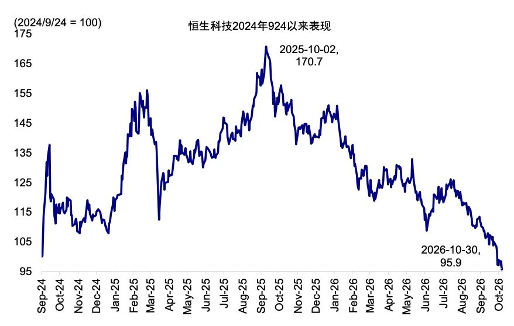

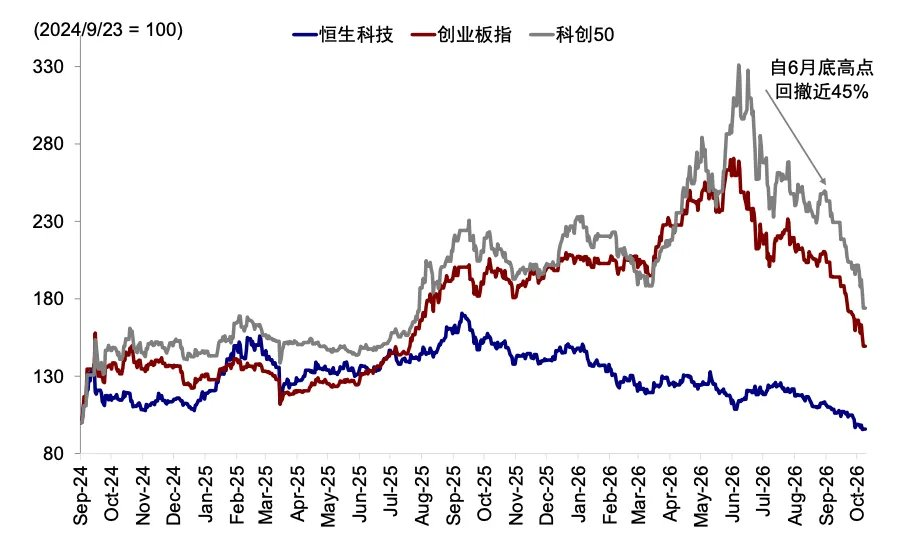

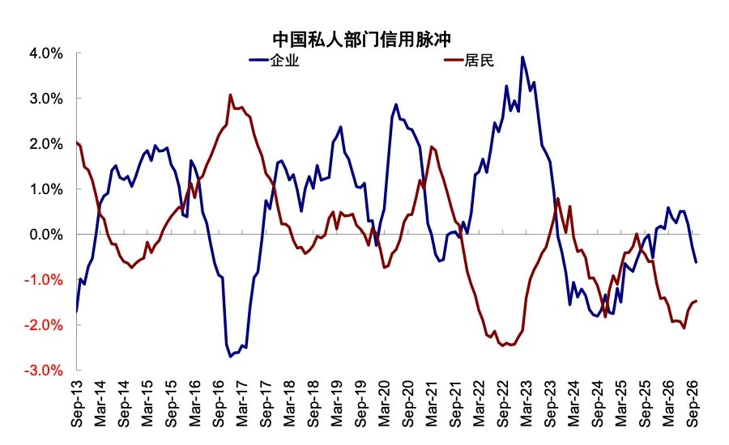

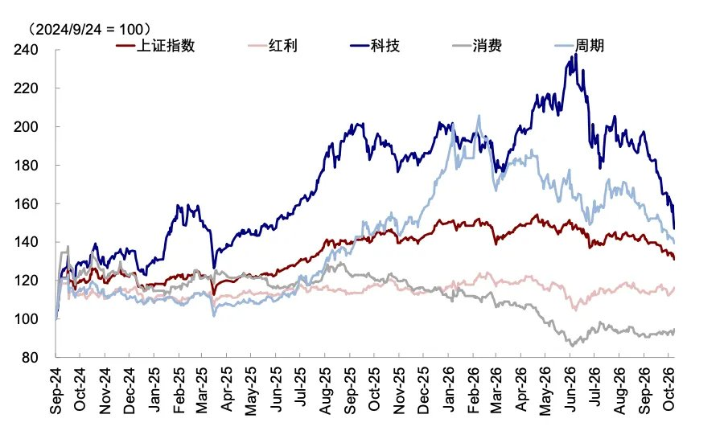

## 为什么相同中国主题会有不同的价格拐点

[恒生指数与恒生科技指数](../../10_concepts/恒生指数与恒生科技指数.md)是不同选样和权重的组合。图5按作者业务分组列恒科互联网35%、电动车14%、电商13%、消费电子10%、科技硬件19%等；前四项合计约72%。这解释作者把它视作内需敏感观察组合的理由；业务分组不等于正式行业分类，亦未证明这些收入都来自境内。图9给恒指同一截面的更广业务分布，包含本地金融、银行、电信等。

两地资金取得与替代资产选择也不同。[港股市场](../../10_concepts/港股市场.md)连接全球资金，境内A股另有跨境配置约束，因而盈利预期、必要风险补偿和边际买家的变化未必同步。图6—8回看两轮先后关系：2021年恒科2月见顶、创业板11月见顶；2025年恒科10月高点与2026年A股成长6月高点又相隔约8—9个月。少量周期样本只是需要解释的历史观察，不能设为固定领先参数。

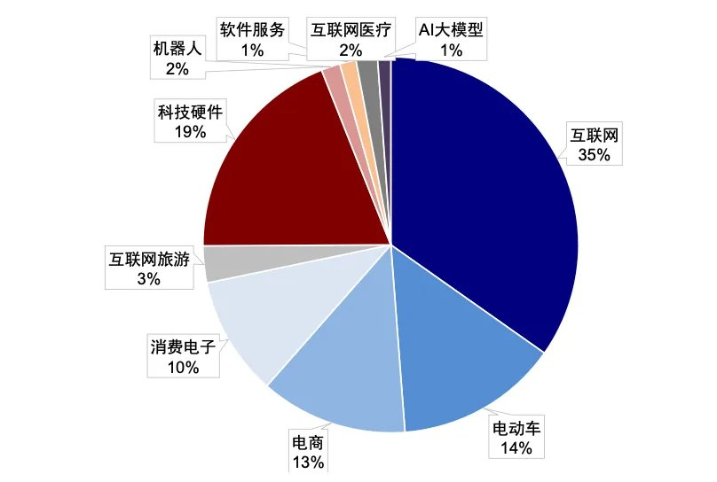

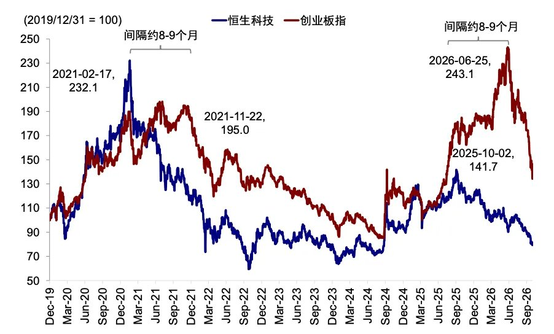

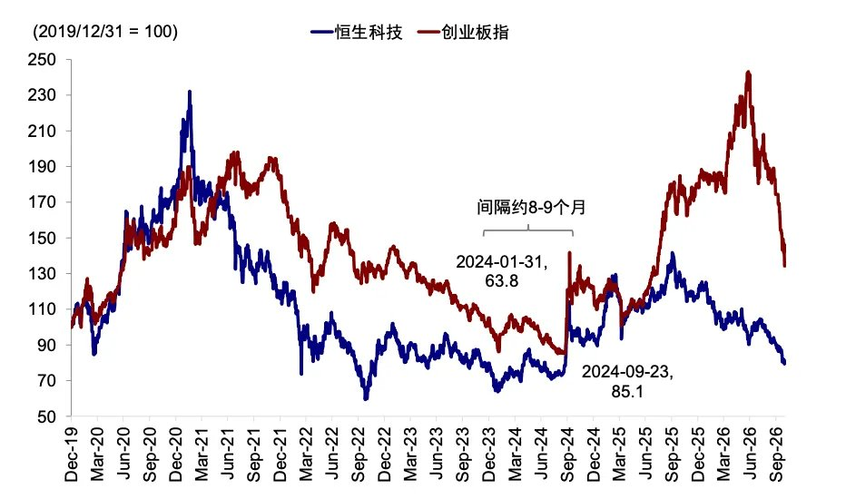

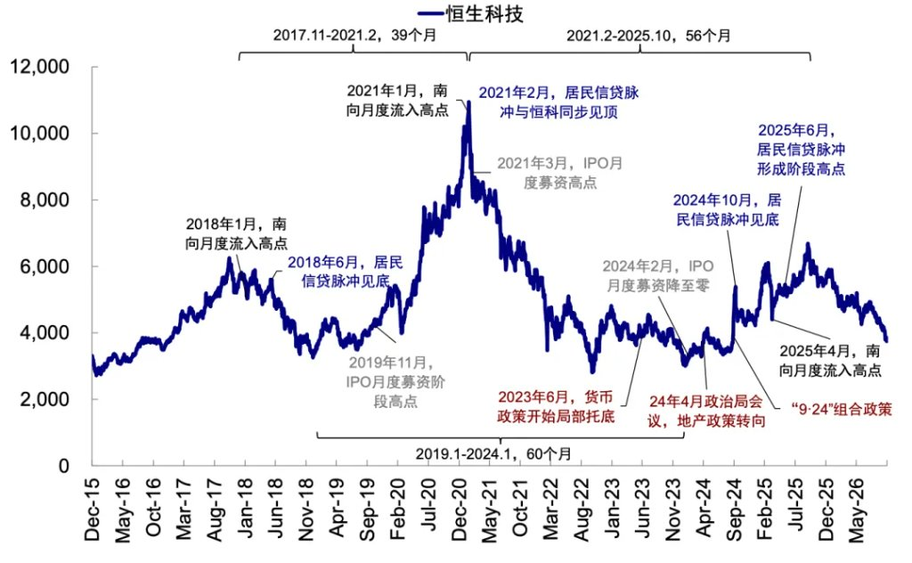

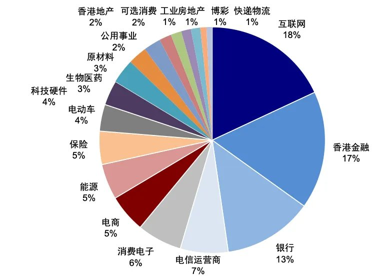

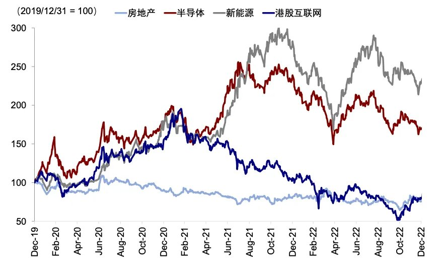

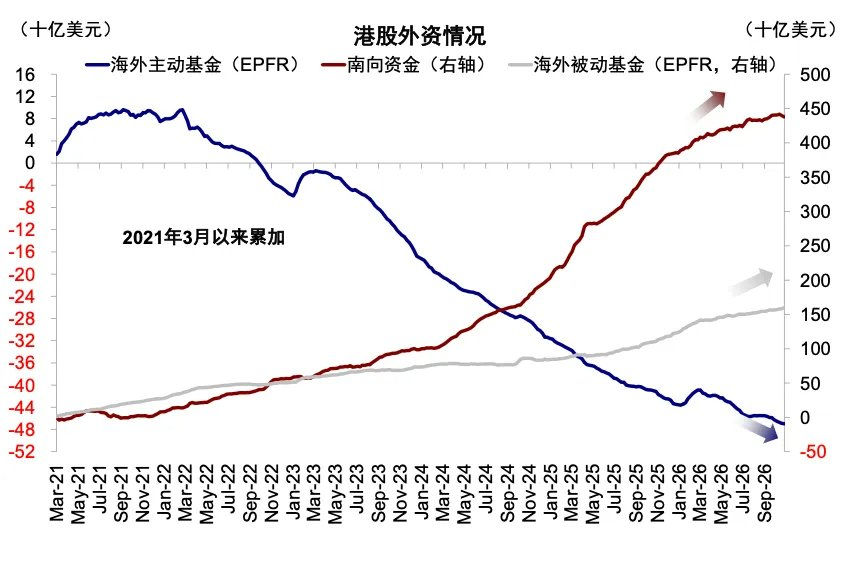

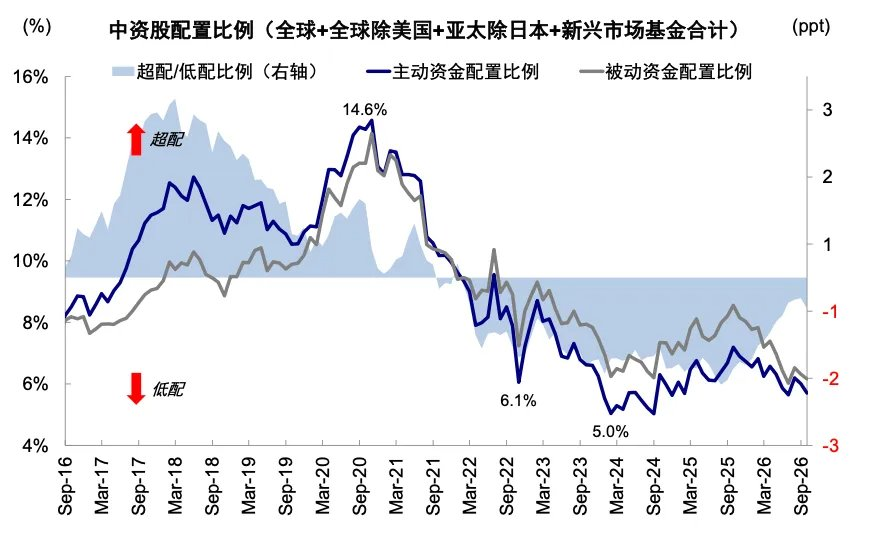

图11从2021年3月累计，海外主动基金使用左轴，南向与海外被动使用右轴；斜率变化反映这套累计口径的增减，不同高度不能横向比较规模。图12的配置比例和相对基准的超低配分别用百分比与百分点表示；权重还会受价格与分母变化影响。低配置提供未来可能增配的空间，但没有自动生成下一期买单。原文给出的14.6%、5.0%、5.7%等均保留为EPFR样本观察，不能概括全部外资持股。

## 价格底可以早于盈利和信用底

“价格底”在这里指回看某段区间的指数低点；盈利底和居民信用底是另两种序列拐点，均依赖指标构造和后来数据。指数企稳可以来自盈利修订，也可以来自所需风险补偿、实际购买及未来分配预期的变化。文章把2024年港股先企稳解释为现金回报承接，强调当时对增长仍不确定，红利并不要求同时出现全面盈利复苏。[高股息关系中的该案例](../../20_mechanisms/高股息资产的债券替代效应.md#ws3784961-shareholder-return)解释过程与条件。

图14的板块比较采用MSCI中国，信息技术20.5%、保险16.1%、银行12.3%，必需消费−15.9%、地产−11.4%；不能改记为恒指自己的行业贡献。图16列腾讯39.9%、恒生高股息15.8%，不代表全部回报均由回购或派息造成。腾讯当年回购计划、实际执行、年度回购收益率与股价回报又是不同量：作者提2024年3月承诺至少1000亿港元，图15列后来2024年实际回购约1120亿港元与2.9%回购回报，2023年对应1.8%。

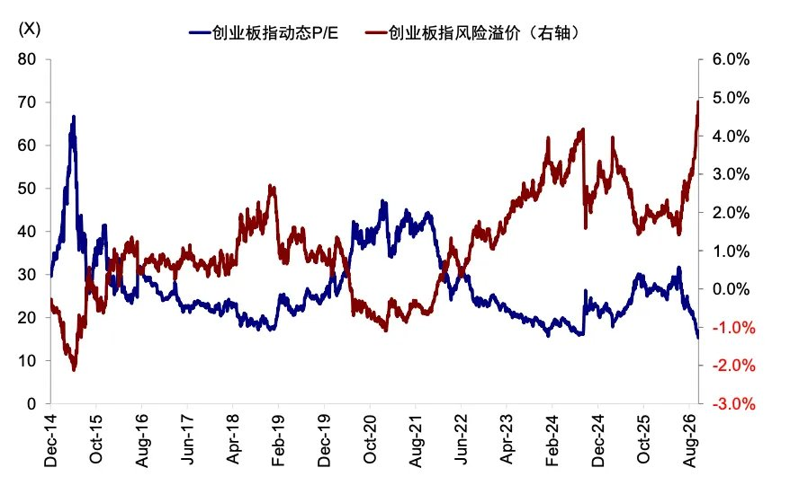

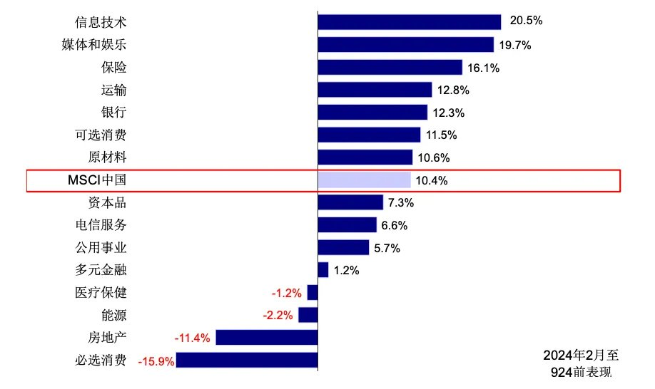

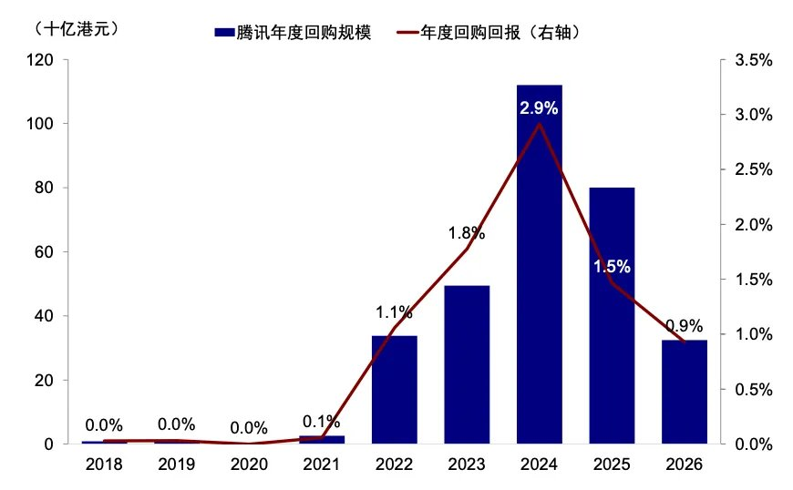

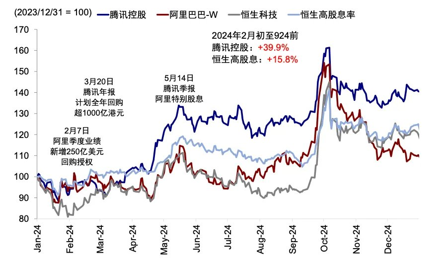

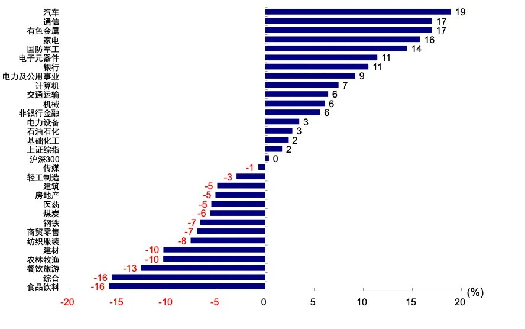

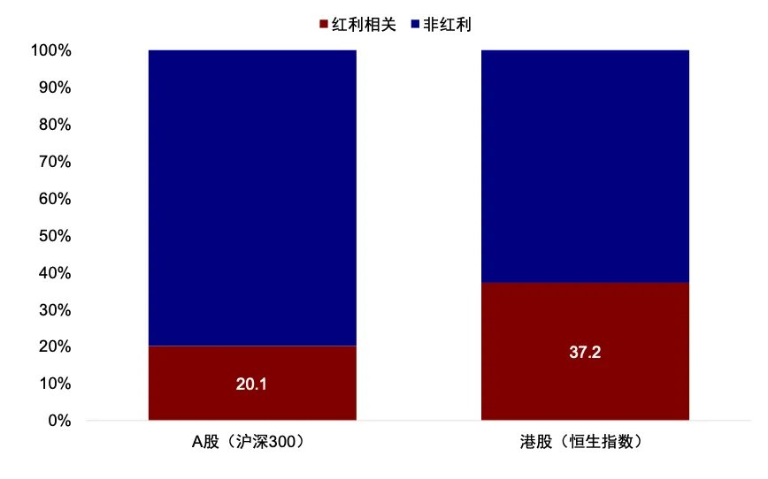

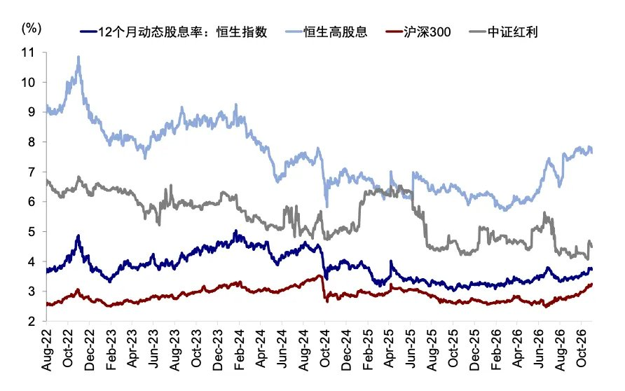

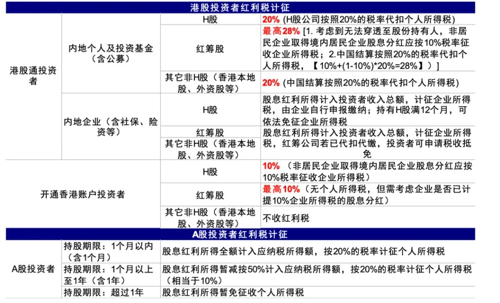

图18红利相关标的约占沪深300的20.1%、恒指37.2%，这是作者分类的组合结构差异。图19比较预期股息率，未来实际分配仍由经营现金、资本开支、债务与决议决定。回购提高现金分配与改变股数的过程，也不同于所有持有人都按股息率取得现金。图20原样保留转载税务表，投资者身份、账户渠道及当时法律条件没有在本轮逐项核实；本页不据表提供现行税务判断。

## 把2024年条件与2026年截面逐项比较

下表保存作者截至11月2日的比较，不能作为下一次反转的机械阈值。

| 维度 | 2024年初及924前的作者观察 | 2026年截面与局限 |
|---|---|---|
| 估值与风险补偿 | 正文称1月底恒科动态PE12.9倍、ERP4.3%；9月16日12.6倍、4.8% | 正文称当前PE13.1倍、ERP3.9%；图21含动态加权无风险利率和ERP两条右轴曲线，未取得底表核对精确末值，不自行重算 |
| 股东回购 | 正文称2024年全市场约2655亿港元，较2023年增长109% | 正文称2025年约1798亿；2026截至10月31日1282亿，较2024同期低42%、较2025同期低12%；均保留转载口径 |
| 基金配置 | 正文称2024初海外主动配置约5.0%，公募港股占股票市值约16.9% | 当前前者约5.7%，后者18.3%；图23另列占基金总规模15.5%，分母不能互换 |
| 股权融资 | 2024融资显著偏弱 | 2026年前十个月正文称合计7489亿港元；2024、2025正文与原图/既有官方表有差异，详见供给节 |
| 政策与信用 | 年初局部托底、924扩散，居民信用底在作者曲线中为10月 | 作者认为仍需向居民倾斜的财政与信用修复；没有给出政策量或反转日期 |

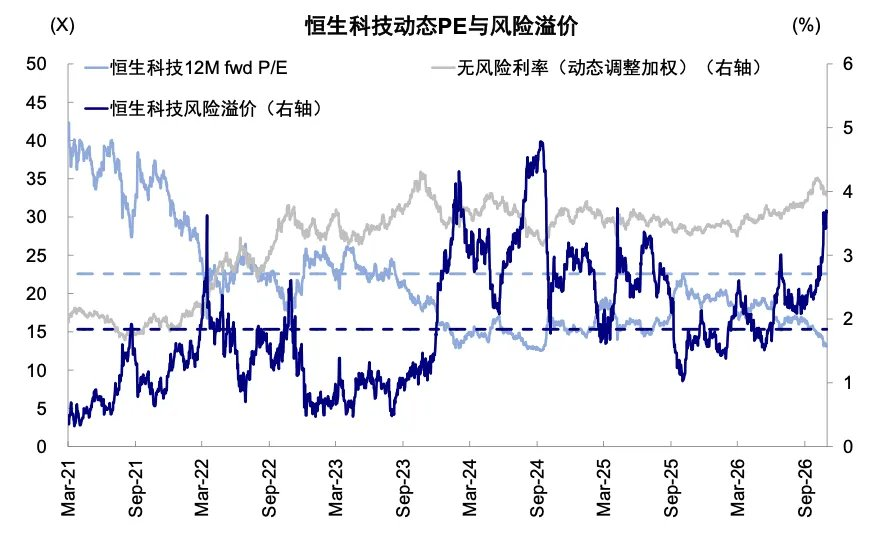

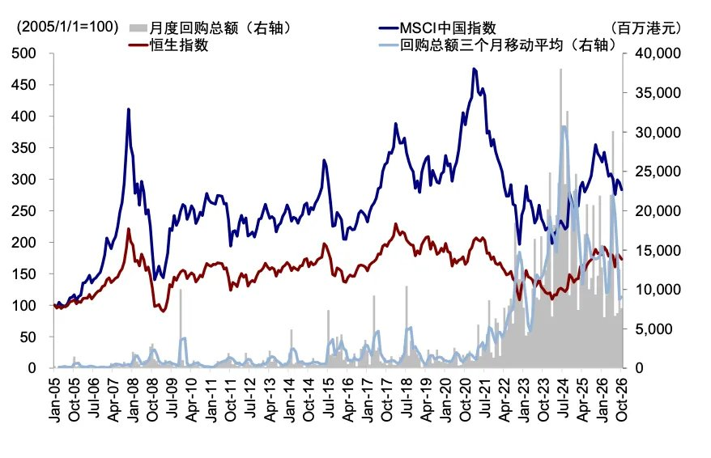

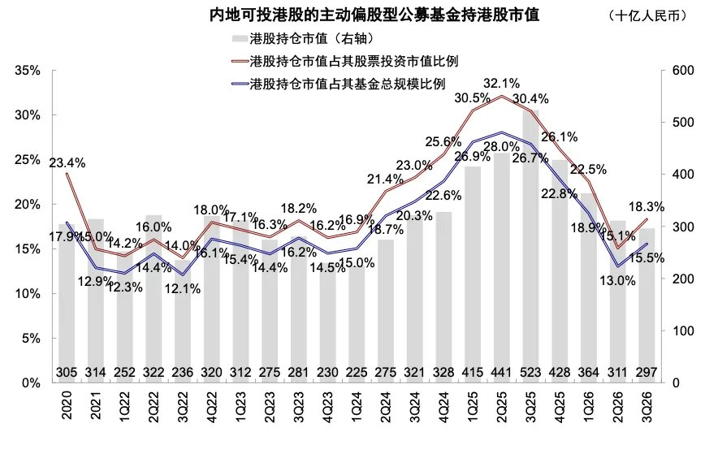

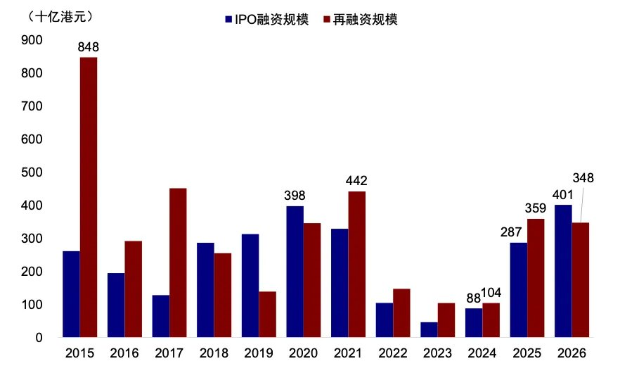

图21支持估值与风险补偿随价格和预测共同变化的观察。[ERP页](../../10_concepts/股权风险溢价ERP.md)已解释，盈利收益率减某个国债收益率只是代理，不能把研究机构的曲线当真实可直接测得的要求回报。本页不从13.1倍或3.9%推导确定的底部点位。

## 信用、政策和股票供求的时滞如何相接

作者用居民新增信用联系需求及企业收入，用政策反应与商业周期滞后解释价格先后变化。既有[社融结构、信用脉冲与实体需求](../../20_mechanisms/社融结构、信用脉冲与实体需求.md)区分融资渠道、借款人、用途和真实支付；低利率、融资增加及实际需求改善需要分别核对。本文不把作者特定私人/财政曲线换成统一的官方指数，也不以两轮拐点建立计时模型。

图25的财政脉冲及私人脉冲和股票共用时间轴，末端虚线包含机构延伸判断，不能当已实现融资。图26恒科与中证消费自相同924基期的路径、图27高股息价格表现及图28前瞻EPS展示了不同观察面；图28从2021年末归一化，不能用不同指数的归一化EPS点位比较绝对每股盈利。

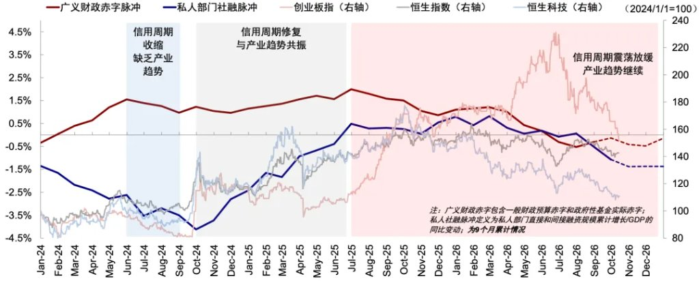

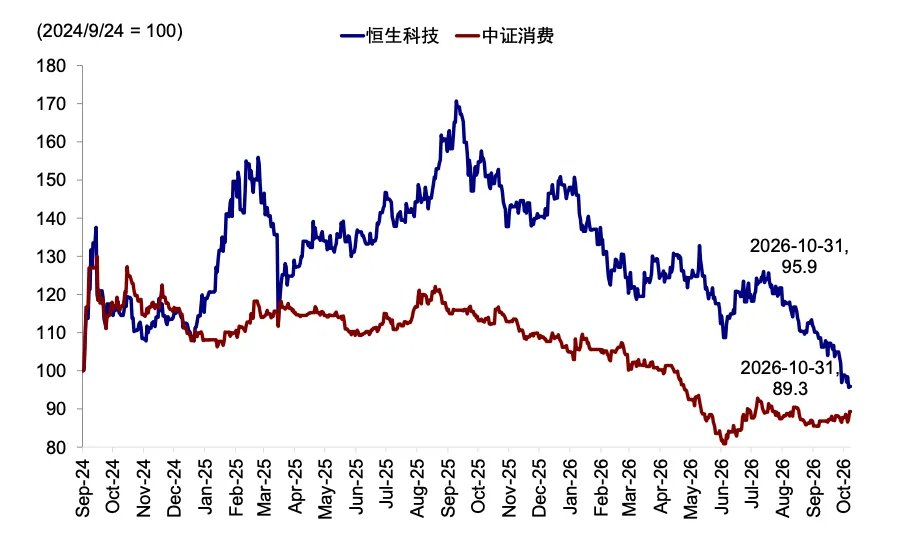

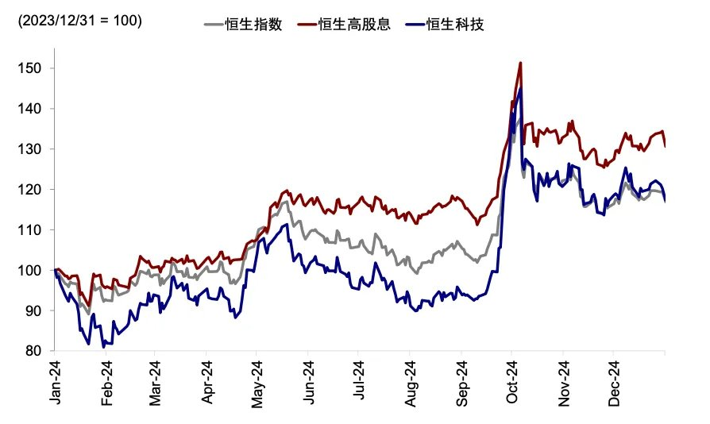

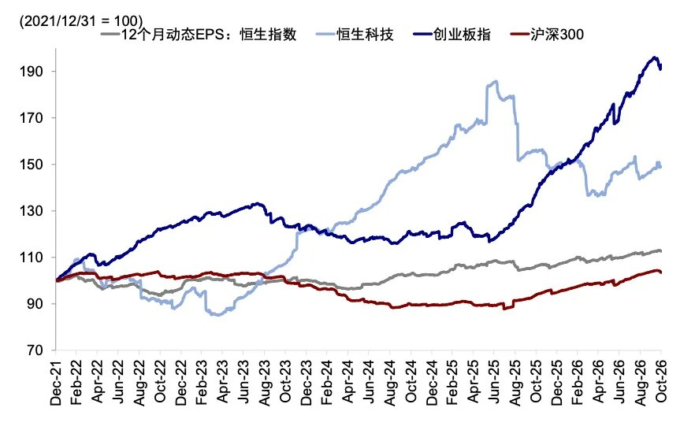

## 发行和解禁为何可能在行情转弱后继续到来

投资者二级买入、发行人新股融资和股东回购分别改变不同主体的现金与权益。行情好时企业融资意愿增强，项目准备与审核发行又有实施时间，先前项目可在价格转弱后继续落地。再往后，锁定期到期增加可售股份范围。已有[IPO、再融资与退市](../../10_concepts/IPO、再融资与退市.md#ws3784961-equity-supply)保存这条过程。

对供给压力的观察要匹配口径。图29是滚动一年南向净流入；图30是每周主动外资流入的一年移动平均；图31是滚动12个月IPO。平滑后的峰值与单月交易峰值不同，不能据图峰直接给出未平滑资金的固定领先月数。图32按十亿港元标注2026年9月解禁约398.6、2027年1月283.8；后者为当时未来安排，是否实际卖出仍取决于持有人。

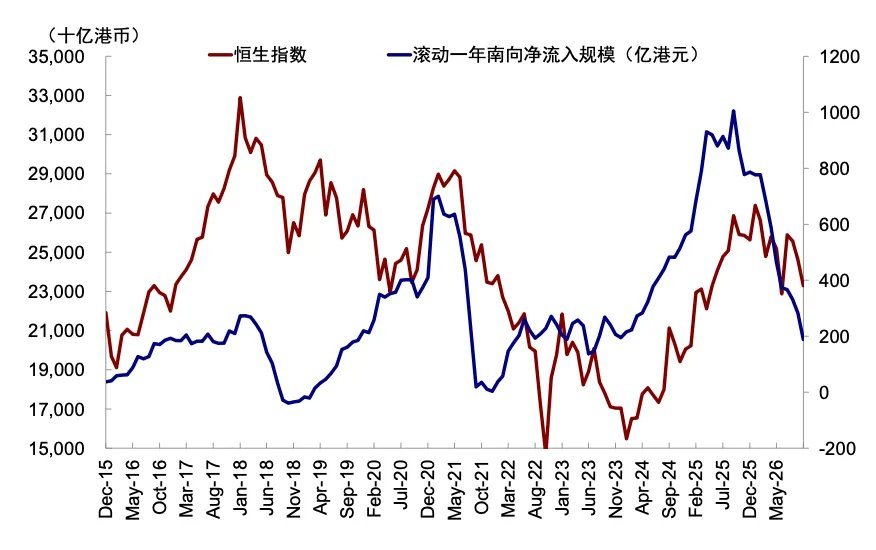

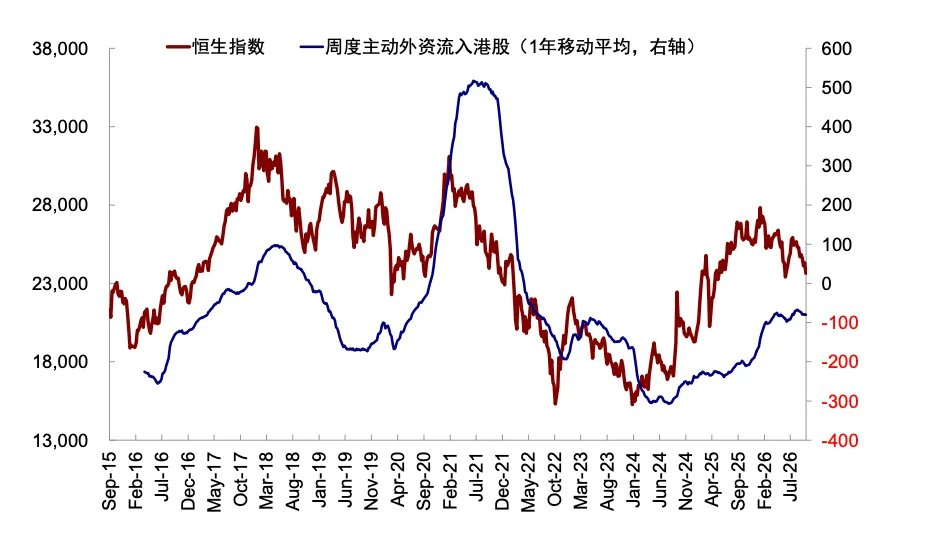

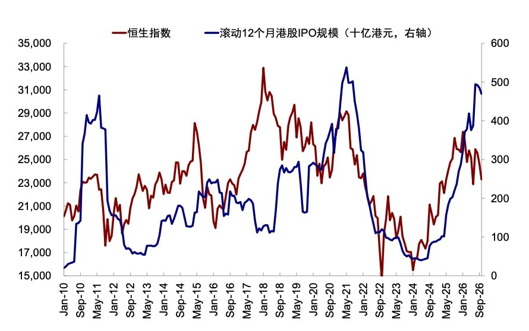

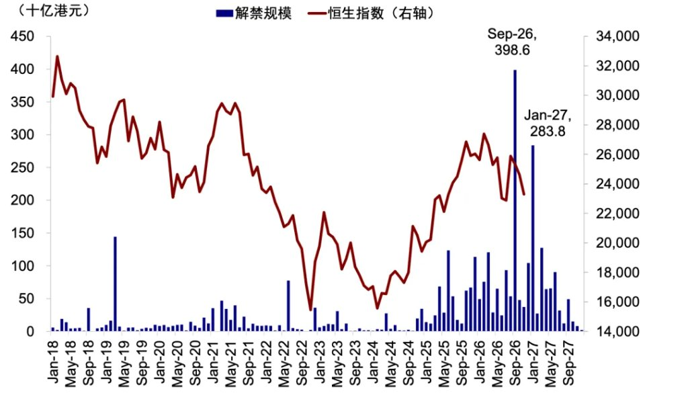

图24与正文需要分开读：正文称2024年IPO和上市后募资881、858亿港元，合计约1740亿；但图中2024两柱约88、104十亿港元。既有IPO页采用港交所2025年度比较表的2024年88.0、104.2十亿、2025年合计644.4十亿；转载正文2025年写6138亿港元。不同范围、统计版本或转述错误均有可能，本轮未取得中金底表，不能确定原因。原有官方比较表保持不变，也不将转载的年度数与2026年前十个月数无条件计算同比。

## 当时预期与可修订的观察

**中金截至2026-11-02。** 作者认为估值、超卖和低配置已构成反弹的赔率条件，但较低回购、较高融资供给及居民信用未改善使持续反转的条件不足；财政进一步发力并向居民倾斜是其判断的重要条件。文章没有给反转日期、指数目标或概率。其对2024“分红底”的解释，是回看阶段价格与盈利、信用不同步，并未单独识别所有价格贡献。

**本库2026-11-16据该信息集整理，研究之后数个财报及融资窗口。** 若股东实际分配增强、供给需要被新增购买吸收，且盈利与居民需求证据逐步改善，局部企稳更可能扩散；若仅有价格上涨和机构权重回升，而现金分配、订单或信用用途仍弱，则需继续区分估值修复与经营修复。高回购还须核其可持续现金来源，解禁则须核实际卖出。本文没有加入文章日期之后的实现结果。

## 来源与连接

[来源记录 S-WS-3784961](../../40_sources/S-WS-3784961.md)登记全文、32图及关键口径差异。指数暴露、股东回报与融资供给的可复用部分分别维护在[恒指与恒科](../../10_concepts/恒生指数与恒生科技指数.md#ws3784961-exposure)、[高股息机制](../../20_mechanisms/高股息资产的债券替代效应.md#ws3784961-shareholder-return)、[IPO页](../../10_concepts/IPO、再融资与退市.md#ws3784961-equity-supply)。
