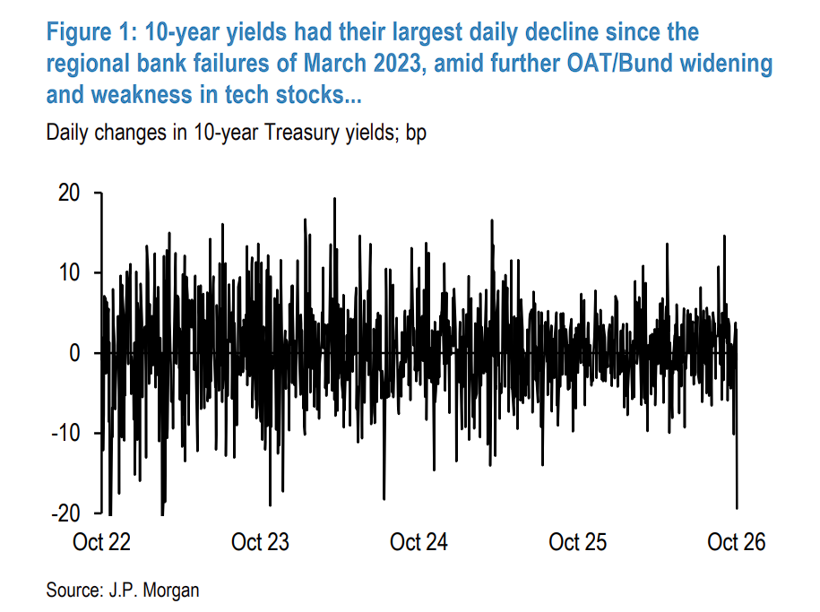
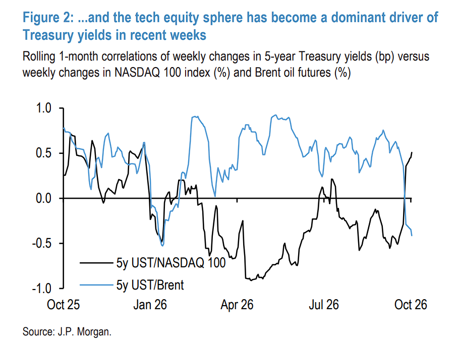
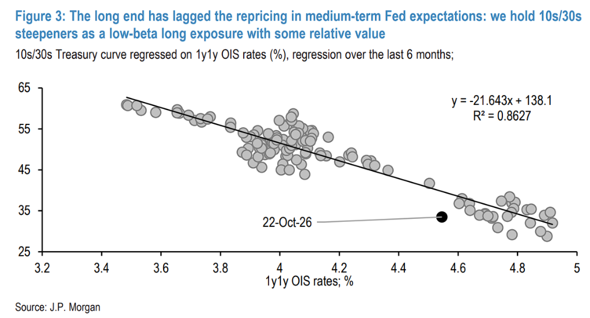
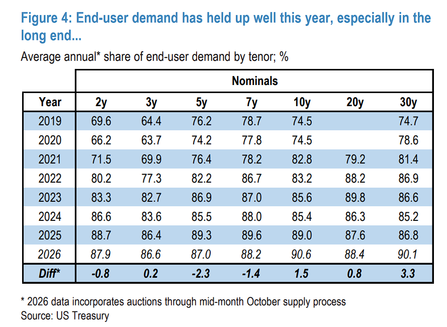
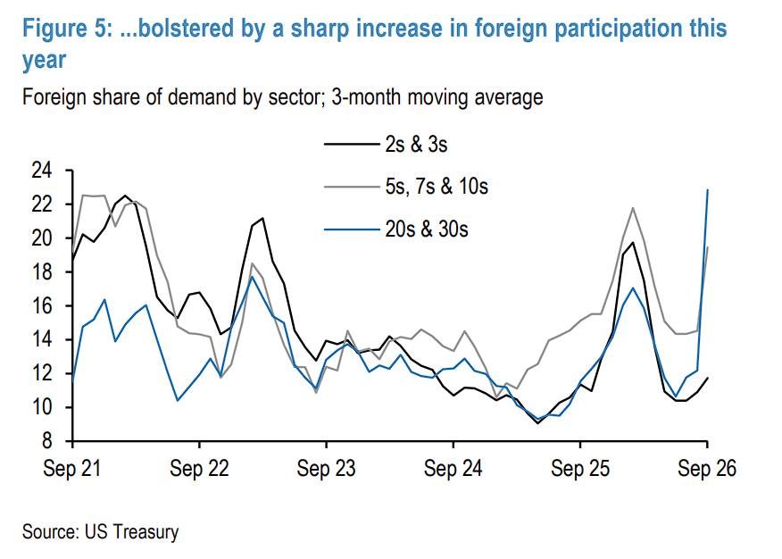
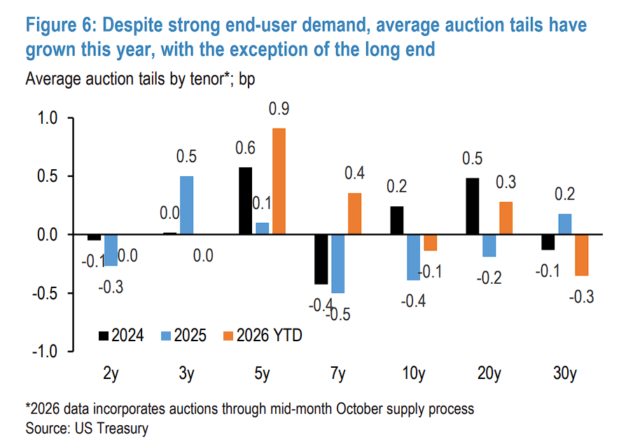
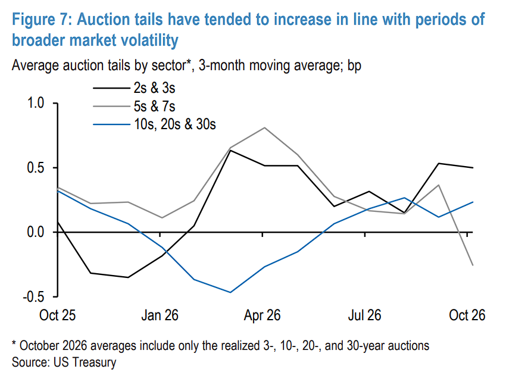
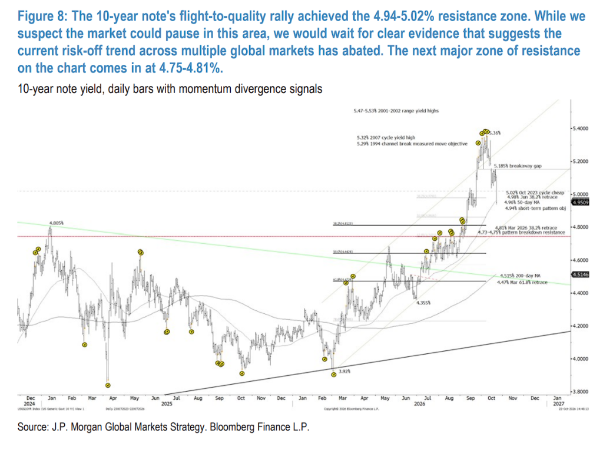

# 美债反弹、曲线与拍卖承接：摩根大通2026年10月判断

2026-10-23，华尔街见闻董静据追风交易台转述摩根大通10月22日研究：欧洲主权债压力与科技股疲弱推动美债上涨，长端拍卖需求仍强；在风险资产没有明确企稳前，不宜逆势做空债券反弹。机构同时继续持有10s/30s陡峭化观点。全文分别讨论价格变动、相对交易和一级承接，三者并非同一种证据。

本篇保存当时论证与8张分析图；第9张会员推广留在[本地原文](<../../../../../materials/wallstreetcn/SourcePost/美债本轮反弹的持续性如何？/article.md>)。2026-11-16是整理日，没有补入10月23日以后行情。[来源记录](../../40_sources/S-WS-3784306.md)登记实际核读与未取得的底层。

## 反弹指债价上涨，先保存当时的冲击判断

转载称10月22日各期限美债收益率下降15—21bp，十年收于约4.95%；图1只画十年收益率日变化，并将其称为2023年3月地区银行失败以来最大单日下降。固定现金流用较低收益率折现，对应较高债价；这个变化没有直接测量财政信用、未来实际增长或最终持有人。

报道还称法国OAT相对德国Bund利差当日扩大15bp。OAT和Bund分别是法国、德国政府债务，同以欧元计价；两者的相对收益率可反映不同的信用、流动性和需求，比较还需对齐期限。研究将法国政治与财政压力、以及欧洲收盘后仍下行的美债收益率，与科技股疲弱联系起来；同时承认当周法国利差扩大没有明确催化剂。所谓“危机蔓延”保留为研究解释，未据一段共同变化识别传染强度。机构认为法国政治财政改善或欧洲央行释放潜在干预信号，可能打破当地利差扩大的循环；没有给出干预日期。

## 科技股与利率重新同向，图中测量了什么

图2实际采用**五年国债收益率周变化**，分别与纳斯达克100周回报、Brent期货周回报计算一个月滚动相关。末端前者为正、后者转负。它没有使用十年债券总回报；一月周频窗口也不能代表多年稳定关系。[纳指100](../../10_concepts/纳斯达克100指数.md)提供具体权益对象的定义。

股票回报与收益率变化正相关，表示股票走弱时收益率倾向同时下降，固定利率债价由此可能上涨。经济解释可以是盈利担忧增强、政策路径被下修，或者资金转向具有支付和交易用途的国债；相关系数本身不能确认其中哪一项领先。相应的一般联系见[股债状态机制](../../20_mechanisms/股债相关性与通胀／增长主导状态.md)。

转载称中东冲突初期油价突破110美元后，美债对油价已呈负敏感。图2的Brent线在2026年3月仍明显为正，10月才在末端转负，不能仅据该图确认正文所述3月切换。油价上涨可提高通胀和政策利率压力，也可削弱实际需求、增强避险；哪条占优需再看同期信息与政策价格。JPM将近期科技股列为主导观察，并没有完成排除共同冲击的因果识别。

机构还讨论十年收益率5%—6%可能压制股市估值，具体起点随增长情景不同；这不是一个所有公司共用的硬阈值。盈利、风险补偿与当时已经计入的政策路径共同决定股价反应。

## 相对曲线判断怎样成为不同的风险暴露

10s/30s通常指`三十年收益率−十年收益率`。十年是这组中的较短端，文章所说“受益于前端下行”应按这一相对期限理解。若十年降得更多，利差扩大；若三十年因避险或负债匹配下降更多，债价整体上涨也可以伴随利差缩小。

一种陡峭化表达是持有十年券、同时卖出三十年券，并按各腿DV01匹配平行利率风险。DV01表示收益率变动1bp对应的价格金额，小变动时组合损益约为共同DV01乘两腿收益率变化之差。三十年券通常需要较少面额来匹配风险；同面额交易会留下较明显净久期。票息、滚降、回购融资、空券借用、凸性与调仓也会改变实际损益。[曲线机制logic-1](../../20_mechanisms/收益率曲线陡峭化与平坦化.md#logic-1)维护这项基础解释。

图3用过去六个月数据，将斜率对1y1y OIS利率回归：`斜率(bp) = −21.643 × OIS利率(%) + 138.1`，R²为0.8627。1y1y表示一年后开始、持续一年的隔夜指数互换期限，价格反映该段隔夜利率风险的市场定价，仍受合约和风险价格影响。不能把4.5%的百分数输入错成0.045，也不能将R²读成交易获利概率。

10月22日黑点在拟合线下约6bp，JPM据此判断曲线偏平、对中期美联储预期重估反应滞后，继续推荐陡峭化并称其低贝塔多头。残差只相对该样本关系定义；若关系改变或期限风险补偿变化，它未必收敛。原文未给合约、实际配比、退出日期或6bp的置信区间，本库不将该回归注册成普遍模型。

## 需求数量强，拍卖价格仍可能更敏感

图4列各期限年均end-user需求占比，2026数据只纳入截至10月中旬的拍卖。十年90.6%、三十年90.1%均为所列2019年以来最高；“创历史新高”沿用作者表述，不能据这张有限表核实更早全部历史。

| 名义国债期限 | 2025年终端占比 | 2026年至10月中旬 | 变化，百分点 |
|---|---:|---:|---:|
| 2年 | 88.7% | 87.9% | −0.8 |
| 3年 | 86.4% | 86.6% | +0.2 |
| 5年 | 89.3% | 87.0% | −2.3 |
| 7年 | 89.6% | 88.2% | −1.4 |
| 10年 | 89.0% | 90.6% | +1.5 |
| 20年 | 87.6% | 88.4% | +0.8 |
| 30年 | 86.8% | 90.1% | +3.3 |

变化列沿原图，显示数因取整不必精确相减。研究未交代end-user与官方投资者分类的完整映射；该占比不能直接当作外国需求、所有最终持仓或长期不出售承诺。[拍卖页](../../10_concepts/拍卖、投标倍数与尾差.md#end-user-202610)分开数量、渠道和类别。

图5另列外国需求占比的三个月移动平均，截至9月。20/30年组末端约23%，5/7/10年组约19%，2/3年组约12%；这是读图量级，未取得底表精算，不能当作单场或全部期限净买入金额。JPM将长端增量解读为私人资金，并称8月TIC显示一年多来最快的长期国债净买入、主要由私人推动。外国官方与私人均可以购买中长债；财政部的Foreign and International拍卖分类也将多种主体合在一起。要确认私人身份仍需对应TIC或分类底表，本轮没有重建这项分解。拍卖获配、二级持仓和跨境净交易更不能直接相加。

尾差比较拍卖截止收益率和截止前WI报价。原价格附近需求不足时，需要更高收益率完成发行；买家仍可取得很高份额。因此终端占比高与尾差变大能够并存，并没有逻辑冲突。图6还显示期限差别：

| 期限 | 2025年均尾差，bp | 2026年迄今，bp |
|---|---:|---:|
| 2年 | −0.3 | 约0.0（图示−0.0） |
| 3年 | +0.5 | 0.0 |
| 5年 | +0.1 | +0.9 |
| 7年 | −0.5 | +0.4 |
| 10年 | −0.4 | −0.1 |
| 20年 | −0.2 | +0.3 |
| 30年 | +0.2 | −0.3 |

三年尾差较2025年收窄，二十年却扩大，三十年改善；正文“长端例外”不能代表所有长券。负尾差表示相对WI的stop-through，−0.4变−0.1仍是向更高截止收益率方向变化。

JPM提出两种解释：私人投资者更关注价格；利率波动增大，使竞标前报价与最终截止值更易偏离。两种解释都有待主体和同频市场证据，图7只画分组尾差，并未同时画波动率。它还说明10月只纳入已经完成的3、10、20、30年拍卖；末端存在不完整月份和组内构成差异，不能把一组均值变化直接归因某一种买家。

基于融资缺口和长端承接，JPM反对削减长端发行，属于当时对发行选择的评价。发行规模不变仍可能伴随政策路径、避险和融资变化；[国债供给logic-3](../../20_mechanisms/国债供给的定价机制.md#logic-3)连接数量承接与边际价格。

## 作者怎样限制反弹判断

图8使用十年国债收益率的技术图。JPM将4.94%—5.02%称为债券反弹第一阻力区，下一关注区为4.75%—4.81%；债价继续上涨对应收益率向较低区间移动。正文“收益率的反弹”容易造成方向混淆，原图标题明确为flight-to-quality rally。5.035%—5.05%及5.15%—5.185%属于收益率较高的战术区域，分别关乎小时枢轴和10月跳空，不能将不同方向的价格/收益率标签混用。

原图把2023年收益率高位、38.2%回撤、50日均线等技术位并置。它们是机构的交易参考，没有提供普遍经济估值或区间有效概率。本篇不恢复这些阈值为独立模型。

截至10月22日的判断是：可能在第一技术区整固，但在多个风险市场出现明确企稳前，不急于做空债券反弹；法国政治财政或ECB信号改变，也可能影响避险需求。机构未给固定终止日。后续应分别观察科技盈利与价格、政策路径、欧洲利差及拍卖承接，比较新信息改变了哪一项前提。十年债价涨跌、10s/30s相对交易收益和外国买家身份，仍要各自核对。
